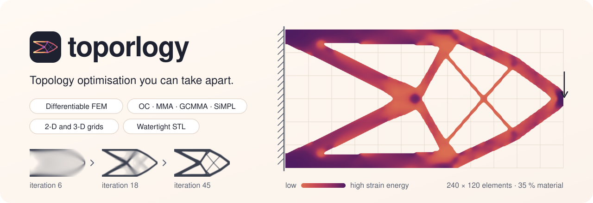

<picture>
  <source media="(prefers-color-scheme: dark)" srcset="docs/assets/banner-dark.svg">
  
</picture>

**toporlogy** is a research core for structural optimisation and computational mechanics, on regular 2-D and 3-D
grids and, through a general-mesh package, on unstructured meshes. It is built from small, replaceable, verified
pieces:

- **materials:** one tensor algebra for NumPy and Torch; linear elastic materials from isotropic to general
  anisotropic; per-element orientation; phases with their own elasticity tensors; a constitutive protocol with
  hyperelastic laws and small-strain J2 plasticity; classical lamination theory;
- **mechanics:** linear and geometrically non-linear elasticity; Newton and arc-length path following; heat
  conduction, steady and transient; one-way thermoelasticity; structural dynamics; modal analysis and linear
  buckling; periodic homogenisation; general-mesh elements (Q4, Q9, T3, T6, H8, T4, T10) and a Taylor–Hood u-p
  formulation;
- **design:** a differentiable design chain with density, phase and fibre-angle blocks; four optimisers (OC, MMA,
  GCMMA, SiMPL);
- **responses:** stress, buckling (with a reliability record), frequency, manufacturing and one-body constraints;
  mass properties, centre of mass and inertia as constraints; scenario (robust) and per-case compliance for
  robust and Pareto studies; identification tools;
- **solvers:** direct solvers with a nested-dissection order (SuperLU, optional supernodal Cholesky), a GPU
  multigrid solver, and implicit differentiation of any residual;
- **post-processing:** a pipeline that turns the density field into a checked, printable surface, VTU field
  export;
- **verification:** pre-registered checks, a ledger of every expected failure, catalogs and a compatibility matrix
  of what is verified and what is not.

The banner is one of its results ([`docs/assets/make_banner.py`](docs/assets/make_banner.py) re-runs and redraws
it).

Derivatives come from PyTorch autograd, plus one hand-written adjoint for the linear solve. A new objective or
constraint is therefore a forward computation and a finite-difference test, nothing more.
[`docs/deriving_methods.md`](docs/deriving_methods.md) works through four derivations, each executed by a test.

Every number in this file names the test or record behind it. Tests registered before their first run are marked
as **pre-registered**; their thresholds are never loosened, and a check that failed stays in the suite as a strict
expected failure (see [Verification](#verification-and-validation)).

> **Proprietary software — all rights reserved.** No licence to use, copy, modify or distribute this code is
> granted; see [LICENSE](LICENSE). Access to the repository does not imply permission.

| | |
|:---|:---|
| Version | 0.2.0 (research code; interfaces may change) |
| Python | ≥ 3.11 |
| Core dependencies | numpy, scipy, torch, pyyaml |
| Developed and tested on | Windows 11, CPU; CUDA for the multigrid solver |

**Contents:** [Install](#install) · [Quickstart](#quickstart) · [Configuration](#configuration) ·
[Python API](#python-api) · [Architecture](#architecture) · [Materials](#materials-and-tensors) ·
[Physics](#physics) · [Stress](#stress) · [Buckling](#buckling) · [One body](#keeping-the-part-in-one-body) ·
[Solvers](#solvers) · [Verification](#verification-and-validation) · [Limitations](#known-limitations) ·
[Development](#development) · [Licence](#licence)

## Install

```bash
pip install -e .                       # core: numpy, scipy, torch, pyyaml
pip install -e ".[post,fast,mesh,dev]" # everything
```

| Extra | Adds | Needed for |
|:---|:---|:---|
| `post` | pyvista, vtk, numba | surfaces, manufacturing checks, STL/PLY/OBJ export |
| `fast` | pypardiso | MKL PARDISO direct solver (SuperLU otherwise) |
| `mesh` | gmsh | tetrahedral (T10) re-analysis of the finished part |
| `plot` | matplotlib | plots |
| `dev` | pytest, pytest-timeout, hypothesis, mypy, ruff, scikit-fem | tests and static checks |

On Windows, torch and MKL each ship `libiomp5md.dll`, and loading MKL after torch aborts the process. `import toporlogy`
loads PARDISO first, so import it **before** torch. If torch came first, the direct solver falls back to SuperLU.

## Quickstart

```bash
python -m toporlogy validate examples/mbb2d.yaml     # supports, loads, resultants, rigid-body modes
python -m toporlogy run examples/mbb2d.yaml --out runs/mbb
```

`run` prints one line per iteration and ends with a `RESULT` line: status, objective, constraints, iterations,
time and grey fraction. The run folder holds everything needed to reproduce and inspect the run:

| File | Content |
|:---|:---|
| `config.resolved.yaml` | the config with every default filled in, plus git revision and overrides |
| `setup.json` | environment (Python, NumPy, torch, machine) and study settings |
| `history.jsonl` | one row per iteration: objective, constraints, design change, schedule state |
| `result.npz` | final design vector `x` and physical density `xphys` |
| `result.json` | iterations, convergence flag, time, objective, constraint values, settings |
| `summary.json` | objective and constraints of the returned design, each constraint's verdict (PASS / FAIL / UNVERIFIED) and the source of its value, post-processing results, status |

A real part, from primitives to a printable surface:

```bash
python -m toporlogy run examples/lbracket_bore3d.yaml --out runs/lbracket
```

That example builds an L-bracket by CSG, finds its bore, applies a bearing load, and enforces a minimum and a
maximum member size. It keeps the part in one body and exports a smoothed STL with a quality report.

| Command | Purpose |
|:---|:---|
| `run CONFIG [--set key.path=value] [--sweep key.path=v1,v2]` | one run, or every combination of a sweep (`sweep.csv`) |
| `validate CONFIG` | build the study and check the boundary conditions without optimising |
| `show RUN_DIR` | summary of a finished run |
| `compare RUN_DIR...` | several runs side by side |
| `list [KIND]` | every registered component with its parameters and units |

Exit codes:

- **0:** ok.
- **1:** the run finished but failed a check: not converged, a constraint violated or unverified, the objective
  unverified, or a post step failed (for example the one-body gate).
- **2:** configuration error, including a combination the compatibility matrix refuses.

Only a value computed on the returned design can PASS or FAIL. A value read from an older run folder or from the
last iterate is UNVERIFIED, and is never shown as "ok".

## Configuration

A study is one YAML file. The half MBB beam (`examples/mbb2d.yaml`):

```yaml
name: mbb2d
domain: {type: box, shape: [60, 20], h: 1.0}
material: {E0: 1.0, nu: 0.3}
supports:
  - {type: fixed, where: {type: plane, axis: x, at: min}, dofs: x}        # symmetry line
  - {type: fixed, where: {type: point, at: [max, min]}, dofs: y}          # roller at the bottom right
load_cases:
  - name: centre
    loads:
      - {type: force, where: {type: point, at: [min, max]}, force: [0, -1]}
chain:
  - {type: density_filter, rmin: 2.0}
interpolation: {type: simp, penal: 3.0, emin_ratio: 1.0e-9}
objective: compliance
constraints:
  - {response: volume, upper: 0.5}
optimizer: {type: oc, move: 0.2, bisection_tol: 1.0e-3}
run: {max_iter: 300, tol: 0.01}
```

`examples/` holds seven examples:

- 2-D and 3-D compliance;
- several load cases;
- eigenfrequency maximisation;
- symmetry with an additive-manufacturing filter;
- connectivity;
- the full post-processing chain.

Seven more are in `examples/research/`:

- stress constraints, aggregated and by an augmented Lagrangian (with a solid load pad and the one-body
  protection);
- buckling;
- a compliant inverter;
- SiMPL with a PDE filter;
- a fibre-angle design block on an orthotropic cantilever;
- a cantilever in mm and N with values with units, a material record, VTU export and a checkpoint.

113 components in 13 kinds can be used from YAML. `python -m toporlogy list` documents them, and
[`docs/registry.md`](docs/registry.md) shows how to add one in a single line.

**Units and schema.** A config may carry `schema_version: "1"` (another version is refused) and a `units` section.
Without `units`, every value is a plain number in one consistent set of units chosen by the user. With
`units: {length: mm, force: N}`, a parameter with a physical unit may be given as `"210 GPa"`, `"-1 kN"` or
`"0.001 m"`. The value is converted into that consistent system (time in s, mass = force·s²/length); a value of the
wrong dimension (a mass for a force, a force for a modulus) is refused with both dimensions named
([`birimler_onkayit.md`](docs/olcumler/birimler_onkayit.md)). Duplicate YAML/JSON keys, non-finite loads and a
volume bound outside (0, 1] are refused.

**Material records.** `material: {catalog: <id>}` takes the values of a record of the material data catalog
([`docs/vv_katalog.md`](docs/vv_katalog.md) §4). The records carry source, page, licence, condition and uncertainty
fields and are checked for admissibility; the catalog holds synthetic records only, since no real material value
is entered without a read source and licence.

**Outputs.** `post: [{type: vtu}]` writes the fields of the design (density, modulus, displacements, solid von
Mises stress) as `result.vtu`, an exact ASCII roundtrip that vtk reads; `post: [{type: homogenize}]` writes the
effective stiffness of the design as a periodic cell. The responses `effective_stiffness` (C_ij, `negate: true` for a
lower bound) and `effective_poisson` (`convention` required: `uniaxial` = ν_ij = −ε_j/ε_i under uniaxial stress,
2-D and 3-D; `stiffness_ratio` = the legacy C12/C11, which is ν21 of an uncoupled cell) make the cell's properties an
objective or a constraint
(inverse homogenisation, no state solve); `density_filter: {periodic: true}` wraps the filter across the cell faces.

## Python API

```python
import numpy as np
import toporlogy as T            # before torch: loads MKL PARDISO first

d = T.Domain((60, 20, 10), h=1.0)
X = d.node_coords()
fixed = d.dofs(np.flatnonzero(X[:, 0] == 0))
tip = np.flatnonzero((X[:, 0] == X[:, 0].max()) & (X[:, 2] == 0))
F = d.load_vector(); F[3 * tip + 2, 0] = -1.0 / len(tip)

chain = T.standard_chain(d, rmin=1.5)
study = T.Study(d, T.Elasticity(d, fixed), F, chain, T.SIMP(d), T.Compliance(),
                [T.Constraint(T.Volume(), 0.3)], T.MMA(), T.BetaContinuation(chain, 1, 16, 25))
result = study.run(max_iter=150)
result.objective, result.constraint_values, result.xphys   # all of the returned design
```

Each `run()` starts from the schedule's initial state and a fresh optimizer, so running a study twice gives the same
result. `study.run(checkpoint=path, checkpoint_every=k)` writes the run state atomically (design, chain, schedule,
optimizer, response scales, random states); `study.run(resume=path)` in a study built from the same configuration
continues it, and the resumed MMA, GCMMA or OC run is bit for bit the uninterrupted one
([`checkpoint_onkayit.md`](docs/olcumler/checkpoint_onkayit.md)). From YAML: `run: {checkpoint_every: k}` and
`python -m toporlogy run CONFIG --out DIR --resume`. When the physics changes its model (the adaptive cutoff of the
non-linear energy interpolation), `Study` resets the optimizer so that asymptotes of the old model are not reused
(`reset_on_model_change`, default on; [`model_donemi_onkayit.md`](docs/olcumler/model_donemi_onkayit.md)). The energy interpolation sees the real
density: `Study` hands the physics the inverse of its SIMP / RAMP interpolation, so γ stays right when the SIMP
exponent is continued ([`gercek_yogunluk_onkayit.md`](docs/olcumler/gercek_yogunluk_onkayit.md)). `run.start`
perturbs the uniform start (`{type: cosine, amplitude, periods}` or `{type: random, amplitude}` with `run.seed`;
`study.perturbed_start(spec)`), for objectives at which a uniform design is stationary
([`baslangic_tasarimi_onkayit.md`](docs/olcumler/baslangic_tasarimi_onkayit.md)). To give boundary conditions by geometry instead of DOF numbers, use `toporlogy.boundary`
(`BoundaryConditions`, `OnCylinder`, `BearingLoad`, `RemoteForce`, `check()`). For surfaces, use
`toporlogy.post.finalize(...)`.

## Architecture

The library follows the optimisation pipeline. Every stage is a module that can be used alone or replaced. Every
module, class and config component has one name: there are no alias modules and no second names for old paths.

| Stage | Module | Provides |
|:---|:---|:---|
| Tensors and materials | `core` (`tensor`, `linear_elastic`, `anisotropy`, `material`, `material_field`, `constitutive`, `laminate`, `mass_properties`, `vtu`) | tensor algebra, linear elastic family, directional analysis, failure strengths, phase material fields, the constitutive protocol (SVK, neo-Hooke, J2 plasticity), lamination theory, mass properties, VTU I/O |
| Geometry | `geometry` | CSG primitives, STL voxelisation with partial volumes, bore detection |
| Boundary conditions | `boundary` | 18 geometric selectors; 5 support types (fixed, roller, symmetry, pinned bore, springs); nodal and 9 distributed load types incl. bearing and remote loads; load cases and combinations; resultant and rigid-body checks |
| Design chain | `design` (`chain`, `pde_filter`, `interp`, `phases`, `manufacturing`) | cone density filter, Helmholtz (PDE) filter, tanh projection, keep/void regions; SIMP, RAMP, Hashin–Shtrikman and multi-phase interpolation; AM overhang filter, symmetry, extrusion and pattern tying, casting/milling pull direction |
| Physics | `fem`, `solvers` | Q4, Q4IM, H8 and H8IM elasticity with any material D (per element if needed) or element tensors (`tensor_elastic`); geometrically non-linear elasticity; heat conduction, steady and transient (`transient_heat`); thermoelasticity (`thermoelastic`, also as Study physics `physics: {type: thermoelastic, alpha, delta_T}` with compliance F_totᵀ U); Newmark dynamics (`dynamics_newmark`); modal analysis; linear buckling; periodic homogenisation (`homogenization`); Mindlin–Reissner plate bending (`plate`, Q4 with reduced shear); the general-mesh package `fem.mesh`; direct (SuperLU, supernodal Cholesky), multigrid, Newton and arc-length solvers (`solvers.newton`, `solvers.continuation`) |
| Responses | `optimization` | compliance, end compliance, volume, phase volume, mass, cost; robust minimum solid/void size; maximum thickness; one-body constraints; eigenfrequencies; von Mises stress and failure indices; buckling load factor; displacement; sums and ratios of responses |
| Method toolkit | `optimization` (`aggregates`, `local`, `benchmark`, `diagnostics`, `stress_recovery`, `stress_singularity`, `implicit`, `mode_tracking`, `uq`, `pareto`, `identification`, `rom`, `laminate_failure`) | six smooth aggregates with proven bounds; any local criterion as one aggregated constraint or as an augmented Lagrangian; evaluation of the thresholded design; optimizer-independent first-order optimality; stress output types; peak-stress convergence diagnosis; implicit differentiation of a residual; mode tracking by MAC; sampling and uncertainty propagation; Pareto scalarisations; parameter identification; POD reduced models; first-ply failure |
| Optimisation | `optimizers`, `optimization.study` | OC (one constraint), MMA and GCMMA (any number of constraints), SiMPL (one volume-type constraint), β continuation, multiplier updates, move-limit control; run folders with git revision |
| Configuration | `configuration` (`registry`, `catalog`, `units`) | YAML components; schema version and unit-checked values; versioned catalogs of elements, physics, solvers, benchmarks and materials; a compatibility matrix checked at build time |
| Post-processing | `post` | density → signed distance → topology-preserving opening/closing → exact functional faces → smooth surface (optionally clipped to the exact CAD envelope) → manufacturing checks → T10 re-analysis with a mesh-convergence verdict → STL/PLY/OBJ; symmetry report |

## Materials and tensors

```yaml
material:
  E0: 40000.0                       # with orthotropic: must equal E1 (the modulus the interpolation scales)
  plane: stress                     # 2-D only: stress | strain
  orthotropic: {E1: 40000, E2: 9000, E3: 9000, G12: 4000, G13: 4000, G23: 3200,
                nu12: 0.28, nu13: 0.28, nu23: 0.4, angle: 30}        # or axes: [[1,0,0],[0,1,0]] in 3-D
  strength: {Xt: 1500, Xc: 1200, Yt: 50, Yc: 200, S12: 70, safety_factor: 1.5}
  # isotropic strength: {tension: 300, compression: 450, safety_factor: 1.5}
```

**Tensor core (`core.tensor`).** One implementation for NumPy and Torch; Torch paths are differentiable. It covers:

- Voigt order `[xx, yy, zz, yz, xz, xy]`, with separate maps for stress (physical shear) and strain (engineering
  shear);
- the orthonormal Mandel form, used for eigenvalues and condition numbers;
- rotations and invariants;
- kinematics from F to the Hencky strain, with explicit errors for J ≤ 0;
- the PK1, PK2, Kirchhoff and Cauchy stresses. PK1 has no Voigt form and is refused.

Every other module calls this core; there is no second copy of the mathematics.

**Linear elastic family (`core.linear_elastic`, `core.anisotropy`).**

- `ElasticTensor` is built from isotropic, cubic, transversely isotropic or orthotropic constants, or from C or S.
  It refuses a non-symmetric matrix (no silent symmetrisation) and a matrix that is not positive definite (Cholesky
  plus a scaled Mandel eigenvalue).
- Strong ellipticity is checked by sampling the acoustic tensor.
- Plane stress eliminates σzz, σyz and σxz together. Eliminating σzz alone is 26 % off after a general rotation.
- Directional analysis gives E(n), ν(n, m), G(n, m) and the linear compressibility β(n). The extrema of ν over m
  come from a 2 × 2 eigenproblem; the extrema over n are sampled and refined, and labelled as such.
- Derivatives: dC/dparameter, dS = −S dC S, rotated stiffness, plane-stress condensation, and an SPD-preserving
  Cholesky parametrisation.

**Interpolation admissibility.** `hs_admissible_exponents(nu, dim, plane)` gives the SIMP exponent below which SIMP
violates the Hashin–Shtrikman bounds of a porous solid. At ν = 0.3 it is 3.08 in 2-D plane stress, 3.5 in 2-D plane
strain and 2.63 in 3-D. So p = 3 is not admissible in 2-D at ν = 0.3. The Hashin–Shtrikman interpolation
(`interpolation: hashin_shtrikman`) does not penalise grey material: use it to judge a grey design.

**Phases with their own tensors and the fibre angle (`core.material_field`, `design.phases`,
`design.orientation`).** `interpolation: tensor_phases` mixes phases that each have their own `ElasticTensor`
(own ν, anisotropy and orientation) as a convex combination of positive definite tensors (rules `simplex` and
`recursive`; the latter equals `multiphase_simp` for scalar multiples of one D). `physics: tensor_elasticity`
solves it on Q4 / H8 with the adjoint dJ/dC. In 2-D the fibre angle is a design block
(`embed: {angle: {location: element | global, rmin}}`), filtered in the doubled-angle representation so that +89°
and −89° average to 90°. Checked against Voigt/Reuss bars, an independent assembly, the off-axis modulus in closed
form and a 1-D angle sweep. Plain MMA settles into a 2-cycle on a single angle with no active constraint (the
documented MMA limitation); GCMMA reaches the sweep minimum.

**Constitutive protocol (`core.constitutive`).** Material laws share one protocol: small or finite kinematics,
explicit stress and tangent measures, a trial state that never touches the committed one, commit only after a
converged step. It covers St. Venant–Kirchhoff and neo-Hooke (moved, bit for bit the same results), small-strain
linear elasticity and J2 plasticity with isotropic hardening (radial return, consistent tangent; closed-form
material-point checks, FE loading/unloading, dissipation and energy balance).

**Laminates (`core.laminate`, `optimization.laminate_failure`).** Classical lamination theory: ply Q and Q̄, ABD,
thermal resultants, ply stresses, angle and thickness derivatives; first-ply failure by Tsai–Wu and Hashin
(strengths are user input).

Records: [`tensor_elastisite.md`](docs/olcumler/tensor_elastisite.md),
[`malzeme_modelleri.md`](docs/olcumler/malzeme_modelleri.md), [`malzeme_tasarimi.md`](docs/olcumler/malzeme_tasarimi.md),
[`nonlineer_cozucu.md`](docs/olcumler/nonlineer_cozucu.md), [`laminat_uq.md`](docs/olcumler/laminat_uq.md).

### Physical material models (Foundations II)

Material-point laws with physical parameters (Pa, s, K, J/mol) and physical time, separate from the unit-modulus laws
above (`docs/foundations/MATERIAL_CONTRACT.md`): `MaterialRequest.step = TimeStep(t, dt, T, T_prev)` carries time and
temperature; `drive_material_point(..., times=, temperatures=)` integrates mixed strain/stress histories; these
models set `physical = True` and the element-modulus FE physics refuse them.

| Module | Content | Evidence |
|---|---|---|
| `core.properties` | E(T), ν(T) / K(T), G(T) from two independent functions, piecewise-linear / PCHIP / polynomial properties with validity box (no extrapolation), ε_th = ∫α dT, enthalpy, thermoelastic point | `docs/foundations/prereg/P_properties.md` |
| `core.viscoelastic` | Maxwell, Kelvin–Voigt, SLS, Burgers closed forms; 3-D generalized Maxwell with independent shear and bulk Prony series (exact piecewise-linear update, algorithmic tangent, energy, dissipation); WLF / Arrhenius shift; DMA complex moduli | `prereg/V_viscoelastic.md` |
| `core.creep` | Norton and Norton–Bailey (time / strain hardening) J2 creep, Arrhenius factor, adaptive long-hold integration with rollback | `prereg/C_creep.md` |
| `core.viscoplastic` | physical J2, Perzyna overstress, Eyring rate law, Drucker–Prager (associated and non-associated) | `prereg/R_rate.md` |
| `core.cure` | n-th order and Kamal–Sourour cure kinetics (bounded implicit step), DiBenedetto Tg, reaction heat, chemical shrinkage, Avrami / Nakamura crystallisation | `prereg/TS_cure.md` |
| `core.spectral` | functions of symmetric tensors (exp, log, sqrt, power) with Fréchet derivative, JVP, VJP at repeated eigenvalues | `prereg/T_spectral.md` |
| `core.viscoelastic_aniso`, `core.fractional` | anisotropic generalized Maxwell (PSD branch tensors); fractional Maxwell/KV/Zener with Mittag-Leffler and a Prony bridge | `prereg/VA_anisotropic_ve.md`, `prereg/VF_fractional.md` |
| `core.creep_plasticity`, `core.thermomechanics` | coupled J2 creep + plasticity (one local residual); adiabatic Perzyna with Taylor–Quinney heating | `prereg/C8_creep_plasticity.md`, `prereg/R5_adiabatic.md` |
| `core.thermoplastic`, `core.micromechanics` | glass-transition property model, crystallinity mixing, crystallising point; Voigt/Reuss, Hashin–Shtrikman, Mori–Tanaka, SIMP/RAMP admissibility | `prereg/TP_thermoplastic.md`, `prereg/MM_micromechanics.md` |
| `fem.mesh.history` | small-strain history solid on a general mesh (Newton, commit after convergence, rollback, reactions); every physical model above checked against its material point | `prereg/H_history.md`, `H6_physical_models_fe.md`, `H8_more_models_fe.md` |
| `fem.mesh.cure_slab`, `fem.mesh.nonlinear_heat` | coupled thermo-chemical cure slab with residual stress; nonlinear transient heat with k(T), ρc_p(T) in enthalpy form | `prereg/TS7_cure_slab.md`, `prereg/NH_nonlinear_heat.md` |
| `fem.mesh.topology`, `quality`, `locate` | mesh validation by id, quality with a Jacobian certificate, inverse map / point location, renumbering | `prereg/M_mesh.md` |
| `solvers.saddle` | saddle-point block operator, Schur complement, block-diagonal (MINRES) and block-triangular (GMRES) preconditioners | `prereg/L6_saddle.md` |
| `solvers.eigen` | eigenpair reliability report (backward error, clusters by principal angles), MAC, mode tracking through sweeps, shift-invert with refusal of a shift at an eigenvalue, buckling pencil with stated load convention | `prereg/L6e_eigen.md`, `EIGEN_RELIABILITY.md` |
| `fem.mesh.constraints` | general linear constraints (fix, tie, MPC, periodic with macro jump) by elimination, Lagrange or penalty; contradictory/redundant sets refused; reactions and multipliers | `prereg/F34_assembly.md`, `ASSEMBLY_CONSTRAINTS.md` |
| `fem.mesh.homogenization` | periodic homogenisation of a cell given as a general (skew) mesh, elasticity and conduction, with self-adjoint design sensitivities | `prereg/MH_mesh_homogenization.md` |
| `optimization.cell_topology` | inverse homogenisation on a periodic mesh: periodic density filter, SIMP, MMA, bulk-modulus objective checked against the Hashin–Shtrikman bound | `prereg/IH_inverse_homogenization.md` |
| `optimization.material_identification` | Prony / Norton identification, identifiability SVD, data records with units and validity box | `prereg/D_identification.md` |
| `optimization.viscoelastic_topology` | compliance at service times of a viscoelastic structure (temperature history via WLF/Arrhenius), min–max over times, robust over material samples, exact discrete history adjoint with optional checkpointing, KKT stop; YAML via `analysis: {type: history}` | `prereg/VO_viscoelastic_topology.md` |
| `optimization.creep_topology` | compliance at a service time under Norton creep (optionally with an Arrhenius temperature history), exact history adjoint | `prereg/CO_creep_topology.md`, `CO6_creep_topology.md` |
| `optimization.material_cards` | material cards (dict / YAML) with explicit units, provenance and validity box; synthetic examples in `examples/foundations/materials/` | `prereg/P05_material_cards.md` |
| `fem.mesh.mixed.MixedKG` | K-based u–p mixed elasticity (valid at ν = 0 and ν → 0.5, exact incompressibility) | `prereg/X_mixed.md` |
| `fem.mesh.adaptivity` | residual / ZZ error indicators, Dörfler marking, newest-vertex bisection of T3 meshes | `prereg/A_adaptivity.md` |
| `solvers.diagnostics` | backward / forward error report, inertia, Krylov solvers with structural checks, gauge solve, iterative refinement | `prereg/L_solver.md` |

All parameters in these tests are synthetic; no real material is claimed. Failed preregistered checks are strict
xfails in `docs/vv_kutugu.json`; live status: `docs/foundations/STATUS.md`.

## Physics

```yaml
material:
  E0: 40.0
  orthotropic: {E1: 40, E2: 9, E3: 9, G12: 4, G13: 4, G23: 3.2, nu12: 0.28, nu13: 0.28, nu23: 0.4,
                angle_field: fibre_angle.npy}          # degrees per element (2-D); axis_field in 3-D
  phases: [{name: soft, E: 10, density: 0.6, cost: 1}, {name: stiff, E: 40, density: 1.0, cost: 4}]
interpolation: multiphase_simp
physics: {type: nonlinear_elasticity, material: svk}   # or neo_hooke (isotropic)
objective: end_compliance
constraints:
  - {response: {type: phase_volume, phases: stiff}, upper: 0.2}
```

| Capability | Verified by | Record |
|:---|:---|:---|
| Orthotropic, rotated and plane-strain elasticity, also per element (`angle_field`, `axis_field`), in `Elasticity`, `Modal`, `LinearBuckling`, `FailureIndex` and the T10 re-analysis | isotropic case = closed forms to 1e-14; 2-D plane strain = 3-D slab with w = 0 to 1e-10; two-orientation strip in parallel / series = Voigt / Reuss to 1e-14; gradients ≤ 2e-7 | [`eleman_yonu.md`](docs/olcumler/eleman_yonu.md) |
| Several solid phases + void sharing one unit D (`material.phases`, `multiphase_simp`); `phase_volume`, `mass`, `cost`; `phase_report` | one phase = SIMP bit for bit; two-material bar in series / parallel to 1e-14; gradients ≤ 1.6e-7; no published compliance to compare with (NOT VERIFIED) | [`cok_malzeme.md`](docs/olcumler/cok_malzeme.md) |
| Density optimisation on a general mesh (`optimization.mesh_topology`: centroid filter, compliance adjoint, MMA; outside Study) | equals the grid path on `Mesh.from_domain` (filter ≤ 1e-14, compliance 2.7e-14); gradient on distorted Q4 / T3 meshes ≤ 2e-8 | [`ag_topoloji_onkayit.md`](docs/olcumler/ag_topoloji_onkayit.md) |
| Flat-facet shell (`fem.shell`: rectangular facets in 3-D, 6 DOFs per node, membrane + Mindlin bending + drilling penalty; standalone) | six rigid modes on a curved segment; pressurised tube equals its exact faceted solution (≤ 6e-10); pinched ring and Navier plate converge at second order; gradient 1.8e-11; bending patch 1.12e-12 (strict xfail); drilling scale changes curved compliance by 5 % (choice, not validated) | [`kabuk_onkayit.md`](docs/olcumler/kabuk_onkayit.md) |
| Mindlin–Reissner plate (`fem.plate`: Q4, bending 2 × 2, shear 1 point) | Navier series of the hard simply supported plate: centre deflection 2.2e-4 (a/t = 10) and 3.1e-4 (a/t = 100) at 32 × 32, second order; thin limit 3.1e-4; full shear integration locks; design gradient 8.8e-7 | [`plaka_onkayit.md`](docs/olcumler/plaka_onkayit.md) |
| Thermoelastic compliance (`physics: thermoelastic`: uniform temperature rise, design-dependent thermal load) | ΔT = 0 equals elasticity to 6e-14; value equals the direct solve exactly; design gradient 4.5e-8 (2-D) / 1.2e-9 (3-D) | [`termoelastik_study_onkayit.md`](docs/olcumler/termoelastik_study_onkayit.md) |
| Geometrically non-linear statics (`physics: nonlinear_elasticity`: Total Lagrangian, Q4 / H8, St. Venant–Kirchhoff with any D or compressible neo-Hooke; energy interpolation for void) and `end_compliance` | uniaxial tension closed form 2e-14; cantilever elastica −0.13 %; tangent 1.9e-10; design gradient 1.2e-9; quadratic error contraction | [`geometrik_dogrusal_olmama.md`](docs/olcumler/geometrik_dogrusal_olmama.md) |
| 2-D incompatible-mode element `Q4IM` (Wilson's Q6), also in the geometric stiffness | pure bending exact (Q4 −11 %); Ferrari & Sigmund 2019 column: Q4 20 × 2 gives their published error 0.119 | [`malzeme_modelleri.md`](docs/olcumler/malzeme_modelleri.md) |
| Heat conduction, modal analysis (eigenfrequencies with KS aggregation of repeated eigenvalues) | conduction second order on three grids; first bending frequency 0.997–1.001 of Euler–Bernoulli (H8IM) | `test_fem_mms_extended.py`, `test_modal.py` |
| Newton and path following (`solvers.newton`, `solvers.continuation`: load control, displacement control, Crisfield arc length), failure codes, line search with residual or energy merit | shallow truss snap-through against its closed form; FE arch: arc length = displacement control to 7.3e-15; no branch switching (the arch bifurcates before its limit point) | [`nonlineer_cozucu.md`](docs/olcumler/nonlineer_cozucu.md) |
| General-mesh FEM (`fem.mesh`: Q4, Q9, T3, T6, H8, T4, T10; signed-Jacobian check, tags, boundary facets, nonzero Dirichlet, consistent tractions, reactions, rigid-mode rank check); Taylor–Hood u-p (T6-T3, Q9-Q4, T10-T4) | `Mesh.from_domain` = grid path (K ≤ 8.9e-16, u ≤ 1.3e-13); scikit-fem on seven elements (K ≤ 7.1e-16); optimal MMS rates on distorted meshes; Taylor–Hood removes the volumetric locking that Q4/T3/H8/T4 show at ν = 0.4999 | [`fem_genel.md`](docs/olcumler/fem_genel.md) |
| Periodic homogenisation (`fem.homogenization`): effective stiffness and conductivity, element sensitivities, kinematic (KUBC) and static (SUBC) bounds, post step `homogenize` | homogeneous cell = D to 1e-12; two-phase laminates = Backus closed form (2-D, 3-D) to 1e-10; Hill–Mandel; Voigt/Reuss and SUBC ≤ PBC ≤ KUBC; tiling invariance; gradients ≤ 1e-6; Study responses `effective_stiffness` / `effective_poisson`: value exact, gradient 2.9e-9 | [`homojenlestirme_onkayit.md`](docs/olcumler/homojenlestirme_onkayit.md) |
| One-way thermoelasticity (`fem.thermoelastic`), differentiable in modulus, conductivity and thermal load | free and constrained expansion (plane stress, plane strain, 3-D), rotated orthotropic α, layered conduction to 1e-12; design gradient to central differences; cutting either coupling chain is detected | [`termoelastisite_onkayit.md`](docs/olcumler/termoelastisite_onkayit.md) |
| Transient heat (`fem.transient_heat`, θ-method) and Newmark structural dynamics (`fem.dynamics_newmark`, Rayleigh damping), both differentiable through time | backward Euler order 1.00, Crank–Nicolson 2.00, conservation to 1e-12; Newmark energy conserved to 1e-12, damping decay to 1.3e-4, order 2 against the modal solution | [`gecici_isi_onkayit.md`](docs/olcumler/gecici_isi_onkayit.md), [`newmark_onkayit.md`](docs/olcumler/newmark_onkayit.md) |
| Mass properties (`core.mass_properties`): mass, centre, inertia tensor, differentiable | closed forms, parallel-axis theorem, superposition to 1e-12 | [`kutle_ozellikleri_onkayit.md`](docs/olcumler/kutle_ozellikleri_onkayit.md) |

A small example of inverse homogenisation: a 30 × 30 periodic cell designed for a negative Poisson ratio has
ν12 = −1.01 after thresholding ([`auxetic_hucre_onkayit.md`](docs/olcumler/auxetic_hucre_onkayit.md); a
demonstration on a coarse grid, not a metamaterial claim).

## Stress

**Stress fields.** `optimization.stress` provides the solid von Mises stress, with qp or polynomial relaxation. It
can be used as one aggregated constraint or as local constraints through an augmented Lagrangian.
`FailureIndex` applies any criterion of `optimization.strength` (von Mises, Tresca, Drucker–Prager, Raghava,
Tsai–Wu) with any elasticity, also per element. Tsai–Wu is positive semidefinite in its normal-stress block only for
−1/2 ≤ f12 < 1 when all three normal stresses act; a stress for which the quadratic form is negative raises
instead of returning a negative index ([`tsai_wu_kabul_onkayit.md`](docs/olcumler/tsai_wu_kabul_onkayit.md)).

**At zero density.** For exponents 0 < q < 1 the one-sided derivative of x̄^q at x̄ = 0 is +∞, and the library
sets it to 0 there. With p-norm aggregation (q·P > 1) this is the true derivative of the aggregate. With KS or a
local constraint it is a convention. Values do not change: Z1–Z5, `test_stress_zero_density.py`.

**Output types (`optimization.stress_recovery`).** A displacement solution has no single stress field, so each
reading is its own type and none is called *the* stress:

- integration points;
- element centroid;
- integration-point maximum;
- corner extrapolation;
- nodal average (never averaged across a material interface);
- patch recovery on the regular grid.

Its pre-registered checks on analytic tension and bending pass ([`gerilme.md`](docs/olcumler/gerilme.md) §1).

**Singularity diagnosis (`optimization.stress_singularity`).** `assess_peak` reads a mesh-refinement sequence. It
returns `singular — max stress not converged` when the peak keeps growing, as at a point load, a re-entrant corner
or a clamped edge. Such a peak must not be compared with an allowable.

**The L-bracket examples** (`examples/research/stress_*lbracket2d.yaml`) minimise volume under a stress limit.

- **The load pad.** The pad under the load is kept solid, and the support is joined to it by the one-body
  protection. Without both, a volume objective drops the load into void, where the relaxed stress vanishes, and
  still meets its constraints.
- **With them:**
  - the load is carried by solid material, with 0/1 compliance 2.5 × (aggregated) and 4.3 × (augmented Lagrangian)
    that of the full bracket;
  - neither 0/1 design meets the stress limit: the peak stress is 1.02–1.10 × σ_lim at the centroid;
  - the re-entrant corner is singular on refinement, so the peak has no mesh limit;
  - the aggregated run reports the violated constraint, and the augmented-Lagrangian run fails the one-body gate on
    two floating 8-cell islands; both exit with code 1.

  Record: [`gerilme.md`](docs/olcumler/gerilme.md) §3.5–3.6.

## Buckling

- **Linear buckling** (`fem.buckling`, `optimization.buckling`). The sensitivity comes by autograd through a
  Rayleigh quotient. It supports a preload (held load case), a warning when an eigenvalue cluster is cut, the share
  of the mode energy in low-density elements, and a localisation measure. `exclude` removes the stress stiffness at
  singular points.
- **Verified.** The Euler column converges with refinement (2-D 1.125 → 1.0015; 3-D H8IM 0.9975). A preload c on
  the same pattern lowers λ by exactly c (1e-8). Gradients are below 1e-8.
- **A localised mode.** The published wall's λ1 does not converge (2.85 → 1.20 from 40² to 320²), because its mode
  sits at a singular stress. The localisation measure flags this; excluding the clamp end only moves the mode to
  the next singular corner.
- **Reliability record.** Every buckling evaluation carries one (`BucklingKS.last_reliability`): a cut eigenvalue
  cluster, a mode living in grey or void material, or no buckling make it unreliable; localisation is reported.
  The modes are tracked between iterations by MAC and subspace angle (`optimization.mode_tracking`). Mesh series
  give a verdict: the Euler column and a column embedded in a void design domain converge (order 2), the wall
  with a singular clamp end does not.

**Geometry transfer.** `post.chain.record_chain` records every step from density to surface (volume, bodies and
voids, local thickness, overshoot of the CAD envelope, watertightness) as PASS / FAIL / MEASURED / UNVERIFIED /
NOT VERIFIED, with the geometric and the structural verdict kept apart. `post.reanalysis` re-analyses the finished
shape on a staircase voxel mesh with toporlogy's H8 and, independently, scikit-fem (agreement 1.5e-12); it does not
replace the T10 re-analysis. Correcting the volume alone does not fix stress or buckling: at equal volume λ1 moved
by 10 % and the peak von Mises stress by 21 %.

Records: [`malzeme_modelleri.md`](docs/olcumler/malzeme_modelleri.md),
[`burkulma_geometri.md`](docs/olcumler/burkulma_geometri.md), `test_buckling*.py`, `test_independent_buckling.py`.

## Keeping the part in one body

A compliance optimum often splits into separate load paths. They are joined by nothing, or by a grey film that
disappears at thresholding. A stress-constrained volume optimum can also drop its load into void.

`connectivity: {ties: 1, constraint: conduction, gate: true}` (Python: `optimization.connectivity.one_body()`)
stacks three defences:

- frozen minimal ties between the interfaces (supports and loads by default);
- a virtual-conduction constraint on the eroded field;
- a geometric gate after the run. It re-checks the result at several thresholds and after erosion, with an
  optional bridge repair, and its FAIL ends the run with exit code 1.

**On 14 pre-registered scenarios, plain optimisation kept none in one body; the default plan kept all 14**
([`docs/olcumler/robustness.md`](docs/olcumler/robustness.md)).

| Method | PASS | FRAGILE | FAIL | Median compliance vs plain |
|:---|---:|---:|---:|---:|
| `one_body()` default | 14 | 0 | 0 | 1.30 |
| Frozen ties only | 14 | 0 | 0 | 1.25 |
| Conduction constraint only | 0 | 13 | 1 | 1.65 |
| Plain compliance | 0 | 2 | 12 | 1.00 |

PASS means one body holding every interface at thresholds 0.3, 0.5 and 0.7, and after a one-element erosion.

- **Compliance penalty:** four scenarios carry a large one (26–53×) that has not been analysed.
- **Repair:** the bridge repair adds material without re-optimising; repaired designs measured 1.07–2.61 × the
  volume bound. The gate fails a repair that breaks a constraint, and also one whose constraints cannot all be
  evaluated.
- **Symmetric problems:** the ties can be mirrored (`connectivity.symmetry`). An exactly symmetric design needs
  `SymmetryTying` ([`simetrik_baglar.md`](docs/olcumler/simetrik_baglar.md)).

## Solvers

- **Direct (default).** Sparse Cholesky / LU via PARDISO, or SuperLU when PARDISO is absent. On SPD grid systems
  SuperLU uses a nested-dissection elimination order. This order is used by elasticity, heat conduction, modal
  analysis with σ ≤ 0, the preloaded buckling matrix and the multigrid direct coarse solve. It cuts the fill by
  26–33 % on the larger grids. Factorisation is 2.1× faster at 53 k DOF (3-D) and 2.5–2.8× faster at 90–241 k DOF
  (2-D). Modal analysis is 2.6× faster at 53 k DOF, the preloaded buckling solve 1.3–1.5× faster.
- **Accuracy of the direct solve.** The backward error is at most 5e-17. One step of iterative refinement changes the
  compliance by at most 1e-12. The condition number is 1e8–1e11 with Emin = 1e-6 … 1e-9 and drops to 1e6 under
  Jacobi scaling, so it reflects scale, not instability.
- **Multigrid (`ElasticityGMG`).** Matrix-free geometric multigrid PCG on CUDA or CPU, for 3-D H8/H8IM only. It is
  7.2× faster than PARDISO at 163 k DOF and solves 10⁶ elements to 1e-8.
- **Optimisation loop.** `Study.run` runs torch on one thread (`Study(torch_threads=1)`; `None` leaves torch
  alone). On a loaded machine large OC runs became 5–11× faster per iteration (mbb2d 300 × 100: 13.2 → 1.15 s;
  cantilever3d 40 × 20 × 10: 24.8 → 5.27 s); the gain depends on the load and was not measured on an idle machine.
  The SuperLU input is built from a cached index map (same arrays, 10–13× faster set-up). The seven examples stay
  bit for bit the same.
- **Supernodal Cholesky (opt-in).** `physics.solver: {type: direct, method: cholesky}` factorises 3-D systems
  2.3–3.1× faster than SuperLU (to 2e-11 of its solution), also with oblique supports; it is not faster in 2-D.
- **Implicit differentiation (`optimization.implicit`).** Any residual R(y, x) = 0 is solved by Newton and
  differentiated by the transposed factorisation of R_y, shared between responses.

Records: [`hizlandirma.md`](docs/olcumler/hizlandirma.md), [`cozucu_siralama.md`](docs/olcumler/cozucu_siralama.md),
[`dogrulama_turu.md`](docs/olcumler/dogrulama_turu.md), [`A2.md`](docs/olcumler/A2.md).

## Verification and validation

Three categories are kept apart, as in 08 of the research plan:

- **code verification:** the equations and their implementation;
- **solution verification:** discretisation and convergence;
- **validation:** against physical experiment. There is none yet, so no result here is called validated.

| Tool | What it does | Where |
|:---|:---|:---|
| Pre-registration | thresholds, references and failure criteria committed with a timestamp before the first run; post-hoc checks labelled | `docs/olcumler/*onkayit*.md`, test docstrings |
| Strict-xfail and skip ledger | every expected failure with its reason, model, risk and resolution condition; a test checks the ledger against the collected suite, so an unexpected pass fails the run | [`docs/vv_kutugu.md`](docs/vv_kutugu.md), `test_catalog_ledger.py` |
| Risk coverage matrix | test layers (unit, material point, element, assembly, analytic/MMS, independent solver, gradient/KKT, end-to-end, compatibility, performance) × library areas, generated from the test sources; a map, not a score | [`docs/vv_risk_kapsam.md`](docs/vv_risk_kapsam.md) |
| Catalogs and compatibility matrix | elements, physics, solvers, benchmarks and physics × response states SUPPORTED / EXPERIMENTAL / UNSUPPORTED / NOT VERIFIED from one versioned schema over the registry; unsupported combinations are refused at build | [`docs/vv_katalog.md`](docs/vv_katalog.md), `test_catalog.py`, `test_compatibility.py` |
| Fault injection | NaN/Inf, non-SPD material, inverted element, singular supports, wrong shapes and units, malformed YAML must stop with a named error | [`docs/vv_fault_injection.md`](docs/vv_fault_injection.md) |
| Baseline record | environment, BLAS and threads, and objective, constraints, KKT, residual, time and peak memory of the twelve examples | [`baseline_ornekler.md`](docs/olcumler/baseline_ornekler.md) |
| Resumable sweeps | `sweep_manifest.json` (request hash, environment, seconds and peak memory per run) written atomically before the first solve and after every run; `run ... --sweep ... --out DIR --resume` continues an interrupted sweep without re-running finished runs | [`tarama_surdurme_onkayit.md`](docs/olcumler/tarama_surdurme_onkayit.md) |

| Check | Reference | Result | Source |
|:---|:---|:---|:---|
| Compliance problems against published codes | NumPy transcriptions of Top88 (`mbb2d.yaml`) and Top3D (24 × 8 × 4) | objective and gradient ≤ 2.1e-11; histories ≤ 1e-11; same iteration count to convergence | `test_independent_vv.py` |
| Another team's FE code | scikit-fem 12: same grid with its own mesh, elements, forms and quadrature; the general-mesh package on seven element types; the voxel re-analysis of finished shapes | grid: stiffness, mass, conduction ≤ 5.8e-16, cantilever ≤ 7e-15; general mesh: K ≤ 7.1e-16, u ≤ 1.7e-14; re-analysis 1.5e-12 | `test_skfem_crosscheck.py`, `test_mesh_verification.py`, `test_buckling_geometry.py` |
| Matrices, stresses, failure indices, buckling | separately written dense implementation in the tests (same author) | matrices ≤ 4.6e-16, stresses ≤ 1.1e-15, eigenvalues ≤ 3.2e-14, load factors ≤ 4e-13 | `test_independent_matrices.py`, `test_independent_stress.py`, `test_independent_buckling.py` |
| Tensor algebra and elastic family | exact roundtrips, energy equivalence, 3-D elimination, central differences | ≤ 1e-12 (plane stress / strain), derivatives ≤ 1e-6 | `test_tensor.py`, `test_linear_elastic.py`, `test_anisotropy.py` |
| Manufactured solutions | isotropic Q4 / H8 / H8IM; Q4IM; varying orthotropic axes; heat conduction; SVK and neo-Hooke | second order on three grids (1.97–2.05); wrong constants stall | `test_fem_mms.py`, `test_fem_mms_extended.py` |
| Cantilever closed form | Timoshenko–Goodier, parabolic end shear | tip deflection 1.8e-4 (Q4), 2.3e-6 (Q4IM); RMS and mid-span rates 2.00–2.14 | `test_timoshenko_cantilever.py` |
| Stress output types and singularity | uniform tension, pure bending, L corner, point load, clamped edge | pre-registered checks pass (singular cases diagnosed as singular, the smooth control as converged) | `test_stress_recovery.py`, `test_stress_singularity.py` |
| Gradients | central differences for every link and response; Taylor remainder for eleven responses | ≤ 1e-6 relative; remainder order 2.00 and a 1 % wrong gradient detected | `test_gradients.py`, `test_taylor_remainder.py` |
| First-order optimality of the result | closed-form constrained problem; MBB with MMA, OC, GCMMA, SiMPL | 1.4e-16 at the closed-form solution; falls by 46–27 600× at convergence | `test_kkt_estimate.py` |
| Frame invariance and objectivity | 90° rotation and mirror with orientation fields; rigid rotation of large deformations | ≤ 7e-15 | `test_frame_invariance.py` |
| T10 mesh convergence | three-grid order, Richardson value, GCI | box cantilever: CONVERGED (order 1.47, GCI 0.07 %) on the fine sequence | `test_t10_convergence.py` |
| Material point and path-dependent laws | J2 plasticity closed forms (uniaxial, cyclic, shear), consistent tangent by central differences, AD oracle of the hyperelastic laws | ≤ 1e-14 σ_y; tangent 1.4e-10; oracle ≤ 1.3e-14 | `test_constitutive.py`, `test_nonlinear_solvers.py` |
| Laminates, sampling, reduced models | single ply and symmetric / balanced laminates in closed form; ABD by a second integration path; seeded MC / LHS / Sobol convergence; POD with an error bound | see the record (four pre-registered checks failed and are strict xfail) | `test_laminate.py`, `test_uq.py`, `test_rom.py`, [`laminat_uq.md`](docs/olcumler/laminat_uq.md) |
| Reproducibility | stored baseline of the seven examples | bitwise in the reference environment; elsewhere scalars to 1e-6 | `test_baseline.py` |

## Known limitations

- **Geometry of the analysis.** The optimisation runs on the regular grid (undistorted square/cube elements). The
  general-mesh package (`fem.mesh`) is verified on distorted meshes but is Python API only: no YAML physics and no
  optimisation on it yet. There is no NAFEMS benchmark. Incompatible modes do not remove volumetric locking in 3-D
  on the tested mesh (H8IM error 0.72 at ν = 0.4999); use the Taylor–Hood elements there.
- **Independent references.** The second implementation in the tests has the same author, so it is not another
  team's code; scikit-fem is. The Timoshenko–Goodier three-grid rate check failed (1.34–1.82) because the largest
  error sits at a loaded corner; that is a strict xfail.
- **T10 convergence of finished parts.** The finest mesh of a converging sequence on `cantilever3d` (about 750 000
  T10 elements) does not fit in 16 GB. The R-01 experiment that needs it is pre-registered but not run
  ([`r01_onkayit.md`](docs/olcumler/r01_onkayit.md)). Without gmsh, the T10 re-analysis is NOT VERIFIED.
- **`Result.converged`** means "design change below `tol` and continuation finished". It does not include
  constraint feasibility or optimality. Check `summary.json` → `status`, the constraint values, and `stationarity`.
- **Literature.** Several methods were implemented from records, abstracts or textbook knowledge: stress relaxation,
  SiMPL, the augmented Lagrangian, energy interpolation, Hashin–Shtrikman, the unbounded Poisson ratio of Ting and
  Chen, radial return, the cylindrical arc length, Taylor–Hood, the Hashin criterion and the Sobol estimators.
  Every docstring and record says what was read; those implementations are not verified reproductions of the
  papers.
- **Stress.**
  - Centroid stress of a voxel model is inaccurate at jagged boundaries and under-reported in grey elements.
  - There is no regional aggregation, no robust (eroded/dilated) stress, and no body-fitted check in the loop.
  - No stress design in this repository has met the stress limit on its 0/1 design.
- **Buckling.**
  - Linear bifurcation only; no imperfection or post-buckling path.
  - A 2-D plane model cannot buckle out of its plane.
  - Plain `Elasticity` only.
  - No regularisation against localised modes: `exclude` moves a singular localisation rather than removing it.
  - The number of aggregated modes is fixed by the user; a cut cluster now marks the result unreliable.
- **Materials.**
  - The fibre angle is a design block in 2-D only; 3-D orientation design is not implemented.
  - Several phases together with the angle block are refused by `Study` (rule `angle_phases`).
  - No damage after first ply failure; no plate or shell element for laminates.
  - The Tsai–Wu interaction f12 = −0.5 is a common choice, not a measured value.
  - The multigrid solver takes one D only.
  - The material data catalog holds synthetic entries only.
- **Several phases (`multiphase_simp`).** The phases share ν and the material axes (one unit D scaled by E); use
  `tensor_phases` for phases with their own tensors. Stress, buckling, modal, robust, connectivity, manufacturing
  ties and the geometry post steps refuse several phases.
- **Non-linearity.**
  - Dead loads only; no contact or follower loads.
  - No branch switching at bifurcations; the path follower stays on the primary path.
  - No design sensitivities for path-dependent (plastic) models.
  - The adaptive energy-interpolation cutoff can make the objective jump between designs (7 model changes on 21
    points of a design line); a monotone policy exists (`cutoff_policy: monotone`).
  - The neo-Hooke plane-stress tangent condenses σzz only, which is right for the isotropic model it serves.
- **Coupled and transient physics.** Thermoelasticity is one-way (temperature → displacement). Transient heat and
  Newmark dynamics keep the whole time history in the autograd graph, so memory grows with the number of steps.
  These three are Python API, not yet `Study` physics; the homogenisation is also a post step, the mass properties
  are `Study` responses (`centre_of_mass`, `inertia`).
- **Checkpoints** hold the optimisation state, not the physics' own state (an adaptive cutoff, a material history):
  resuming a run with such a physics is not guaranteed to be bit for bit.
- **Optimisers.**
  - MMA has no global convergence guarantee: a variable with an interior optimum and no active constraint can end
    in a two-cycle (seen on the fibre angle); GCMMA removes it at the cost of extra solves.
  - OC and SiMPL handle exactly one constraint that needs no state solve.
- **Not provided:** contact, damage, post-buckling, de-homogenisation, plate and shell elements, STEP or other B-rep
  output (STL/PLY/OBJ only).

The research plan and its status are in [`docs/gelistirme_plani.md`](docs/gelistirme_plani.md) and
[`docs/yol_haritasi_2026-11-18.md`](docs/yol_haritasi_2026-11-18.md). The method decisions are in
[`docs/mimari_plan.md`](docs/mimari_plan.md), the literature survey in
[`docs/literatur_2026-11-21.md`](docs/literatur_2026-11-21.md), and the module dependencies in
[`docs/vv_bagimlilik.md`](docs/vv_bagimlilik.md). All measurements are in [`docs/olcumler/`](docs/olcumler/).

## Development

```bash
python -m pytest tests/toporlogy -m "not slow"                  # main suite (1766 pass, 36 strict xfail on 26 Nov 2026)
python -m pytest tests/toporlogy/test_baseline.py -m baseline   # bitwise baseline of the examples (~3.5 min)
python -m pytest tests/toporlogy -m slow                        # pre-registered sweeps and full example runs (weekly in CI)
```

Guard rails for refactoring (`tests/toporlogy`):

| Test | Fails when |
|:---|:---|
| `test_baseline.py` | any example's objective, constraints, design or exported surface changes by one bit (in the recorded reference environment; elsewhere a scalar changes by more than 1e-6 relative) |
| `test_api_surface.py` | a public name disappears or points to another object; `toporlogy list` output changes |
| `test_architecture.py` | an import crosses the layer rules, or importing toporlogy loads torch before PARDISO |
| `test_catalog_ledger.py` | an xfail is not strict or not in the ledger, a ledger entry has no test, a test file is not in the risk map |
| `test_catalog.py` | a catalog entry names a component, reference or test that does not exist, or a generated catalog file is stale |

After an intended change, rewrite the snapshot and say why in the commit:

- `python tests/toporlogy/test_baseline.py --write`
- `python tests/toporlogy/test_api_surface.py --write`
- `python tests/toporlogy/test_catalog_ledger.py --write` (after editing `docs/vv_kutugu.json`)
- `python tests/toporlogy/_vv_layers.py --write`
- `python -m toporlogy.configuration.catalog --write docs`
- `python tests/toporlogy/test_units.py --write` (resolved configs of the examples)

Other notes:

- `tests/toporlogy/topo_oracles/` holds frozen copies of earlier drivers, used only as regression oracles.
- Optional native packages outside site-packages are found through `TOPORLOGY_PYLIB` (folders separated by the
  path separator), and the MKL DLLs through `TOPORLOGY_MKL_BIN`.
- Under heavy CPU load, multithreaded MKL and torch can be 10–25× slower than single-threaded; `Study.run` sets one
  torch thread for its loop.
- Static checks: `ruff check src/toporlogy tests/toporlogy` and `mypy src/toporlogy`, both clean and both run by CI
  (`.github/workflows/tests.yml`). PARDISO, gmsh/T10 and the Linux baseline run in `backends.yml`. A test that needs
  a missing backend reports it as NOT VERIFIED, never as passed.

## Licence

Copyright © 2026 Ayberk. All rights reserved. This is proprietary software: no permission is granted to use, copy,
modify or distribute it without prior written permission. See [LICENSE](LICENSE).
