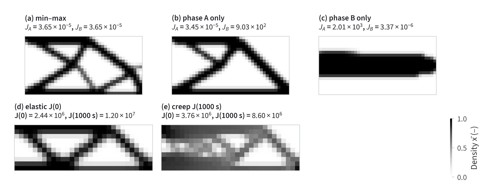

# Figure: time-aware topology optimisation designs

**Figure.** A design optimised for the time history differs from one optimised for a single instant.
(a)–(c) Linear viscoelastic cantilever (40 × 20 Q4, bulk-relaxing synthetic material) under a vertical load on
0–10 s followed by a horizontal load on 10–100 s: (a) min–max design, J_A and J_B balanced; (b), (c) each
single-phase design is near-singular for the other phase. (d), (e) Norton-creep MBB half-beam (30 × 10 Q4, synthetic
A = 1e-4 1/s, σ_ref = 10 MPa, n = 3): (d) design minimising the elastic compliance J(0); (e) design minimising the
compliance after 1000 s of creep — 28 % lower J(1000 s), 54 % higher J(0); it keeps more intermediate densities
(grey), a property of this SIMP-interpolated creep design, not a rendering artefact. Density x̄ on one shared grey
scale (solid = black). All runs KKT-stopped (residual ≤ 1e-4; (e) after a continuation). Data:
`scripts/save_designs.py`; figure: `scripts/fig_designs.py`; audit `fig_designs.denetim.txt` (0 errors, 3
justified warnings: fixed-aspect panels of different domain ratios leave horizontal gaps; the colour bar is longer
than the short panels; greyscale needs no CVD check). Records: `prereg/VM_minmax_switching.md`,
`prereg/CO6_creep_topology.md`.

Note on panel (a): the min–max values here (J_A = 3.6547e-5) differ by 0.6 % from the VM test (3.6751e-5) because
the figure script passes r_min = 0.075 and the test 1.5 · 0.05 = 0.07500000000000001; the 1e-17 difference changes
the MMA path and the run ends at another KKT-stationary point. Re-running the test reproduces 3.6751e-5 exactly.
