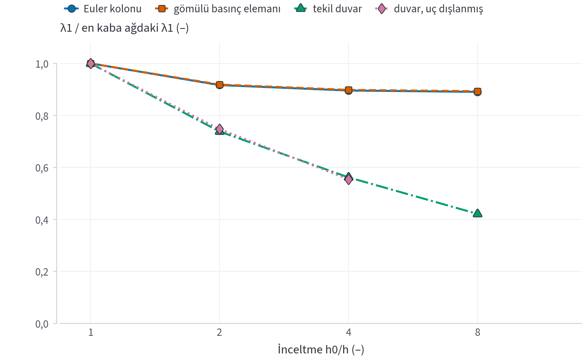
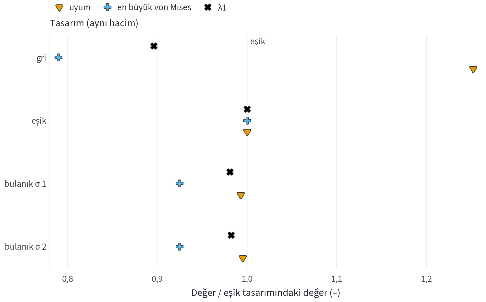

# Burkulma güvenilirliği ve geometri aktarımı: sonuç (06 §2, §3)

Ön kayıt: `burkulma_geometri_onkayit.md` (2026-11-26 05:03 +0300, commit `478ed4a`). Ham veri:
`burkulma_geometri.json`; betik: `python docs/olcumler/burkulma_geometri.py [A SP RL GC CANT VC POST]`; figürler:
`python docs/olcumler/burkulma_geometri_figur.py` (datawiz). Ortam: Windows 11, Python 3.12.1, NumPy 2.2.6,
SciPy 1.14.1, torch 2.5.1+cu121, scikit-fem 12.0.2; doğrudan çözücü SuperLU (PARDISO yok), gmsh yok. Koşular
`478ed4a` üzerinde, bu dosyada anlatılan kod değişiklikleri çalışma ağacındayken yapıldı (commit sonradan).

## Özet

| # | Sonuç | Ölçülen |
|:--|:--|:--|
| A1 | PASS | Euler kolonu Q4: CONVERGED, mertebe 2,000, Richardson değeri P_T'nin 1,29e-4 altında |
| A2 | PASS | Q4IM 16 eleman: λ/P_T − 1 = −1,28e-4 |
| A3 | PASS | gömülü basınç elemanı: her ağda λ_gömülü/λ_tek − 1 ≤ 1,24e-4; CONVERGED (mertebe 1,99) |
| A4 | PASS | tekil duvar 40²…320²: λ1 2,852 → 2,106 → 1,602 → 1,202, NOT CONVERGED (mertebe 0,33, GCI %162); yerelleşme 0,881 → 0,921 → 0,954 → 0,981 |
| A5 | PASS | uç dışlanmış duvar (r = 0,05): λ1 4,768 → 3,564 → 2,643, NOT CONVERGED |
| A6 | **FAIL** | λ1(r = 0,1)/λ1(r = 0,025) − 1 = 9,7e-5 (tahmin ≥ 0,10) |
| SP1 | PASS | boşluğa gömülü kolon, E_min ≤ 1e-6, beş yöntem: en büyük sapma 1,21e-4 |
| SP2 | **FAIL** | pg = 1 (pozitif kontrol): λ1 oranı 0,768 (≤ 0,5 beklendi), 1. mod düşük yoğunluk payı 0,026 (≥ 0,5 beklendi) |
| SP3 | PASS | pg ∈ {3, 4}: pay 0,026–0,062 |
| RL1 | PASS | n_modes = 1 → `reliable` False, `cluster_cut`; n_modes = 2 → True |
| RL2 | PASS | kesik kümede \|D+ − D−\|/\|D\| = 1,994 |
| RL2b | **FAIL** | tüm kümede asimetri 1,08e-5 (≤ 1e-5), AD–FD 1,16e-6 (≤ 1e-6) |
| RL3 | PASS | yeniden değerlendirme: birim sıra, MAC ≥ 1 − 1,8e-15 |
| GC1 | PASS | hacim: yoğunluk 1792 (tam), eşik +2,8e-6, yüzey −2,8e-4 |
| GC2 | PASS | her adımda 1 gövde, 0 kapalı boşluk |
| GC3 | PASS | açık / manifold olmayan / ters kenar 0 |
| GC4 | **FAIL** | boyun orta hattı yerel kalınlığı eşikte 4,08–4,57, son alanda 4,08–4,34 (4 ± 0,5) |
| GC5 | PASS | zarf dışına taşma 0 |
| GC6 | PASS | kendi kendini kesme / simetri / delik koruma UNVERIFIED; geometri kararı UNVERIFIED (PASS değil) |
| GC7 | PASS | aynı voksel ağında toporlogy H8 ile scikit-fem `ElementHex1`: 1,5e-12 |
| GC8 | **FAIL** | merdiven h = 1/4 uyumu 0,6756, nominal 0,625 (+%8,1; sınır %5); seri NOT CONVERGED (salınımlı) |
| GC9 | PASS | T10: NOT VERIFIED (gmsh yok) |
| VC1 | PASS | aynı hacimdeki gri ve eşik tasarımı: λ1 %10,4, en büyük von Mises %21,0 farklı |
| VC3 | PASS | konsol: son hacim / hedef −%0,21 ("threshold"), −%0,48 ("final") |

Beş ön kayıtlı kontrol başarısız; testleri strict xfail (`docs/vv_kutugu.json`), eşikler değişmedi.

## A. Ağ inceltme serileri

Euler kolonu (b = 4, L = 160, ν = 0) Q4'te 2/4/8/16 eleman genişlikte λ1 = 0,57809, 0,52989, 0,51783, 0,51482;
P_T = 0,513883 (Timoshenko düzeltmeli). `assess_convergence`: mertebe 2,000 (kaba üçlü 2,000), ince ağ GCI %0,24.
Q4IM her ağda P_T'nin 1,3e-4 altında: kalan fark, 2-B sürekli ortam ile kiriş modeli arasındaki farktır (ön kayıtta
öngörülen ~3e-4 düzeyinde), eleman hatası değil. `test_buckling.py`'deki üç ağlı testin üstüne dördüncü ağ, sayısal
karar ve Q4IM eklendi.

Gömülü basınç elemanı (b = 4, L = 80, 5b genişlikte boş alanın ortasında, alt kenar tamamen ankastre): λ_gömülü,
tek başına kolonun λ'sından her ağda yalnız 1,1e-4–1,2e-4 büyük (E_min = 1e-6 boşluğun rijitliği). Seri CONVERGED,
Richardson değerleri 0,0020533 ve 0,0020531.

Tekil duvar beklendiği gibi yakınsamıyor. Ön kayıttaki tahminin aksine sıkıştırma ucunu dışlamak λ1'i bölge
boyutuna bağlı yapmadı (A6 FAIL): **post-hoc** (`POST` bölümü) 80²'de dışlamasız 1. modun enerjisinin %66'sı
sıkıştırma uçlarının 0,02 yakınında, %0,07'si açıklığın içbükey köşelerinin (0,4, 0,6) ve (0,8, 0,6) 0,05
yakınında; r = 0,05 dışlamayla uçlardaki pay 3e-4'e düşüyor, köşelerdeki pay 0,951'e çıkıyor. Mod bir sonraki tekil
noktaya taşınıyor; λ1 orada da inceltmeyle düşüyor (A5) ve dışlama bölgesinden uzak olduğu için yarıçapa duyarsız.
`fem/buckling.py`'nin eski notu ("yerelleşme dışlanan bölgenin kenarına taşınır, λ bölge boyutuna bağlı olur") bu
ölçümle çelişiyordu; not düzeltildi. Sonuç aynı: dışlama tekilliği gidermez.

Literatür (gerilme yerelleşmesi düzenlemesi, 06 §2): bu turda kaynak okunmadı; doğrulanmadı.

**Şekil 1.** Euler kolonunda ve gömülü basınç elemanında λ1 ağla yerleşiyor; tekil duvarda inceltme sürdükçe düşüyor
ve sıkıştırma ucunu dışlamak bunu durdurmuyor. λ1 en kaba ağdaki değere bölündü; inceltme h0/h = 1, 2, 4, 8 (duvar
40²…320², dışlamalı duvar 40²…160², kolonlar 2…16 eleman genişlik). Denetim: `burkulma_yakinsama.denetim.txt`
(0 HATA).

## B. Sahte mod teşhisi ve yöntem karşılaştırması

D1 (0/1 kolon boşlukta): boşluk elemanları x = 0 olduğundan E_G = x^pg yöntemlerinde gerilme rijitliği yok;
`stiffness` yönteminde E_min kadar var. E_min = 1e-3'te boşluğun rijitliği λ1'i %11,7 (`stiffness`) / %12,1 (öteki
yöntemler) büyütüyor ve 1. modun K-enerjisinin %10,5'i boşlukta: bu sahte mod değil, E_min'in kendi rijitliği.
E_min ≤ 1e-6'da fark ≤ 1,2e-4 (SP1).

D2 (16 × 48 uyum optimumu, elemanların %36'sı 0,05 < x̄ < 0,95): gerilme modülü üssü λ1'i doğrudan değiştiriyor
(E_min = 1e-6: pg = 1 → 0,006776, pg = 2 → 0,007997, pg = 3 → 0,008826, pg = 4 → 0,009456; `stiffness` ≈ pg = 3),
ama hiçbir durumda 1. mod düşük yoğunluklu değil (K-enerjisi payı 0,026, E_min = 1e-3'te 0,062). pg = 1'de gerilme
rijitliği enerjisinin düşük yoğunluk payı 0,004'ten 0,070'e çıkıyor: gri sınırlar modu sürüyor ama mod yapının
modu olarak kalıyor. Pozitif kontrol (SP2) bu tasarımda sahte mod üretmedi; teşhis ölçüsünün sahte modu yakaladığı
bir örnek bu turda gösterilemedi. Sonuç: pg < p ile hesaplanan λ1 aynı tasarımda %23'e kadar düşük; bu fark bir
"sahte mod" bayrağı olmadan da ortaya çıkıyor, yani bayrak yokluğu yöntemin doğru olduğunu göstermez.

## C. Güvenilirlik işareti ve mod takibi

Kare kesitli kolonda λ1 = λ2: bir mod toplandığında kayıt `reliable = False`, bayrak `cluster_cut`; iki modla True.
Kesik kümenin tek taraflı türevleri her yönde zıt işaretli (\|D+ − D−\|/\|D\| = 1,994, adımdan bağımsız: post-hoc
h = 1e-5…1e-2'de hep 1,994): AD'nin verdiği tek sayı türev değildir. Tüm küme toplandığında (RL2b) ön kayıtlı eşikler
kaçtı: **post-hoc** adım taraması asimetri 1,5e-4 / 1,1e-5 / 8,8e-4 / 0,66 (h = 1e-5, 1e-4, 1e-3, 1e-2), AD–FD 5,0e-6 /
1,2e-6 / 7,9e-8 / 1,3e-8. AD–FD büyük adımda 1e-6'nın çok altına iniyor (küçük adımda özdeğer çözücü toleransı
gürültüsü); asimetri ise iki yönde de büyüyor: KS (ρ = 20) çift özdeğerin ayrılmasında güçlü eğrilik taşıyor, h²
mertebeli kesme hatası büyük. Türev doğru; ön kayıtlı asimetri ölçütü bu fonksiyon için kötü seçilmişti.

RL4 (betimsel): burkulma kısıtlı kolon koşusu (λ1 ≥ 1,6 λ0 = 0,01412, 60 iterasyon) 61 değerlendirmede 5 mod
değişimi (iterasyon 1, 9, 11, 18, 31), takip edilen 1. modun en küçük MAC'i 0,957. İlk 9 değerlendirme
`spurious_low_density` bayrağı aldı: başlangıç x = 0,35 her yerde, hiç katı eleman yokken pay tanım gereği 1. Bu bir
tanı sınırı; modül notuna yazıldı.

Doğrusal olmayan burkulma (kusurlu geometri, limit noktası): 04'ün `solvers/continuation` modülü bu tabanda yok →
NOT VERIFIED.

## D. Geometri zinciri

Analitik basamaklı çubukta (tam hacim 1792) her adım ayrı kaydedildi (`GC.record`): hacim 1792 → 1792,005 (eşik) →
1791,36 (açma) → 1794,08 (kapama) → 1791,50 (yüzey); bütün adımlarda tek gövde; yüzey su geçirmez; zarf dışına taşma
0. Yerel kalınlık p1 eşikte 2,52, morfolojiden sonra 3,04 (keskin kenarlar açmayla yuvarlanıyor), yüzeyde ışın
kalınlığı p1 4,08. GC4 FAIL: boyun orta hattında ölçü 4,57'ye çıkıyor (en büyük değer basamağa yakın uçta; neden
incelenmedi).

Bağımsız yeniden analiz: aynı voksel ağında toporlogy ve scikit-fem uyumu 1,5e-12 farklı (GC7). Merdiven ağlarında
(h = 1/2, 1/3, 1/4) uyum 0,6799 / 0,6706 / 0,6756, voksel hacmi yüzey hacminden −%1,8 / −%0,7 / −%1,3: geometri hatası
ağla değişiyor, seri salınımlı (NOT CONVERGED). GC8 FAIL (+%8,1). **Post-hoc:** son geometrinin h = 1/4 kesit
alanlarıyla seri çubuk değeri 0,6307 (orta kesitler 63,25 ve 31,25; nominal 64 ve 32): alan kaybı farkın yalnız
~%0,9'unu açıklıyor; kalan ~%7 basamak geçişlerinin 3-B etkisi ve merdiven sınırıdır, burada ayrılamadı.

Gerçek tasarım (30 × 10 × 10 konsol, `min_wall = 1,0`): her alan adımında ve yüzeyde duvar p1 0,50–0,64 < 1,0 →
geometri kararı FAIL (mevcut `test_post_cantilever.py` bu ölçütü kapıdan geçirmiyor). Merdiven uyumu
31,45 / 31,47 / 31,39 ("threshold") ve 31,54 / 31,55 / 31,52 ("final"), NOT CONVERGED (salınımlı); T10 NOT VERIFIED.

Değerlendirilmeyen 06 §3 maddeleri: kendi kendini kesme, simetri, delik koruma, sarkma (ölçülüyor, kapı yok),
CAD/B-rep dışa aktarma (yok; STL STEP değildir), malzeme alanı aktarımı (merkez–en yakın / interpolasyon
karşılaştırması yapılmadı), T10 ağ yakınsaması ve Jacobian / tepki dengesi (gmsh yok). Voksel çözümünde tepki toplamı
uygulanan yükü 1e-14 düzeyinde dengeliyor (scikit-fem yolu).

## E. Hacim düzeltmesi gerilme ve burkulmayı garanti etmez

**Şekil 2.** Aynı hacimdeki dört tasarımda uyum, en büyük von Mises ve λ1 eşik tasarımına göre. Gri: uyum %25 büyük,
en büyük von Mises %21 küçük, λ1 %10 küçük; Gauss bulanık + eşik (σ = 1, 2 eleman): von Mises %8 küçük, λ1 %2 küçük.
Hacimler 268,8–269,0 (eleman). En büyük von Mises tek ağda, katı malzeme gerilmesi, x̄ ≥ 0,5 elemanlarında; içbükey
köşelerde ağa bağlıdır (yakınsamış gerilme iddiası değil). Denetim: `hacim_esit.denetim.txt` (0 HATA).

3-B konsolda iki hacim eşleme seçeneği hacmi hedefin %0,5'i içinde tutuyor (VC3) ve merdiven uyumları birbirinden
%0,4 farklı; aynı hacimdeki gri voksel modelinin uyumu 35,83 (bitmiş parçanın merdiven uyumundan %14 büyük, yük ve mesnet aynı).

## Bulunan ve düzeltilen hata (kayıt için)

* scikit-fem yolu ilk koşuda SuperLU'nun kendi MMD sıralamasıyla 51 000 serbestlik derecesini 2180 s'de çözdü
  (aynı ağda toporlogy 19 s). Iç içe bölme sıralaması (`solvers.ordering`) verildi: 194 s, sonuç aynı (1,49e-12).
* `CANT` bölümünün ilk denemesi kaba ızgarada yükü hiçbir yüze dağıtamadan (seçim `x > 29 + 1e-9`) NaN ile durdu ve
  merdiven ağlarında yük yaması h'ye bağlı oluyordu; seçim `x ≥ 29` yapıldı. Kaydedilen CANT sonucu düzeltilmiş koşudur
  (ilk deneme hiçbir sonuç yazmadı).
