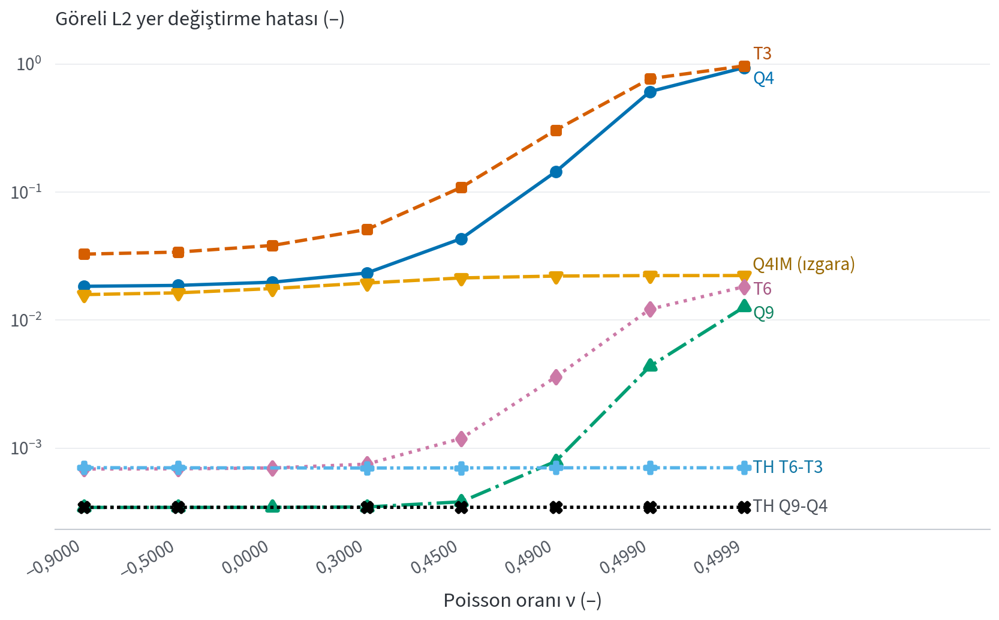
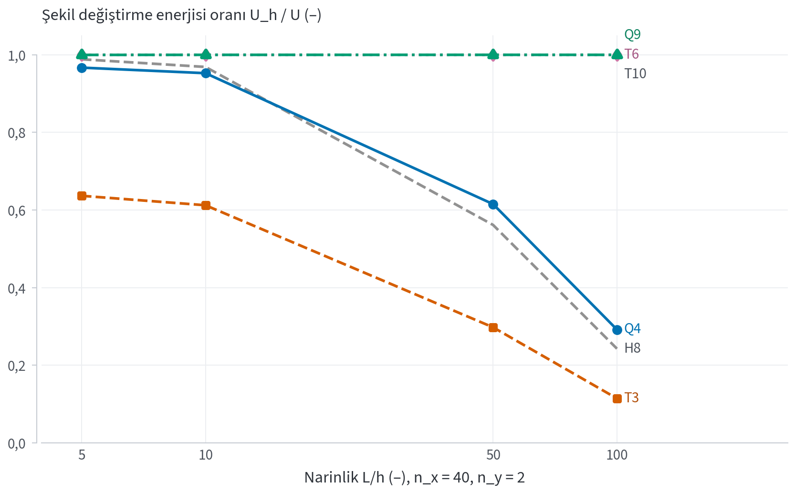
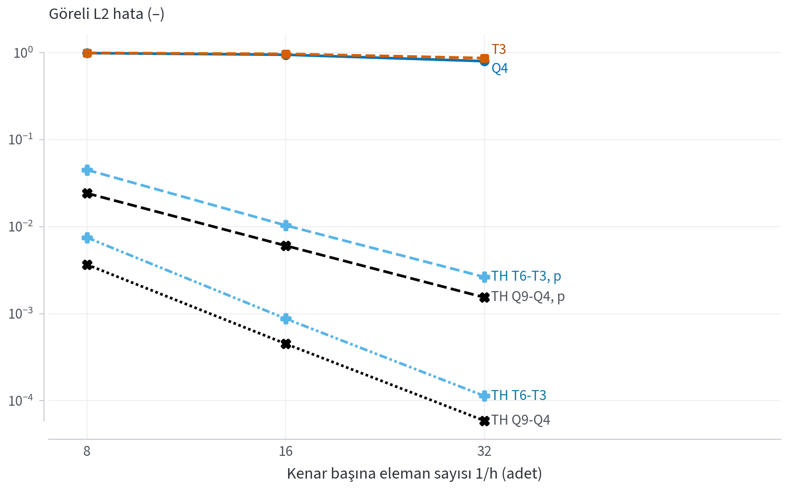

# Genel ağ FEM çekirdeği, eleman sözleşmesi ve kilitlenme: sonuçlar

Ön kayıt: `fem_genel_onkayit.md` (26 Kasım 2026 02:41 +0300, commit `c825263`, kodun ilk koşusundan önce). Kod:
`src/toporlogy/fem/mesh/` (yeni paket; mevcut `fem/*.py` değişmedi). Testler: `tests/toporlogy/test_mesh_elements.py`,
`test_mesh_assembly.py`, `test_mesh_verification.py`, `test_mesh_locking.py`. Ölçüm: `python docs/olcumler/fem_genel.py`
→ `fem_genel.json` (koşu `0ea4577` üzerinde, 03:44 +0300, 677 s, süreç tepe belleği 2,2 GB). Figürler:
`python docs/olcumler/fem_genel_figur.py` (datawiz; `fem_genel_nu`, `fem_genel_konsol`, `fem_genel_yakinsama` +
`.denetim.txt`, set `fem_genel.seti.json`, `fem_genel.tutarlilik.txt`).

Ortam: Windows 11, Python 3.12.1, NumPy 2.2.6, SciPy 1.14.1, scikit-fem 12.0.2. PARDISO yüklenmiyor (`pypardiso`
yok): bütün doğrudan çözümler SuperLU. GPU yok, ölçülmedi.

Durum anlamları: PASS = ön kayıtlı eşik tuttu; FAIL = tutmadı, strict xfail + ölçülen değer (`docs/vv_kutugu.json`);
post hoc = ön kayıttan sonra eklenen, ayrı etiketli test; NOT VERIFIED = ölçülmedi.

## 0. Ne yapıldı (API)

* `reference`: `L2 L3 Q4 Q9 H8 T3 T6 T4 T10` (T10 düğüm sırası gmsh / `post/verify.py` ile aynı), şekil fonksiyonu,
  ∂N/∂ξ, yüzler, polinom uzayı. Q8 yerine Q9 seçildi (ön kayıt §0).
* `quadrature`: Gauss–Legendre çarpımı; simplekste Duffy çökertilmiş çarpım, merkez, 3 noktalı üçgen, Keast 4 nokta.
* `kernels`: izoparametrik eşleme, işaretli detJ denetimi (her quadrature noktası ve referans düğümleri;
  `InvertedElementError` / `DegenerateElementError`, eleman numarasıyla; mutlak değer yok), rijitlik, tutarlı ve HRZ
  kütle, ısı iletimi, hacim kuvveti, yüz çekişi/basınç (dış normal geometriden), Robin yüz matrisi.
* `mesh`: `Mesh` (tek eleman türü; karışık hücre reddedilir), fiziksel hücre etiketi, adlı yüz/düğüm kümeleri,
  sınır yüzleri, bağlı bileşenler, `Mesh.from_domain` (ızgaranın kendi DOF numaraları), `rectangle`, `box`
  (Kuhn bölmesi), `perturb`, `straighten`.
* `assembly.Pattern`: bir kez kurulan CSR deseni, her montaj tek `bincount`; dikdörtgen bloklar (u-p) aynı sınıf.
* `linear`: `Factorization` (yapı bildirimli: `spd` → `solvers.direct.DirectSolver`; `symmetric_indefinite` /
  `general` → kısmi pivotlu SuperLU; her çözüm `fem.elastic.checked_residual`), `jacobi_pcg` (yalnız SPD),
  `condition_1norm`, `jacobi_scaled`.
* `problem`: `ElasticProblem`, `HeatProblem`, `Dirichlet` (sıfır olmayan değer, yük durumu başına değer, çelişki
  hatası), reaksiyon, bağlı bileşen başına rijit mod rank tanısı (`MechanismError`), çok sağ taraf ve tek
  çarpanlara ayırma, `set_D` ile desen yeniden kullanımı, `errors` (L2 / enerji, parçalı), MPC/periyodik/eğik
  mesnet için açık `UnsupportedBoundaryCondition`.
* `mixed.MixedElasticity`: Taylor–Hood u-p (T6-T3, Q9-Q4, T10-T4) ve kararsız karşılaştırma Q4-P0; λ = ∞ tam,
  gerektiğinde ∫p = 0 ayarı; düzlem gerilme ve λ = 0 reddedilir; `inf_sup`.
* `manufactured`, `benchmarks`: polinom MMS, ν taraması ve konsol (Timoshenko & Goodier) koşucuları.

## 1. Eleman sözleşmesi (E1–E9): hepsi PASS

E1–E5b bütün elemanlarda ve kurallarda (derece 0–8) eşik altında; E6 her elemanda ters ve çökmüş hücre
reddediliyor, hata yalnız bozuk hücrenin numarasını veriyor; E7 afin ve afin olmayan elemanlarda tam n_rbm sıfır
özdeğer; E8 genel yol Q4/H8 = `ke_q4_from_D` / `ke_h8_from_D` ≤ 1e-14; E9 tek noktalı Q4'te 2 hourglass modu.
Uygulama hatası: E6 testinin ilk sürümü H8 için 2 hücreli ağda 3 numaralı hücreyi bozmaya çalıştı (test kurgusu,
eşik değil); ağ 2 × 2 × 1'e büyütüldü.

## 2. Ağ, montaj, sınır koşulları (G, M)

| # | Sonuç | Ölçülen |
|:---|:---|:---|
| G1 | PASS | Q4 (maskeli, t = 0,6, h = 0,7, eleman başına E, 2 yük durumu): K 8,9e-16, u 1,3e-13; H8: K 6,1e-16, u 2,0e-14 |
| G2 | PASS | 7 eleman × düzlem gerilme/şekil değiştirme/3-B: u ≤ 1,3e-15, gerilme ≤ 4,8e-14 |
| G2b | PASS | eğri kenarlı Q9 7,1e-16, T6 9,2e-16, T10 (derece 3) 9,9e-16 |
| G2c | ölçüm | eğri T10, 4 noktalı kural: u 1,7e-4, gerilme 2,6e-3 (öngörüldüğü gibi geçmiyor: Bᵀσ detJ derece 3) |
| G3 | PASS | kuvvet ve moment dengesi ≤ 2,5e-15 |
| G4 | PASS (düz yüzler) / **FAIL** (eğri L3) | sabit/doğrusal çekiş, basınç, kapalı yüzey, hacim kuvveti ≤ 1e-12; eğri L3 yüzü varsayılan derece-6 kuralla 1,5e-5 (yay uzunluğu integrandı √polinom). Post hoc: derece-40 kuralla 6,3e-17 |
| G5 | PASS (2-B, iki parça) / **FAIL** (3-B beklentisi) | tek düğüm: 1 eksik mod; desteksiz ikinci parça adıyla bulunuyor. 3-B'de bir yüz yalnız x'te: ön kayıt 5 bekledi, ölçülen 3 — beklenti yanlıştı (x = 0 düzleminde u_x = 0, y ve z etrafındaki dönmeyi de tutar); tanı doğru, post hoc test 3'ü doğruluyor |
| G6 | PASS | çelişen Dirichlet, iç yüzde yük, yük durumu uyuşmazlığı, düzlem gerilmede u-p, PD olmayan D, Q4IM/H8IM genel ağda, bilinmeyen eleman, yanlış D boyutu, `constrain("periodic")`, karışık hücre: hepsi açık hata. Post hoc: λ = 0'da u-p reddi (ν taraması ν = 0'da sıfıra bölmeyle buldu) |
| G7 | PASS | 3 yük durumu = ayrı çözümler ≤ 1e-13, tek çarpanlara ayırma |
| G8 | PASS | desen aynı nesne, taze montaja eşit ≤ 1e-15 |
| G9 | PASS | seri iki malzemeli çubuk, 7 eleman ≤ 4,7e-13 |
| G10 | PASS | T10 genel ağ = `post.verify.stiffness_t10` 5,5e-16 |
| M1 | PASS | tutarlı kütle toplamı ρV; HRZ pozitif ve toplamı koruyor (T6, T10 dahil) |
| M2 | PASS | doğrusal sıcaklık yaması ≤ 1,2e-15; Robin levhası ≤ 2,6e-15 |

## 3. Bağımsız ve analitik doğrulama (V)

* V1 PASS: ikinci dereceden tam çözüm, T6 7,5e-16, Q9 1,9e-15, T10 1,0e-15.
* V2 PASS (scikit-fem 12.0.2, DOF'lar koordinatla eşlendi): K / f / u göreli farkı T3 2,1e-16 / 1,2e-16 / 6,8e-15,
  T6 7,1e-16 / 6,8e-16 / 1,6e-14, T4 2,6e-16 / 2,8e-16 / 5,2e-15, T10 5,0e-16 / 6,5e-16 / 1,7e-14, Q4 2,2e-16 /
  1,5e-16 / 1,5e-15, Q9 6,8e-16 / 4,7e-16 / 9,7e-15, H8 2,5e-16 / 1,4e-16 / 3,0e-15. İlk koşuda T6/T10 eşlemesi
  çöktü: test, scikit-fem ağına orta düğümleri de köşe diye vermişti (test kurgusu hatası, düzeltildi).
* V3 (MMS, köşeler ±0,2 h bozulmuş, düzlem şekil değiştirme / 3-B, ν = 0,3), en ince iki ağın mertebesi:

| Eleman | ağlar | L2 | enerji | Sonuç |
|:---|:---|---:|---:|:---|
| Q4 | 4…32 | 1,985 | 0,997 | PASS |
| T3 | 4…32 | 1,902 | 0,976 | PASS |
| Q9 | 4…32 | 3,008 | 1,997 | PASS |
| T6 | 4…32 | 3,002 | 1,980 | PASS |
| H8 | 4, 8, 16 | 1,95 | 0,99 | PASS |
| T4 | 4, 8, 16 | **1,796** | 0,92 | **FAIL** (L2 < 1,8) |
| T10 | 2, 4, 8 | 2,92 | **1,788** | **FAIL** (enerji < 1,8) |

  T4 ve T10 asimptotik öncesi: post hoc bir düzey daha T4 16 → 24: 1,92 / 0,97; T10 8 → 12: 3,00 / 1,89 (yavaş
  pakette `test_v3_posthoc_one_more_level`). 3-B V3 durumları yavaş pakete taşındı (T4 tek başına 50 s); hızlı pakette
  iki düzeyli duman testi var.
* V3b: ±0,2 h köşe + ±0,1 h eğri orta düğüm ailesinde bazı hücreler ters döndü; detJ denetimi ağı reddetti (ön kayıtlı
  ölçüm bu ailede yapılamadı). Post hoc: düz köşe ızgarası + ±0,1 h eğri orta düğüm, Q9: L2 2,03, enerji 1,02 (3 ve 2
  yerine; O(h) eğrilikte bilinen mertebe kaybı). T6 aynı genlikte n = 32'de ters hücre verdi.

## 4. Poisson oranı ve kilitlenme (L)

Hepsi `fem_genel.json`'dan. MMS (A): sıfır diverjanslı, tüm sınır u = 0, düzlem şekil değiştirme n = 16 (3-B n = 6),
düzenli ağ; göreli L2 yer değiştirme hatası:

| Yöntem | −0,9 | −0,5 | 0 | 0,3 | 0,45 | 0,49 | 0,499 | 0,4999 | 0,5 |
|:---|---:|---:|---:|---:|---:|---:|---:|---:|---:|
| Q4 | 1,8e-2 | 1,9e-2 | 2,0e-2 | 2,3e-2 | 4,3e-2 | 0,14 | 0,61 | 0,94 | — |
| T3 | 3,3e-2 | 3,4e-2 | 3,8e-2 | 5,1e-2 | 0,11 | 0,31 | 0,77 | 0,97 | — |
| Q9 | 3,5e-4 | 3,5e-4 | 3,5e-4 | 3,5e-4 | 3,8e-4 | 7,9e-4 | 4,4e-3 | 1,3e-2 | — |
| T6 | 6,9e-4 | 6,9e-4 | 7,0e-4 | 7,5e-4 | 1,2e-3 | 3,6e-3 | 1,2e-2 | 1,8e-2 | — |
| Q4IM (ızgara) | 1,6e-2 | 1,6e-2 | 1,8e-2 | 2,0e-2 | 2,1e-2 | 2,2e-2 | 2,2e-2 | 2,2e-2 | — |
| TH T6-T3 | 7,0e-4 | 7,0e-4 | ret | 7,0e-4 | 7,0e-4 | 7,0e-4 | 7,0e-4 | 7,0e-4 | 7,0e-4 |
| TH Q9-Q4 | 3,5e-4 | 3,5e-4 | ret | 3,5e-4 | 3,5e-4 | 3,5e-4 | 3,5e-4 | 3,5e-4 | 3,5e-4 |
| Q4-P0 | 2,0e-2 | 2,0e-2 | ret | 2,0e-2 | 2,0e-2 | 2,0e-2 | 2,0e-2 | 2,0e-2 | 2,0e-2 |
| H8 (3-B) | 0,13 | 0,13 | 0,14 | 0,15 | 0,24 | 0,52 | 0,91 | 0,99 | — |
| T4 (3-B) | 0,19 | 0,20 | 0,22 | 0,27 | 0,44 | 0,75 | 0,97 | 1,00 | — |
| T10 (3-B) | 1,4e-2 | 1,4e-2 | 1,4e-2 | 1,6e-2 | 2,9e-2 | 6,7e-2 | 0,12 | 0,14 | — |
| H8IM (ızgara) | 0,12 | 0,12 | 0,12 | 0,13 | 0,14 | 0,16 | 0,29 | 0,72 | — |
| TH T10-T4 | 1,4e-2 | 1,4e-2 | ret | 1,4e-2 | 1,4e-2 | 1,5e-2 | 1,5e-2 | 1,5e-2 | 1,5e-2 |

"ret": λ = 0'da u-p reddedilir (§2 G6 post hoc). Düzlem gerilme (yalnız ölçüm): Q4 0,018 → 0,025, T3 0,030 → 0,055
(ν = −0,9 → 0,4999): kilitlenme yok, çünkü λ* sınırlı. 3-B kafes ızgaranın H8IM'i ν = 0,4999'da 0,72'ye çıkıyor:
uyumsuz modlar 2-B'de (Q4IM) hacimsel kilitlenmeyi gideriyor, 3-B'de bu ağda gidermiyor (ölçüm; eşik yoktu).

| # | Sonuç | Ölçülen |
|:---|:---|:---|
| L1a | PASS | E sabit ile G sabit arasındaki en büyük fark 1,0e-11 (bütün yöntem × ν; testte ≤ 1e-10). Göreli hatalar C'nin ölçeklenmesiyle değişmez; ayrım yalnız mutlak büyüklükleri (yer değiştirme, yük) etkiler |
| L1b | PASS (Q4 40×, T3 19×, H8 6,5×) / **FAIL** (T4 3,7×) | T4 n = 6'da e(0,3) = 0,27, oran 1/0,27 = 3,8 ile sınırlı; e(0,4999) = 0,996 tam kilitlenme. Post hoc n = 12: 12,5× |
| L1c | PASS | TH T6-T3 e(0,4999)/e(0,3) = 1,005, e(0,5)/e(0,4999) = 1,000; TH Q9-Q4 1,001 / 1,000 |
| L1d | PASS | aynı yer değiştirme uzayı: TH 7,0e-4 < T6 1,8e-2 (ν = 0,4999) |
| L1e | PASS | (B), bozulmuş ağ 8/16/32: TH T6-T3 u 2,95, p 1,97; Q9-Q4 u 2,94, p 1,98; ν = 0,5'te aynı (ayar kullanıldı). Aynı ailede Q4 0,99 → 0,80, T3 0,99 → 0,86 (yakınsama yok denecek kadar yavaş); T6 / Q9 yalnız yer değiştirme 1,9e-3 / 2,6e-3 (TH'nin 17 / 44 katı) |
| L2 | PASS | TH T6-T3 β = 0,2845 / 0,2841 / 0,2840, Q9-Q4 0,417 / 0,411 / 0,407 (n = 4, 8, 16), tek sıfır özdeğer (hidrostatik). Q4-P0: 2 sıfır özdeğer (hidrostatik + dama tahtası) ve β 0,31 → 0,18 → 0,094 (h ile sıfıra gidiyor) |
| L3a | PASS | F2 (n_x = 40, n_y = 2, en-boy 5) L/h = 100: Q4 R = 0,292, H8 R = 0,242 |
| L3b | PASS | Q9 F2 n_y = 2: 0,9998 / 0,9999 / 1,0000 / 1,0000 |
| L3c | PASS | F1 n_y = 2, L/h = 10/50/100: Q4IM 0,998 / 1,000 / 1,000; H8IM 0,998 / 1,000 / 1,000 |
| L3d | PASS | tam çözümde kayma enerjisi oranı L/h = 5: 3,0e-2; 10: 7,7e-3; 50: 3,1e-4; 100: 7,8e-5. Q4 açığı 0,708 = 9100 × kayma oranı: fiziksel kayma değil, kilitlenme |
| L4 | **FAIL** (κ oranı) / PASS (ayrım) | Q4 κ₁: 186 (0,3), 1460 (0,49), 8280 (0,499), 12700 (0,4999); oran 68 < 100 (n = 16'da h⁻² kısmı baskın). Jacobi ölçekli çözüm farkı ≤ 5,4e-14, bir iyileştirme adımı ≤ 1,1e-13, PCG 38 → 94 yineleme; hata oranı 40× kalıyor. TH T6-T3'ün κ₁'i daha büyük (2,1e4 → 3,5e6) ama hatası sabit: koşul sayısı kilitlenmeyi göstermiyor, iki ayrı sorun. PCG indefinite u-p sisteminde reddediliyor |

Konsol tablosu (R = U_h / U, tam değerler JSON'da): F1 (kare eleman) Q4 n_y = 1/2/4: 0,67 / 0,89 / 0,97, L/h'den
bağımsız (kilitlenme en-boy oranına bağlı, narinliğe değil); T3 0,23 / 0,54 / 0,82; Q9, T6, T10, Q4IM, H8IM ≥ 0,985.
F2 (en-boy L/h / 20): Q4 n_y = 2: 0,967 / 0,953 / 0,615 / 0,292; T3 0,64 / 0,61 / 0,30 / 0,11; H8 0,99 / 0,97 / 0,56
/ 0,24; n_y = 2'de Q9, T6, T10 ≥ 0,999 (n_y = 1'de ≥ 0,995).

**Şekil 1** ν → 0,5'te Q4 ve T3 kilitlenir, Taylor–Hood'un hatası değişmez. MMS (A), düzlem şekil değiştirme,
n = 16, E = 1; ν ekseni eşit aralıklı sıralı. **Şekil 2** Eleman en-boy oranı L/h / 20 ile büyürken doğrusal
elemanlar kayma kilitlenmesine girer; ikinci dereceden elemanlar R ≈ 1 (T10 Q9'un altında). **Şekil 3**
ν = 0,4999, bozulmuş ağ: TH yer değiştirmede h³, basınçta (kesikli) h² ile yakınsar; Q4, T3 yer değiştirme hatası
≈ 1'de kalır. Datawiz denetimi: üç figürde 0 HATA; set 0 HATA, 4 UYARI (işaret boyu ve çizim alanı sol kenarı
figürden figüre değişiyor; ızgara ekseni kategori/değer farkı — tek tek okunan depo figürleri için kabul edildi).

## 5. Kararlı yöntem seçimi ve sınırları

Taylor–Hood seçildi (ön kayıt §5; Brezzi & Fortin 1991, Hughes 1980/2000 ve önerilen doi:10.1007/s00466-019-01760-w
bu oturumda **okunmadı**; seçim bilinen sonuçlara ve buradaki ölçümlere dayanıyor). Ölçülen gerekçe: β_h sınırlı
(L2), yer değiştirme ve basınç optimal mertebede (L1e), ν = 0,5 tam. Q4-P0 (B-bar / ortalama dilatasyona denk) yer
değiştirmede kilitlenmiyor (2,0e-2 sabit) ama dama tahtası basınç modu taşıyor ve β_h → 0 (L2): basınç güvenilmez.
Sınırlar: yalnız izotrop doğrusal elastisite, düzlem şekil değiştirme ve 3-B; simetrik belirsiz sistem SuperLU (kısmi
pivot); TH T10-T4'ün 3-B yakınsaması ve inf-sup'ı ölçülmedi (yalnız ν taraması); F-bar, seçici indirgenmiş
integrasyon ve hourglass kontrolü yok.

## 6. Performans (SuperLU; montaj NumPy, 12 iş parçacıklı dizüstü)

V3 ağlarından (`mms_convergence`): 2-B en büyük Q9 n = 32: 8450 DOF, nnz(K) 264 196, nnz(L+U) 805 278, montaj 0,27 s,
çözüm 0,20 s. 3-B: H8 n = 16 14 739 DOF, nnz(L+U) 8,7e6, 2,3 s; T4 n = 24 46 875 DOF, 5,2e7, 34 s; T10 n = 12 46 875
DOF, 7,1e7, 50 s, süreç tepe belleği 2,2 GB. SuperLU dolgusu 3-B'de hızla büyüyor; 47k DOF'un üstü bu makinede
pratik değil. Gerçek parçalarda T10 kaynak ihtiyacı: **NOT VERIFIED** (gmsh kurulu değil; PARDISO yok).

## 7. Kapsam dışı ve NOT VERIFIED

Q8, H20/H27, kabuk/kiriş; MPC, periyodik ve eğik mesnet genel ağda (açık hata); matris içermeyen ve yinelemeli üretim
çözücüsü (PCG yalnız L4 ölçümünde); geometrik rijitlik; F-bar (04 ile); Cook zarı (yayınlanmış değerler kaynağından
okunmadı); genel ağ YAML fiziği (yalnız Python API; katalogda `mesh:*` satırları `physics` boş); genel bozulmada
uyumsuz modlu elemanlar (yalnız ızgarada kalıyor, genel ağda reddediliyor).
