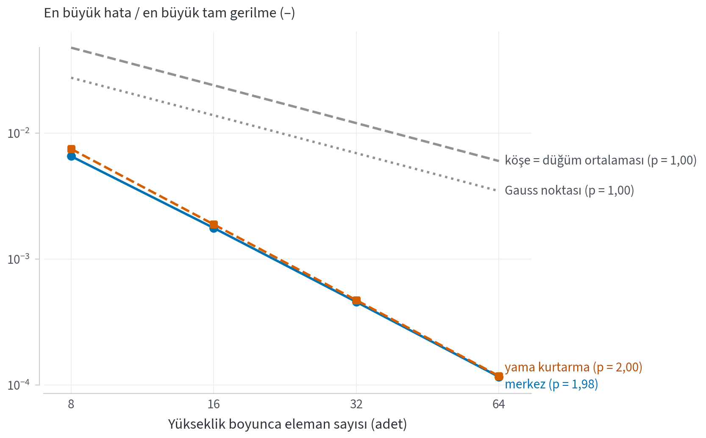
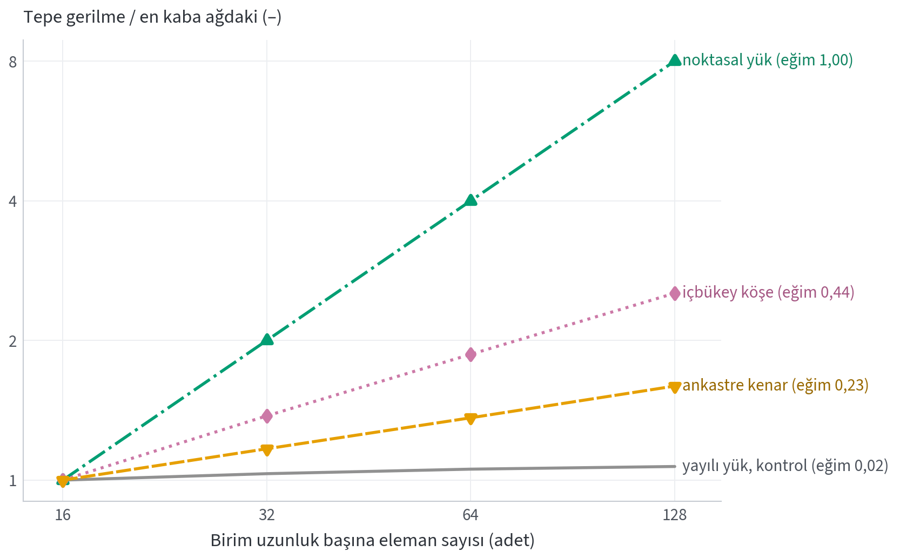
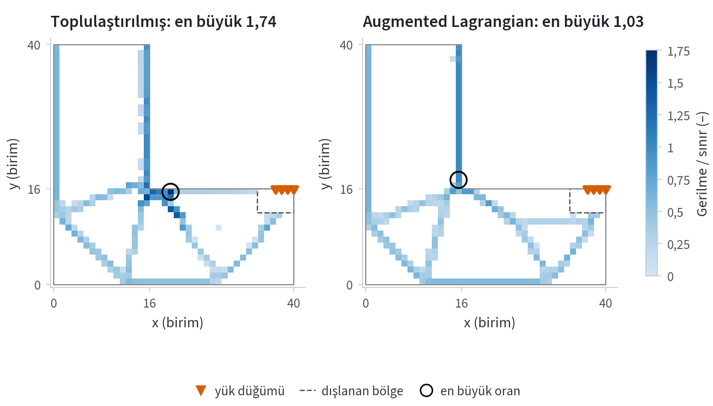
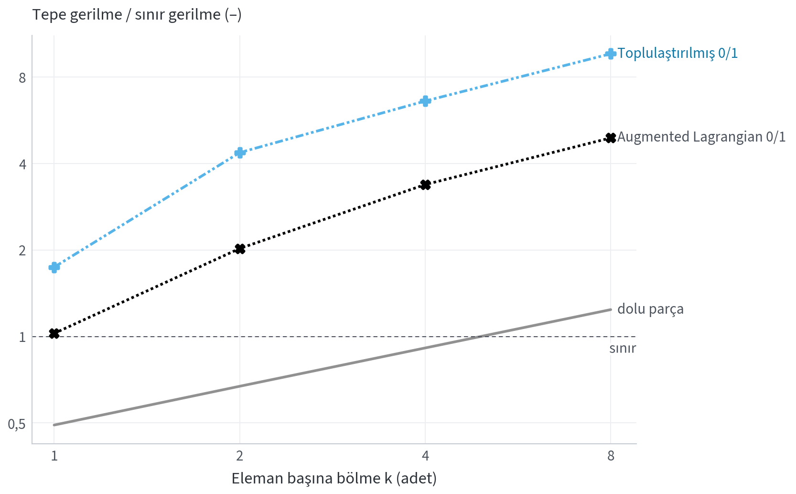

# Gerilme recovery ve tekillik tanısı: sonuçlar

Ön kayıt: [`gerilme_onkayit.md`](gerilme_onkayit.md) (26 Kasım 2026 00:24 +0300, `da8ae17`, ilk koşudan önce).
Ham kayıt: [`gerilme.json`](gerilme.json), iki 0/1 tasarımın alanları [`gerilme_alanlar.json`](gerilme_alanlar.json).
Ölçülen kod: `323a2c8` (taban `main` = `1d1f027`). Yeniden üretim, depo kökünden, yaklaşık iki dakika:

```powershell
python docs/olcumler/gerilme.py
```

Figürler `datawiz` ister (depoda ve bağımlılıklarda yok); sayılar onsuz da üretilir (`gerilme.measure()`).

**Ortam.** Windows 11, 12 çekirdek (torch 6 iş parçacığı), Python 3.12.1, NumPy 2.2.6, SciPy 1.14.1,
torch 2.5.1+cu121 (hesaplar CPU'da), SuperLU (PARDISO ve gmsh yok). Aynı sayılar ayrı üç süreçte birebir çıktı.

## Özet

1. Recovery modülünün ve tekillik tanısının ön kayıtlı analitik ve bağımsız kontrolleri geçti.
2. **Tarihsel L-bracket gerilme deneyi bu ortamda yeniden üretilemiyor:** değiştirilmemiş iki örnek de sonlu
   olmayan modülle duruyor. Nedeni `optimization/stress.py`'deki qp gevşetmesinin x̄ = 0'da NaN gradyan vermesi.
3. **Post-hoc** (NaN giderilince) dönen iki tasarım da yükü taşımıyor: yük düğümlerine değen elemanlar boş
   (gri x̄ ≤ 0,084), uyum dolu parçanın 280 ila 2800 katı. Çalışma yine de `feasible` diyor.
4. Bu nedenle `yontemler.md` §3'teki %71 ve %2,5 aşımları "üretilebilir tasarımın gerilme aşımı" diye
   okunmamalı. Tarihsel tasarımlar saklanmadığı için onların bağlı olup olmadığı **NOT VERIFIED**.

## Kontrol durumu

| Kontrol | Konu | Durum |
|:---|:---|:---|
| T1, B0 | tek eksenli çekme; uyumsuz modlu elemanda saf eğilme | PASS (en büyük hata 4e-14; 6e-13) |
| I1, I2 | malzeme arayüzünde ayrık ortalama; ayrım kapalıyken hata 0,375 | PASS |
| O1, O2 | `_independent_fe` gerilmeleri; Gauss enerjisi = ½ uᵀKu | PASS (≤ 5e-16) |
| F1, F2 | kırılma ölçütü; kapalı başarısızlık | PASS |
| C1–C6 | saf eğilme yakınsama mertebesi | PASS (aşağıdaki tablo) |
| S1–S7 | tekillik tanısı ve negatif kontroller | PASS |
| K1 | tarihsel dört oranın yeniden üretimi | **FAIL** (koşu tamamlanmıyor; strict xfail) |
| K2 | döndürülen 0/1 tasarımda bağımsız karşılaştırma | ön kayıtlı koşulda NOT VERIFIED; post-hoc ≤ 5e-16 |
| K3 | dolu L-bracket tepe oranı 0,49 ± 0,005 | PASS (0,4918) |
| K4 | sabit geometri inceltmede tekil | dolu: PASS; iki 0/1 tasarım: yalnız post-hoc |
| — | gmsh T10, gövdeye uyumlu pürüzsüz yuvarlatma, 3-B tekillik, düzlem şekil değiştirme von Mises | NOT VERIFIED |

## 1. Recovery çıktı türleri

`toporlogy.optimization.stress_recovery.StressRecovery` altı ayrı tür döndürür: Gauss noktası, merkez, Gauss
en büyüğü, köşeye dışdeğerleme, düğüm ortalaması (malzeme arayüzünde ayrık), yama kurtarma (SPR). Q4, Q4IM, H8,
H8IM; eleman başına D desteklenir; gradyan yoktur (tanı aracı).

Modüller `post/` yerine `optimization/` altında: `post` paketi içe aktarılırken `numba` ister ve katman kuralı
`post` → `optimization` bağımlılığına izin vermez; von Mises matrisi ikinci kez yazılmasın diye böyle yapıldı.

Saf eğilme, ν = 0,3. Hücre: en ince çiftten mertebe p (en ince ağdaki en büyük hata / σ_max). R: x ≤ L/2;
R': iç bölge. "Bütün parça" sütunları **post-hoc**tur.

| Çıktı türü | Q4, R | Q4, R' | Q4, bütün parça | H8, R | H8, bütün parça |
|:---|:---|:---|:---|:---|:---|
| merkez | 1,98 (1,16e-04) | 1,95 (5,72e-05) | 1,00 (1,38e-03) | 1,85 (2,15e-03) | 1,01 (6,37e-03) |
| Gauss noktası | 1,00 (3,47e-03) | 1,00 (3,47e-03) | 1,00 (3,78e-03) | 0,98 (1,49e-02) | 0,99 (1,85e-02) |
| Gauss en büyüğü | 1,18 (6,90e-04) | 1,03 (6,10e-04) | 0,99 (2,80e-03) | 1,31 (5,76e-03) | 0,97 (1,25e-02) |
| köşeye dışdeğerleme | 1,00 (6,01e-03) | 1,00 (6,01e-03) | 1,00 (6,35e-03) | 0,99 (2,57e-02) | 0,99 (3,05e-02) |
| düğüm ortalaması | 1,00 (6,01e-03) | 2,00 (5,90e-05) | 1,00 (6,06e-03) | 0,99 (2,52e-02) | 1,00 (2,53e-02) |
| yama kurtarma | 2,00 (1,18e-04) | 2,00 (5,90e-05) | 1,00 (2,41e-03) | 1,89 (2,43e-03) | 1,00 (1,11e-02) |



**Şekil 1.** Merkez ve yama kurtarma O(h²), Gauss noktası ve köşe/düğüm değerleri O(h). Q4, saf eğilme, bölge R,
n = 8, 16, 32, 64; parantezde en ince çiftin mertebesi.

Sınır: bölge R dışında, yüklü uçta, her tür en büyük normda birinci mertebeye düşer (post-hoc sütunlar). "SPR
ikinci mertebe" ifadesi yalnız yüklü uçtan uzakta ve bu pürüzsüz, özel problemde ölçüldü.

## 2. Tekillik tanısı

`assess_peak` son üç ağdan karar verir (kural ön kayıtta). Merkez von Mises, bölge = tekil nokta çevresinde yarı
genişliği 0,25 kutu.

| Durum | n = 16 | n = 32 | n = 64 | n = 128 | Son eğim | Δ₂/Δ₁ | Bölge ortalaması, son değişim | Karar |
|:---|---:|---:|---:|---:|---:|---:|---:|:---|
| noktasal yük | 9,97 | 19,95 | 39,90 | 79,80 | 1,00 | 2,00 | %0,70 | singular — max stress not converged |
| içbükey köşe (L) | 22,69 | 31,21 | 42,37 | 57,37 | 0,44 | 1,35 | %0,34 | singular — max stress not converged |
| ankastre kenar | 12,25 | 14,32 | 16,70 | 19,54 | 0,23 | 1,20 | %0,05 | singular — max stress not converged |
| yayılı yük (kontrol) | 3,43 | 3,54 | 3,62 | 3,67 | 0,02 | 0,60 | %0,18 | converged |
| basamaklı yuvarlatma, r = 0,125 | 22,04 | 29,01 | 33,56 | 36,53 | 0,12 | 0,65 | %0,59 | not converged |



**Şekil 2.** Üç tekil noktada tepe büyümeye devam ediyor, yayılı yükte yerleşiyor. Tepe / en kaba ağdaki tepe;
parantezde son çiftin yerel eğimi.

* Tekil noktaya uzaklık her ağda 0,71 h; L köşesinin eğimi (0,44) mod I değeri 1 − λ = 0,4555'e yakın (λ, kapalı
  denklemin kökü olarak testte hesaplanır; denklemin kaynağı bu turda okunmadı).
* Bölge **ortalaması** üç tekil durumda da yerleşiyor: tekil problemde izlenebilecek bir nicelik, ama izin verilen
  gerilmeyle karşılaştırılacak tepe değeri değil.
* Voksel ızgarada yuvarlatma basamaklıdır ve bu ağlarda karar verdirmiyor. Gerçek yuvarlatma: NOT VERIFIED.
* Negatif kontrol: saf eğilmede tepe her incelmede büyür (0,868 → 0,984) ama yavaşlayarak; n = 8…32
  `not converged`, n = 8…64 `converged`, hiçbirinde `singular` değil.

## 3. L-bracket gerilme deneyi

### 3.1 Ön kayıtlı koşu: tamamlanmıyor

| | toplulaştırılmış | augmented Lagrangian |
|:---|---:|---:|
| Hata | `InvalidModuliError` (1024 modül sonlu değil) | `InvalidModuliError` (240 modül) |
| Tamamlanan iterasyon | 10 | 11 |
| İlk NaN gradyan, değerlendirme no. | 65 | 11 |
| O anda x̄ = 0 olan eleman | 3 | 94 |
| NaN olan tasarım değişkeni | 8 | 162 |

Mekanizma: `VonMises.__call__` `x.clamp_min(0.0) ** q` (q = 0,5) kullanıyor. Türevi x̄ = 0'da sonsuz;
toplulaştırmadan gelen sıfır gradyanla çarpımı torch 2.5.1'de NaN (yalın `torch` denemesiyle doğrulandı).
`FailureIndex` aynı `__call__`'ı miras alır.

* Kaydın alındığı commit (`567bfc4`) de bu ortamda aynı hatayla duruyor: sonradan giren bir gerileme değil.
* Linux / torch 2.15 koşusunun tamamlanmış olmasının nedeni **NOT VERIFIED** (olası açıklama: yeni torch 0·∞'u
  sıfırlıyor).
* `stress.py` bu çalışmada **değiştirilmedi** (dosya sahipliği). Kusur
  `test_relaxed_stress_gradient_is_finite_at_zero_density` ile strict xfail olarak kayıtlı; xfail yalnız torch bu
  davranışı gösterdiğinde etkindir.

### 3.2 Post-hoc koşu

Yalnız deney kodunda `ZeroSafeVonMises` (§3.5'ten beri kütüphanede): aynı değerler, x̄ = 0'da türev 0 (toplulaştırılmış bileşiğin oradaki
türevi budur, v^p ~ x̄⁴). Kütüphane değişmedi. **Bu bölümdeki hiçbir sayı ön kayıtlı kanıt değildir.**
İki koşu da iterasyon sınırında durdu (120 / 600; 752 / 601 durum çözümü; M_nd 0,236 / 0,177).

Ham = x̄ > 0,5 ve dışlanmamış elemanlarda katı von Mises / σ_lim. Relaxed = x̄^0,5 · ham, bütün dışlanmamış
elemanlarda. Hepsi döndürülen tasarımdan.

| Yöntem | Tasarım | Tarihsel ham | Yeni ham | Relaxed (qp) | Relaxed (polinom g) | Hacim | Uyum | Yükte en büyük x̄ |
|:---|:---|---:|---:|---:|---:|---:|---:|---:|
| toplulaştırılmış | gri | 1,131 | 1,229 | 0,982 | – | 0,196 | 3,0e+05 | 0,084 |
| toplulaştırılmış | 0/1 | 1,715 | 1,744 | 1,744 | – | 0,205 | 1,6e+06 | 0,000 |
| augmented Lagrangian | gri | 1,103 | 1,169 | 1,755 | 0,031 | 0,181 | 3,0e+04 | 0,047 |
| augmented Lagrangian | 0/1 | 1,025 | 1,025 | 1,025 | 0,025 | 0,198 | 1,2e+06 | 0,000 |

* Dolu parçanın uyumu 106. Dönen tasarımlarda yük, boş (E ≈ E_min) elemanlar üzerinden aktarılıyor.
* Optimizerin gördüğü değer 0,989 (toplulaştırılmış) ve 1,755 (AL izleme kısıtı). AL kendi polinom biçiminde de
  g = 0,031 > 0: relaxed kısıtı da sağlamıyor.
* Hiçbir tasarım gerilme açısından uygun değil: dört ham oranın dördü de 1'in üstünde.
* Tarihsel değerle fark: 0,098; 0,029; 0,066; 0,000. K1 eşiği (0,05) uygulansaydı gri değerler tutmazdı.
* Olası neden (sınanmadı): amaç yalnız hacim, kısıt yalnız dışlama kutusu dışındaki gerilme; yük bölgesi dışlanmış
  ve `keep` değil, dolayısıyla yükü koparmayı cezalandıran bir terim yok.



**Şekil 3.** İki 0/1 tasarımda da yük düğümleri boşlukta kalıyor. Katı elemanlarda ham merkez oranı; boş elemanlar
beyaz; halka en büyük oranın yeri.

### 3.3 Sonuç çıktı türüne bağlı

Katı elemanlar üzerinde recovery, dışlama dışındaki en büyük oran (post-hoc):

| Çıktı türü | toplu. gri | toplu. 0/1 | AL gri | AL 0/1 |
|:---|---:|---:|---:|---:|
| merkez | 1,229 | 1,744 | 1,169 | 1,025 |
| Gauss en büyüğü | 1,605 | 4,299 | 2,541 | 2,082 |
| köşeye dışdeğerleme | 2,150 | 7,230 | 3,689 | 3,007 |
| düğüm ortalaması | 1,586 | 5,711 | 1,910 | 1,651 |
| yama kurtarma | 2,192 | 5,711 | 1,943 | 1,860 |

"%2,5 aşım" yalnız merkez değeri için geçerli; aynı tasarımda Gauss noktalarında oran 2,08. Basamaklı sınırda ince
üyeler tek eleman kalınlığında olduğundan yama kurtarmanın bazı düğümleri düğüm ortalamasına düşer
(`fallback`: 248 / 235 giriş).

### 3.4 Sabit geometriyi inceltme

Her eleman k × k bölündü; aynı mesnet, aynı dört noktasal yük, aynı fiziksel dışlama kutusu. Merkez tepe oranı:

| Geometri | k = 1 | k = 2 | k = 4 | k = 8 | Son eğim | Gauss en büyüğü, k = 8 | Karar |
|:---|---:|---:|---:|---:|---:|---:|:---|
| dolu parça (ön kayıtlı) | 0,492 | 0,671 | 0,912 | 1,240 | 0,44 | 1,70 | singular — max stress not converged |
| toplulaştırılmış 0/1 (post-hoc) | 1,744 | 4,367 | 6,601 | 9,641 | 0,55 | 13,17 | singular — max stress not converged |
| AL 0/1 (post-hoc) | 1,025 | 2,024 | 3,379 | 4,912 | 0,54 | 7,21 | singular — max stress not converged |



**Şekil 4.** Sabit geometri inceltildikçe tepe oranı büyüyor ve sınırın üstüne çıkıyor.

Dolu parça bile k = 8'de σ_lim'i aşıyor: örneğin "dolu parça uygulanabilir (0,49)" gözlemi ağa bağlı. 0/1
tasarımların uyumu da inceltmeyle büyür, çünkü yük boş elemana etkiyen noktasal yüktür; bu satırlar geçerli bir
parçanın gerilmesi değildir.

### 3.5 Kütüphane düzeltmesi (F1–F5, ön kayıt §6)

`optimization/stress.py`: 0 < a < 1 için x̄^a'nın x̄ = 0'daki türevi artık 0 (değer değişmedi). Entegrasyon dalı
`integrate/research-round-1`, ön kayıt `3e10309`. Testler `tests/toporlogy/test_stress_zero_density.py`.

| # | Sonuç | Ölçülen |
|:---|:---|:---|
| F1 | PASS | toplulaştırılmış gradyan sonlu |
| F2 | PASS | `VonMises` ve `FailureIndex`, üç biçim, a ∈ {0,5; 0,25}: değerler eski formülle bit düzeyinde aynı |
| F3 | PASS | x̄ > 0 girdilerinde gradyan bit düzeyinde aynı, x̄ = 0'da tam 0 |
| F4 | PASS | q = 1 ve penal = 3: gradyan bit düzeyinde aynı |
| F5 | PASS | iki örnek değiştirilmeden koşuyor; 120 / 752 ve 600 / 601 iterasyon / durum çözümü; dört ham oran §3.2 ile göreli fark 0 (bit düzeyinde aynı); süre 19,9 s / 19,8 s |

Sonuç: K1, öngörüldüğü gibi kendi eşiğinde FAIL (gri farklar 0,098 ve 0,066 > 0,05); strict xfail, neden artık
ölçülen fark. Deney koduna özgü `ZeroSafeVonMises` kaldırıldı (kütüphane aynı şeyi yapıyor). Yük yolu bulgusu
(§3.2) bu düzeltmeyle değişmedi.

### 3.6 Yük yolu: yük bölgesi ve tek parça koruması (Y1–Y5, ön kayıt §7)

İki örneğe `domain.keep` (yük düğümleri altındaki 4 × 4 eleman) ve `connectivity: {ties: 1, constraint:
conduction, gate: true}` eklendi; kütüphane değişmedi. Ön kayıt `1bb8d40`, ilk koşudan önce. Ham veri
`gerilme_yukyolu.json` (`python docs/olcumler/gerilme_yukyolu.py`); testler `test_stress_lbracket.py` (Y, yavaş).

| # | Kontrol | toplulaştırılmış (GCMMA) | augmented Lagrangian (MMA) |
|:---|:---|:---|:---|
| Y1 | hatasız tamamlanır | PASS (120 it, 560 durum çözümü) | PASS (600 it, 601) |
| Y2 | tek parça kapısı PASS/FRAGILE | PASS (1 gövde) | **FAIL** (3 gövde: kopuk iki 8 hücrelik ada; mesnet ve yük gövde 1'de) |
| Y3 | yük, mesnede katı gövdeyle bağlı (gri ve 0/1) | PASS | PASS |
| Y4 | 0/1 uyum / dolu parça ≤ 10 | PASS (2,50) | PASS (4,32) |
| Y5 | eski tasarımlar kapıdan FAIL ile döner | PASS (yük bağlı değil, 5 gövde) | PASS (yük bağlı değil) |

Eşiksiz rapor:

| | toplulaştırılmış gri | 0/1 | AL gri | 0/1 |
|:---|---:|---:|---:|---:|
| Hacim | 0,365 | 0,374 | 0,206 | 0,215 |
| Ham tepe gerilme / σ_lim | 1,021 | 1,039 | 1,103 | 1,016 |
| Uyum / dolu parça | 2,73 | 2,50 | 5,82 | 4,32 |

* Yük artık katı malzemeyle taşınıyor (önce uyum dolu parçanın 280–15 000 katıydı, şimdi 2,5–5,8 katı).
* Gerilme açısından iki tasarım da sınırın hemen üstünde (1,02–1,10). Toplulaştırılmış koşu `feasible` = False
  diyor ve CLI exit 1 ile bitiyor (kısıt 1,020 > 1, 0/1 denetimi başarısız): sonuç artık kendini doğru raporluyor.
  AL koşusu yerel kısıtları izleme kısıtıyla raporladığı için `feasible` = True; tek parça kapısı FAIL verdiği için
  CLI yine exit 1.
* L köşesi tekil (§3.4): 0/1 tasarımların inceltmede tepe oranı yine büyüyor (K4 post-hoc, `singular`). Gerilme
  uygunluğu bu ağda bir yakınsama iddiası değildir.
* Y2'nin AL başarısızlığı strict xfail. Adalar 8'er hücre ve yük yolunda değil; temizlik (bridge / drop floating)
  ya da robust iletim kısıtı yeni bir ön kayıt ister.
* K1 (tarihsel oranlar) eski örneklere aitti; örnekler değişince test kaldırıldı, FAIL sonucu §3.5'te kayıtlı.

## Ön kayıttan sapmalar

* §2 "beş çıktı türü" diyor ama §1 altı tür sayıyor; altısı da sınandı (daha sıkı).
* K1 değerlendirilemedi; K2 ve K4'ün 0/1 kısmı yalnız post-hoc tasarımlarda ölçüldü.
* İlk koşuda O1'in dört testi, testteki bir NumPy eksen indeksleme hatasından kırıldı; test düzeltildi, eşik ve
  kütüphane kodu bu nedenle değişmedi.
* Eklenen post-hoc ölçümler: "bütün parça" mertebeleri, yük yolu (uyum, yükteki x̄, bağlantı), §3.2–3.4.

## Yapılmayanlar

Burkulma (06 §2), geometri aktarımı ve gövdeye uyumlu yeniden analiz (06 §3), T10, Tresca / Drucker-Prager /
Tsai-Wu için türevlenebilirlik kontrolleri, malzeme arayüzü tekilliği, 3-B tekillik, sonlu şekil değiştirme
ölçüleri. L-bracket için yöntemler arası karşılaştırma yapılmadı: tasarımlar yükü taşımadığı için anlamlı değil.
