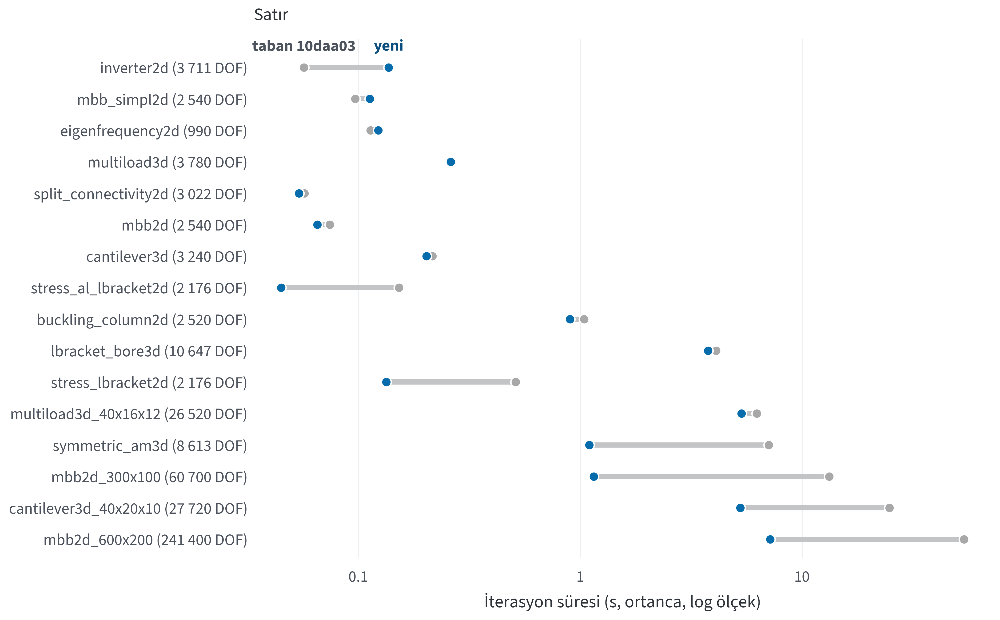

# Optimizasyon döngüsünün hızlandırılması — sonuç (26 Kasım 2026)

Ön kayıt: `docs/olcumler/hizlandirma_onkayit.md` (H1–H3 2026-11-26 03:00:20 +0300, H4 03:47:27 +0300; ikisi de ilgili
değişiklik ölçülmeden önce commit edildi: `5983238`, `94e689d`). Taban `10daa03`; dal `claude/perf-7c523d`.
Etiketler: **[Ö]** bu oturumda ölçüldü (kaynak dosya verilir), **[O]** koddan okundu, **[P]** ön kayıt dışı (post hoc),
**NOT VERIFIED** ölçülmedi.

## 0. Özet

Varsayılan yolda iki değişiklik kaldı, ikisi de örnek çıktılarını **bit düzeyinde** değiştirmiyor (K0: yedi örnek,
fark 0): döngü içinde torch'un tek iş parçacığına alınması (H1) ve SuperLU girdisinin önceden hesaplanmış indeks
haritasıyla kurulması (H2). İsteğe bağlı üçüncüsü süpernodal Cholesky (`DirectSolver("cholesky")`, H3): 3-B'de
çarpanlara ayırmayı 2,3–3,1× hızlandırıyor, 2-B'de hızlandırmıyor; SuperLU ile farkı yuvarlama düzeyinde (≤ 2e-11).

| # | Kontrol | Eşik | Ölçülen | Sonuç |
|---|---|---|---|---|
| H1a | OC bisection (iterasyon başına), 300×100 / 40×20×10, yük altında | ≥ 10× | 10,6 s → 0,131 s (80×) / 17,1 s → 0,077 s (222×); CPU %100 | PASS |
| H1b | İterasyon süresi, aynı satırlar | ≥ 2× | 13,2 → 1,15 s (11,5×) / 24,8 → 5,27 s (4,7×) | PASS |
| H1c | İş parçacığı sayısı run sonrası geri geliyor (normal ve hata) | tam | test geçti | PASS |
| H1d | K0 | geçer | 8 passed, fark 0 | PASS |
| H1e | `torch_threads=None` sonuç bit düzeyinde aynı | tam | test geçti | PASS |
| H2a | SuperLU girdisi (CSC dizileri) eski yolla aynı, 12 örnek × 2 alan | bit düzeyinde | 24/24 aynı (tam sıfır atılan örüntüler dahil) | PASS |
| H2b | `factor` süresi ≥ %5 azalır, 300×100 / 40×20×10 | ≥ %5 | protokol (ayrı süreçler): −%42 / −%27; **izole ölçüm: −%12 / −%2,5** | protokolde PASS; izole ölçümde 3-B satırı eşiğin altında (§2) |
| H2c | K0 | geçer | 8 passed, fark 0 | PASS |
| H3a | Cholesky çarpanlama ≥ 2× SuperLU, 40×20×10 / 300×100 | ≥ 2× | 1,76× / 0,95× | **FAIL** (ön kayıtlı uygulama) |
| H3b | Çözüm farkı, 16×8×8 / 120×40, kontrast 1e-9 | uyum ≤ 1e-10, U ≤ 1e-7 | 1,9e-11 / 9,8e-13; U 1,9e-11 / 1,8e-12 | PASS |
| H3c | Kısmi hacim + keep/void (H8IM, Q4) | H3b | 1,1e-11 / 1,5e-11 | PASS |
| H3c | Eğik mesnet (`ConstrainedElasticity`) | H3b | `NotImplementedError` (blok bölümü yok) | **FAIL**, strict xfail |
| H3d | Uyum gradyanı | ≤ 1e-9 | 1,8e-13 | PASS |
| H3e | Süreç içi ve iki ayrı süreç: çözüm | bit düzeyinde | üçü aynı (`ea4b5397…`) | PASS |
| H3f | SPD olmayan / tekil matris | hata | `CholeskyPivotError` (ön kayıttaki adı `NotPositiveDefiniteError`; `core.linear_elastic`'teki aynı adlı sınıfla çakıştığı için yeniden adlandırıldı) | PASS |
| H3g | Saklanan çarpan girdisi < SuperLU L+U | kesin az | 1,13M < 1,74M; 1,06M < 1,21M | PASS |
| H3h | `Study` 10 iterasyon, amaç geçmişi | ≤ 1e-8 | 7,6e-12 (mbb2d), 5,2e-12 (cantilever3d) | PASS |
| H4a | `constraint_values` çağrısı ≥ %25 kısalır | ≥ %25 | −%8,8 / −%6,7 | **FAIL** → değişiklik geri alındı |
| H4b | Çıktı ve gradyan bit düzeyinde aynı | tam | aynı | PASS (geri alınan kodda) |

Kaynaklar: testler `tests/toporlogy/test_speedups.py` (çıktılar `hizlandirma_testler_ilk.txt`, P1 sonrası
`hizlandirma_testler_p1.txt`), K0 `hizlandirma_baseline_oncesi.txt` / `hizlandirma_baseline_sonrasi.txt`, hız
`hizlandirma_sonrasi.json` (geçiş 1), `hizlandirma_sonrasi_2.json` (geçiş 2), `hizlandirma_h2.json`,
`hizlandirma_h4.json`, `hizlandirma_p1.json`, `hizlandirma_iplik_ab.json`.

H3a ve H4a başarısız. H3a ön kayıtlı uygulamayla ölçüldü; ardından yapılan iyileştirme (P1, §3) ön kayıt dışıdır ve
H3a'nın sonucunu değiştirmez. H2b'nin protokol sonucu geçti, ama aynı süreçte izole edilen ölçüm 3-B satırda etkinin
%5'in altında kaldığını gösteriyor; geçişi yük gürültüsü sağladı.

## 1. Ortam ve yöntem [Ö]

Windows 11, Intel 6 çekirdek / 12 iş parçacığı, 15,9 GiB RAM; Python 3.12.1, NumPy 2.2.6, SciPy 1.14.1, torch
2.5.1+cu121 (MKL, 6 iş parçacığı varsayılan); SuperLU (PARDISO kurulu değil: `pypardiso` yok, NOT VERIFIED).
**Makine boşta değildi:** ölçüm boyunca dört başka oturum çalışıyordu; CPU ortancası satırların çoğunda %100, boş
RAM 0,6–1,6 GiB. Bu yüzden:

* Taban (`git archive 10daa03 src`) ve yeni kod **her satırda art arda, ayrı süreçlerde** koştu
  (`hizlandirma_olcum.py`). Geçiş 1 önce tabanı (kod `6805a10`), geçiş 2 önce yeniyi (kod `4b0b513`; varsayılan yol
  `6805a10` ile aynı) koşturdu. İki geçişin farkı yük oynamasının büyüklüğünü gösteriyor.
* Satır başına 2 ısınma iterasyonu, sonra 3 × 5 (büyüklerde 2 × 3) iterasyon; iterasyon başına ortanca
  (`hizlandirma_profil.py`). Her satırda torch iş parçacığı ve CPU yükü kaydı var (kısa satırlarda yük örneği 0–3
  adet, güvenilmez).
* İki etkiyi ayırmak için iki ek ölçüm aynı süreç içinde yapıldı [P]: H1 için 1 ve 6 iş parçacığı dönüşümlü
  (`hizlandirma_iplik_ab.py`), H2 için eski ve yeni girdi kurulumu dönüşümlü (`hizlandirma_h2.py`).

Boşta makinede ölçüm yapılamadı: **NOT VERIFIED.**

## 2. Önce / sonra [Ö]



**Şekil 1.** Büyük OC problemlerinde iterasyon süresi bir mertebe kısalıyor, küçük örneklerde fark yük
gürültüsünün içinde. Gri: taban `10daa03`, mavi: yeni kod (varsayılan çözücü SuperLU). Satır başına iki geçişin
ortancası (büyük satırlarda tek geçiş); log ölçek; satırlar farka göre sıralı. Makine tam yük altında (CPU %75–100);
küçük satırlarda iki geçişin oranları 0,3× ile 5,7× arasında değişiyor (tablo). Denetim:
`hizlandirma_iterasyon.denetim.txt` (0 HATA, 0 UYARI), renk körlüğü önizlemesi `hizlandirma_iterasyon.cvd.png`.

| Satır | Serbest DOF | Taban (s/it) | Yeni (s/it) | Oran | Taban: çarpanlama / OC değerl. (s) | Yeni: çarpanlama / OC değerl. (s) |
|---|---:|---:|---:|---:|---:|---:|
| mbb2d 300×100 (OC) | 60 700 | 13,2 | 1,15 | 11,5× | 1,46 / 10,6 | 0,851 / 0,131 |
| mbb2d 600×200 (OC) | 241 400 | 53,7 | 7,19 | 7,5× | 4,79 / 45,5 | 5,62 / 0,678 |
| cantilever3d 40×20×10 (OC) | 27 720 | 24,8 | 5,27 | 4,7× | 6,85 / 17,1 | 5,00 / 0,077 |
| multiload3d 40×16×12 (MMA) | 26 520 | 6,24 | 5,34 | 1,17× | 4,97 / — | 4,92 / — |
| symmetric_am3d (OC + AM filtresi), geçiş 1 / 2 | 8 613 | 13,3 / 0,912 | 1,21 / 0,99 | 11,0× / 0,92× | 0,95 / 12,2 ; 0,65 / 0,20 | 0,89 / 0,24 ; 0,72 / 0,20 |
| stress_lbracket2d (GCMMA), geçiş 1 / 2 | 2 176 | 0,878 / 0,147 | 0,155 / 0,112 | 5,7× / 1,3× | | |
| stress_al_lbracket2d (MMA), geçiş 1 / 2 | 2 176 | 0,249 / 0,057 | 0,049 / 0,041 | 5,1× / 1,4× | | |
| lbracket_bore3d (MMA, sağlam), geçiş 1 / 2 | 10 647 | 4,51 / 3,69 | 3,71 / 3,82 | 1,22× / 0,96× | 3,28 / 3,23 | 3,29 / 3,44 |
| mbb2d, geçiş 1 / 2 | 2 540 | 0,071 / 0,078 | 0,061 / 0,070 | 1,16× / 1,12× | 0,023 / 0,022 | 0,018 / 0,019 |
| cantilever3d, geçiş 1 / 2 | 3 240 | 0,214 / 0,217 | 0,212 / 0,195 | 1,01× / 1,11× | 0,146 / 0,145 | 0,141 / 0,122 |
| multiload3d, geçiş 1 / 2 | 3 780 | 0,257 / 0,271 | 0,231 / 0,291 | 1,11× / 0,93× | | |
| split_connectivity2d, geçiş 1 / 2 | 3 022 | 0,064 / 0,051 | 0,054 / 0,054 | 1,18× / 0,94× | | |
| eigenfrequency2d (modal), geçiş 1 / 2 | 990 | 0,092 / 0,135 | 0,119 / 0,127 | 0,77× / 1,06× | | |
| buckling_column2d, geçiş 1 / 2 | 2 520 | 1,69 / 0,393 | 0,749 / 1,05 | 2,25× / 0,37× | | |
| inverter2d, geçiş 1 / 2 | 3 711 | 0,067 / 0,046 | 0,105 / 0,169 | 0,64× / 0,28× | 0,035 / 0,026 | 0,053 / 0,095 |
| mbb_simpl2d (SiMPL), geçiş 1 / 2 | 2 540 | 0,120 / 0,073 | 0,165 / 0,061 | 0,73× / 1,21× | | |

Tam tablo (bütün bileşenler, iki geçiş): `python docs/olcumler/hizlandirma_rapor.py docs/olcumler/hizlandirma_sonrasi.json docs/olcumler/hizlandirma_sonrasi_2.json`.

Bileşenler, iterasyon başına ms (geçiş 1, ortanca):

| Satır | Kod | çarpanlama | OC değerl. | montaj | çözüm | kalıntı | duyarlılık | filtre | optimizer | diğer | iterasyon |
|---|---|---:|---:|---:|---:|---:|---:|---:|---:|---:|---:|
| mbb2d 300×100 | taban | 1463 | 10552 | 42 | 71 | 20 | 20 | 2,2 | 18 | 970 | 13249 |
| mbb2d 300×100 | yeni | 851 | 131 | 31 | 48 | 16 | 19 | 2,0 | 12 | 13 | 1151 |
| cantilever3d 40×20×10 | taban | 6854 | 17130 | 79 | 78 | 29 | 22 | 1,5 | 7,1 | 716 | 24762 |
| cantilever3d 40×20×10 | yeni | 5000 | 77 | 65 | 55 | 25 | 21 | 1,2 | 4,5 | 7,4 | 5268 |
| multiload3d 40×16×12 | taban | 4966 | — | 63 | 111 | 39 | 158 | 1,2 | 8,8 | 880 | 6244 |
| multiload3d 40×16×12 | yeni | 4923 | — | 64 | 126 | 43 | 168 | 1,3 | 10 | 13 | 5338 |
| mbb2d 600×200 | taban | 4787 | 45548 | 127 | 191 | 89 | 77 | 6,8 | 42 | 2887 | 53724 |
| mbb2d 600×200 | yeni | 5619 | 678 | 197 | 235 | 287 | 85 | 10 | 55 | 64 | 7189 |

Okuma:

1. Kazancın neredeyse tamamı H1'den: OC bisection'ındaki kısıt değerlendirmeleri ve "diğer" (autograd grafiği,
   yanıtlar, torch işlemleri) taban kodda yüklü makinede çok iş parçacıklı torch işlemlerinde bekliyor.
2. H1'den sonra büyük satırlarda iterasyonun %74 (300×100) – %95'i (40×20×10) çarpanlara ayırma: sıradaki kaldıraç
   çözücü.
3. Küçük örneklerde (< 32 768 öğeli tensör, torch paralelleşmiyor) iki geçişin oranları birbirini tutmuyor (ör.
   inverter2d'de değişmeyen SuperLU çarpanlaması 26 ms ile 95 ms arasında). Bu satırlarda ayrı süreç karşılaştırması
   yük gürültüsünü ölçüyor; H1'in etkisi §4'teki süreç içi ölçümde.

## 3. H3 ve P1: süpernodal Cholesky (isteğe bağlı) [Ö]

`src/toporlogy/solvers/supernodal.py`. İç içe bölmenin parçaları (yaprak kutu, ayırıcı düzlem) yoğun blok; blok
yapısı bir kez (örüntü ve sıra değişmedikçe yeniden kullanılır), sayısal çarpanlama her iterasyonda: F11 = chol,
L21 = F21 L11⁻ᵀ, U = F22 − L21 L21ᵀ ebeveyne (multifrontal). Yoğun işlemler torch/MKL (döngüde tek iş parçacığı).
Seçim: `DirectSolver("cholesky")`, YAML `physics: {type: elasticity, solver: {type: direct, method: cholesky}}`.
Varsayılan değişmedi.

| Satır | Geçiş (kod) | Serbest DOF | SuperLU çarpanlama (s) | Cholesky çarpanlama (s) | Oran | SuperLU / Cholesky çözüm (s) | İterasyon SuperLU → Cholesky (s) |
|---|---|---:|---:|---:|---:|---:|---:|
| cantilever3d 40×20×10 | 1 (H3) | 27 720 | 5,00 | 2,83 | 1,76× | 0,055 / 0,115 | 5,27 → 3,21 |
| cantilever3d 40×20×10 | 2 (P1) | 27 720 | 5,00 | 2,09 | 2,40× | 0,055 / 0,117 | 5,27 → 2,45 |
| multiload3d 40×16×12 | 2 (P1) | 26 520 | 4,92 | 2,05 | 2,40× | 0,126 / 0,160 | 5,34 → 2,56 |
| symmetric_am3d | 2 (P1) | 8 613 | 0,892 | 0,290 | 3,07× | 0,016 / 0,029 | 1,21 → 0,58 |
| cantilever3d | 1 / 2 | 3 240 | 0,141 | 0,051 | 2,75× | 0,004 / 0,010 | 0,212 → 0,12 |
| multiload3d | 2 (P1) | 3 780 | 0,182 | 0,081 | 2,26× | 0,007 / 0,015 | 0,231 → 0,151 |
| mbb2d 300×100 | 1 / 2 | 60 700 | 0,851 | 0,90 / 1,09 | 0,95× / 0,78× | 0,048 / 0,34 | 1,15 → 1,55 / 1,79 |
| mbb2d 600×200 | 1 / 2 | 241 400 | 5,62 | 4,34 / 4,80 | 1,30× / 1,17× | 0,23 / 1,2 | 7,19 → 6,7 / 7,0 |
| mbb2d | 1 / 2 | 2 540 | 0,018 | 0,033 / 0,030 | 0,54× / 0,59× | 0,002 / 0,014–0,020 | 0,061 → 0,085–0,112 |

SuperLU sütunu geçiş 1'in yeni-kod satırları; Cholesky satırları farklı yükte koştu. Aynı süreçte, aynı matriste
(P1 sonrası, `hizlandirma_p1.json`): 40×20×10 SuperLU 5,09 s, Cholesky 1,68 s (**3,0×**); 300×100 SuperLU 0,88 s,
Cholesky 1,19 s (0,74×).

**P1 [P]**, H3a ölçüldükten sonra: profil (40×20×10) çarpanlamanın yarısının NumPy `F[np.ix_(p, p)] += U`
toplamasında olduğunu gösterdi (1,14 s; yoğun çekirdekler 1,18 s). Bu toplama `torch.index_put_(..., accumulate=True)`
ile yapıldı: her konuma tek toplama, sonuç bit düzeyinde aynı (H3e özeti P1 öncesi ve sonrası aynı: `ea4b5397…`).
Ayrıca blok birleştirme (amalgamation) denendi: 2-B 300×100'de 256 / 1024 bilinmeyenle çarpanlama 1,19 → 0,79 /
0,66 s, ama 120×40'ta saklanan girdi SuperLU'yu aşıyor (H3g FAIL) ve 3-B'de yardımı yok; parametre olarak kaldı,
varsayılan kapalı (`AMALGAMATE = 0`).

Okuma: 3-B'de ön kayıtlı eşiği (2×) P1 ile aşıyor, 2-B'de SuperLU daha hızlı ya da eşit. Cholesky'nin çözümü
blok başına Python yükü yüzünden SuperLU'dan 2–7× yavaş (3-B'de çarpanlamanın yanında küçük, 2-B'de değil).
`ConstrainedElasticity` (eğik mesnet, yay) Cholesky ile çalışmıyor (blok bölümü vermiyor, açık hata); PARDISO ile
karşılaştırma yok (kurulu değil).

## 4. H1 ayrıntı: yük bağımlılığı ve geçiş bedeli [Ö][P]

Süreç içi, aynı çalışma üzerinde 1 ve 6 iş parçacığı dönüşümlü, 4 tur × 3 iterasyon (`hizlandirma_iplik_ab.json`,
bitiş 05:13, CPU %74–100):

| Satır | 1 iş parçacığı (s/it) | 6 iş parçacığı (s/it) | 6 / 1 |
|---|---:|---:|---:|
| mbb2d | 0,0621 | 0,0577 | 0,93 |
| cantilever3d | 0,170 | 0,206 | 1,21 |
| eigenfrequency2d | 0,0829 | 0,0833 | 1,00 |
| inverter2d | 0,0578 | 0,0552 | 0,95 |
| buckling_column2d | 0,335 | 0,427 | 1,27 |
| stress_lbracket2d | 0,130 | 0,140 | 1,08 |
| multiload3d | 0,156 | 0,160 | 1,03 |
| mbb2d 300×100 (CPU %78) | 0,814 | 0,890 | 1,09 |

* Küçük örneklerde tek iş parçacığının bedeli ya da kazancı ±%7 içinde (iki satırda 1,2× kazanç).
* **300×100'de kazanç burada yalnız 1,09×**, aynı satır CPU %100'deki geçiş 1'de 11,5×. Etki makinenin dolu olup
  olmamasına çok bağlı: tam yükte her paralel bölge bütün iş parçacıklarının zaman dilimini bekliyor. Boşta makinede
  tek iş parçacığının (büyük ızgaralarda öğe öğe işlemlerde) bedeli ölçülmedi: **NOT VERIFIED**.
* Geçiş bedeli: `torch.set_num_threads` yük altında pahalı (6'ya dönüş 0,16–0,27 s, ardından ilk paralel işlem
  0,3–0,7 s; 1'e geçiş ilk seferden sonra ≤ 2 ms). H1 bu bedeli her `Study.run`'da bir kez öder. Uzun koşularda
  önemsiz, çok sayıda kısa koşuda (test paketi) birikir. Önerilen: süreç başında bir kez tek iş parçacığı (§7).
* Yan kazanç: tek iş parçacığında torch indirgemelerinin sırası çekirdek sayısından bağımsız (bit düzeyinde
  tekrarlanabilirlik makineler arası). Bunun ölçümü yapılmadı (başka makine yok).

## 5. H2 ayrıntı [Ö]

Aynı süreç, eski kurulum ↔ harita dönüşümlü, 5 tekrar ortancası (`hizlandirma_h2.json`):

| Izgara | DOF | Eski kurulum (ms) | Harita (ms) | Harita bir kez (ms) | SuperLU (s) | Kazanç / çarpanlama |
|---|---:|---:|---:|---:|---:|---:|
| 60×20 | 2 520 | 3,4 | 0,26 | 8 | 0,009 | %27 |
| 24×8×4 | 3 240 | 12,3 | 1,7 | 36 | 0,088 | %10 |
| 300×100 | 60 600 | 93 | 7,2 | 295 | 0,64 | %12 |
| 40×20×10 | 27 720 | 137 | 14 | 731 | 4,76 | %2,5 |
| 600×200 | 241 200 | 377 | 29 | 1 472 | 4,59 | %7 |

Diziler her satırda bit düzeyinde aynı. Harita koşu başına bir kez kuruluyor (0,3–1,5 s; büyük satırda 4 iterasyonda
geri kazanılıyor).

## 6. Uygulanmayan adaylar [Ö][O]

| Aday | Ölçüm (H1 sonrası, iterasyon başına) | Karar |
|---|---|---|
| H4: `Volume` önbelleği, `Passive` `masked_fill` | çağrı başına −%7–9 (eşik %25), `hizlandirma_h4.json` | geri alındı (`5302c67` ölçüm, `f2e447b` geri alma) |
| Montaj (bincount) | 40×20×10: 65 ms / 5,27 s (%1,2); 300×100: 31 ms / 1,15 s (%2,7) | uygulanmadı |
| Kalıntı + geri hata denetimi | 25 ms / 5,27 s; 16 ms / 1,15 s (%0,5–1,4) | uygulanmadı |
| Yoğunluk filtresi (seyrek matris önbellekli [O]: `DensityFilter._H`) | 1–10 ms (≤ %0,2) | gerek yok |
| Duyarlılık λᵀKEu (`einsum`) | multiload3d 40×16×12: 168 ms / 5,34 s (%3); küçük örneklerde iki yük durumlu multiload3d (960 eleman) 20 ms, tek durumlu cantilever3d (768 eleman) 2 ms | uygulanmadı: değişiklik einsum'un toplama sırasını, dolayısıyla bitleri değiştirebilir; kazanç %3 |
| Optimizer adımı (MMA dual L-BFGS-B, OC güncellemesi; değerlendirmeler hariç) | 4–55 ms (≤ %1) | gerek yok |
| Aynı K ile çok yük durumu | zaten tek çarpanlama, bütün durumlar tek çözümde [O] (`Elasticity._solve_free(F2)`) | — |
| Kendine eşlenik kısayol | zaten var, yalnız ∂J/∂U = aF tam eşitliğinde (bağıl 1e-12 denetimi) [O] | — |
| Gereksiz durum çözümü | iterasyon başına bir çarpanlama doğrulandı (cProfile: 5 + 1 değerlendirmede 6 `factor`) [Ö] | — |
| OpenBLAS iş parçacıkları (NumPy/SciPy) | yük altında 1000² gemm 0,63 s (5 GF/s; torch/MKL 4 iş parçacığında 30 GF/s); döngüde yoğun NumPy BLAS yok | denetlenmiyor (threadpoolctl kurulu değil); not |
| Modal / burkulma | eigenfrequency2d: ARPACK (`eigsh`) iterasyonun ~%57'si (cProfile, iş parçacığı geçişi çıkarılınca); burkulma `fem/buckling.py` (bu oturumun dosyası değil) | ölçüldü, değiştirilmedi |

## 7. Başka dosyalarda gereken değişiklikler (sahiplerine)

* `execution/runner.py` / CLI: süreç başında bir kez `torch.set_num_threads(1)` (ya da `run.torch_threads`
  ayarı, `configuration/schema.py`). `Study` her koşuda 1'e alıp geri yüklüyor; süreç başında ayarlanırsa geçiş bedeli
  (yük altında ~0,2–0,7 s/koşu) kalkar.
* `boundary/constrained.py`: `ConstrainedElasticity.elimination_blocks()` (kendi sırasına karşılık gelen parça
  boyları: üst sınıfın blokları, `keep` ile süzülmüş). Olmadan Cholesky açık hata veriyor (H3c strict xfail).
* `configuration/catalog.py`: çözücü kataloğuna `direct/cholesky` satırı (SPD, CPU, 3-B'de önerilir, 2-B'de değil).

## 8. Yeniden üretim

```
git archive 10daa03 src | tar -x -C <taban>
python docs/olcumler/hizlandirma_olcum.py <taban> docs/olcumler/hizlandirma_sonrasi.json --rows small large cholesky
python docs/olcumler/hizlandirma_olcum.py <taban> docs/olcumler/hizlandirma_sonrasi_2.json --rows cholesky small --new-first
PYTHONPATH=src python docs/olcumler/hizlandirma_iplik_ab.py docs/olcumler/hizlandirma_iplik_ab.json
PYTHONPATH=src python docs/olcumler/hizlandirma_h2.py docs/olcumler/hizlandirma_h2.json 60x20 24x8x4 300x100 40x20x10 600x200
PYTHONPATH=src python docs/olcumler/hizlandirma_p1.py docs/olcumler/hizlandirma_p1.json 300x100 40x20x10
python docs/olcumler/hizlandirma_rapor.py docs/olcumler/hizlandirma_sonrasi.json docs/olcumler/hizlandirma_sonrasi_2.json --figure docs/olcumler/hizlandirma_iterasyon
python -m pytest tests/toporlogy/test_speedups.py -s
python -m pytest tests/toporlogy/test_baseline.py -m baseline
```

`hizlandirma_h4.py` H4 kodunu (`5302c67`) ister. Keşif profili: `hizlandirma_oncesi.json` (taban, ön kayıttan önce).
