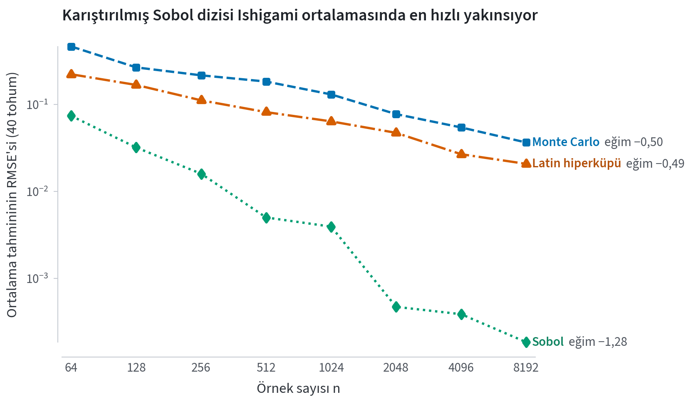
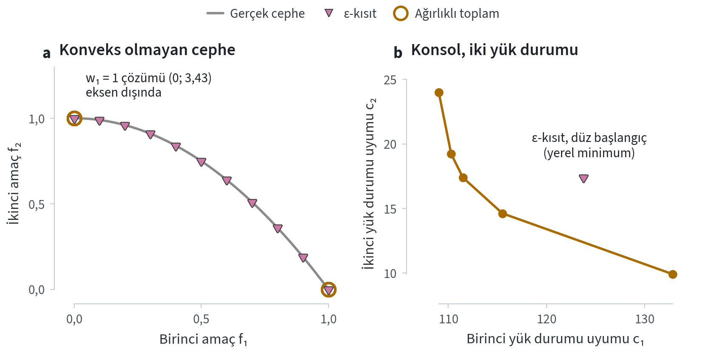
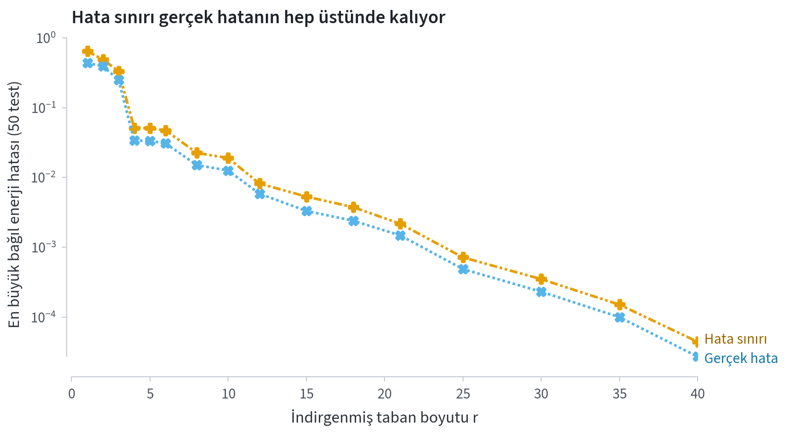

# Laminat (CLT), belirsizlik ve gürbüz tasarım, Pareto, ters problem, POD ROM: sonuçlar

Ön kayıt: [`laminat_uq_onkayit.md`](laminat_uq_onkayit.md) (26 Kasım 2026 02:38 +0300, `0824526`, ilk koşudan önce).
Görev: araştırma komutu 07 §2–§4. §1 (RVE homojenleştirme) yapılmadı. Taban `10daa03`.
Ham kayıt: [`laminat_uq.json`](laminat_uq.json), ölçülen kod `0d0d50c` (`src` ve `tests` temiz). Sonraki `835e880`
yalnız Hashin yük çarpanının bir köşe durumunu düzeltir; kayıttaki sayılar o durumu içermez.

Yeniden üretim (depo kökünden, yaklaşık beş dakika; figürler `datawiz` ister):

```powershell
python docs/olcumler/laminat_uq.py
python docs/olcumler/laminat_uq_figur.py
```

Ortam: Windows 11, Python 3.12.1, NumPy 2.2.6, SciPy 1.14.1, torch 2.5.1+cu121 (hesaplar CPU'da, 6 iş parçacığı).
Makine paralel oturumlarla paylaşılıyordu: süreler yalnız mertebe gösterir.

**Bütün malzeme, dayanım, dağılım ve "ölçüm" sayıları sentetiktir.** Hiçbir sonuç gerçek bir malzeme ya da parça için
izin verilen değer değildir.

## Özet

1. Altı yeni modül; ön kayıtlı kontrollerin dördü tutmadı (U10c, P4c, R5 özdeşliği, R6 düzeyi). Dördü de
   `xfail(strict=True)`, eşik değiştirilmedi.
2. Gürbüz tasarım ön kayıtlı konsolda nominalden iyi **değil** (102,23'e karşı 101,80). Sonradan seçilen kolon
   probleminde (post hoc) ayrılmış senaryolarda ortalama + 3σ 172,7'den 37,4'e indi.
3. Yapısal ε-kısıt, düz başlangıçtan başka bir yerel minimuma düşüyor (c1 +%11).

## Kontrol durumu

| Kontrol | Konu | Durum (ölçülen) |
|:---|:---|:---|
| L1–L3 | Q, Q̄ (klasik formül ve 3-B yol), tek kat | PASS (Q̄: 6,4e-16 ve 1,7e-15) |
| L4–L6 | ABD sayısal integral; simetrik, dengeli, [0/90], yarı izotrop | PASS (L4: 1,0e-15) |
| L7, L8 | serbest genleşme, öz dengeli artık gerilme, denge | PASS |
| L9a, L9b | açı ve kalınlık türevi, Taylor mertebesi | PASS |
| L10a–d, L11 | Tsai–Wu, Hashin, yük çarpanı, eksen dışı; hatalı girdi | PASS |
| U1, U2 | ortalama, varyans, kantil, CVaR analitik | PASS (aşağıda) |
| U3 | %95 güven aralığı kapsaması | PASS (0,948) |
| U4, U5 | yakınsama eğimleri; Ishigami Sobol indisleri | PASS (aşağıda) |
| U6–U9 | kesik dağılım, kopula, başarısız örnek, nadir olay | PASS |
| U10a, U10b | analitik ortalama uyum; gürbüz türev | PASS (5,4e-6; ≤ 3,5e-7) |
| **U10c** | gürbüz tasarım nominalden iyi | **FAIL** (strict xfail) |
| P1–P3, P5 | baskınlık, konveks olmayan ve konveks cephe, hatalı girdi | PASS |
| P4a, P4b | yapısal cephe: uygun, baskın olmayan, monoton | PASS |
| **P4c** | ε-kısıt ağırlıklı noktaya ulaşır | **FAIL** (strict xfail) |
| I1–I7 | Jacobian, geri kazanım, tanılanabilirlik, çoklu başlangıç, uyumsuzluk | PASS |
| R1–R4 | izdüşüm özdeşliği, tam rank, hata sınırı, test hatası | PASS |
| R5 | uyum alt sınır | PASS |
| **R5** | s − s_r = e² (≤ 1e-6 göreli) | **FAIL** (strict xfail) |
| **R6** | eğitim dışı yükte hata ≥ 0,5 | **FAIL** (strict xfail); sınırın uyarması ve sınır denetimleri PASS |
| R7 | süre | yalnız ölçüm |
| — | RVE, ilerleyen hasar, plaka/kabuk bağlantısı, enine kayma, ayrık dizilim, FORM/SORM, hiper indirgeme, ölçülmüş veri, CUDA | NOT VERIFIED |

## 1. Laminat

`core.laminate`: kat malzemesi `ElasticTensor`, Q = `core.material.plane_stress`, Q̄ = düzlem içi
`core.tensor.rotate4`; Voigt dönüşüm matrisi yazılmadı. ABD ve ½rᵀABD⁻¹r Torch girdisiyle türevlenebilir.
`optimization.laminate_failure`: Tsai–Wu mevcut `Criterion`'ın F_i, F_ij'si; Hashin Abaqus 2025 belge sayfasından
(26 Kasım 2026'da okundu, α = 1 → Hashin 1980; Hashin'in makalesi okunmadı).

API örneği, [0/45/−45/90]s (sentetik), N = (100; 20; 0), ΔT = −100:

| Ölçüt | En büyük indeks | İlk kat yük çarpanı | Termal gerilmesiz çarpan | Kritik kat |
|:---|---:|---:|---:|:---|
| Tsai–Wu | 0,907 | 1,267 | 2,878 | 90° |
| Hashin | 0,884 | 1,344 | 2,970 | 90°, matris çekme |

Soğuma artık gerilmesi ilk kat yükünü yarıdan aza indiriyor; 1/indeks yük çarpanı **değildir**. İlk kat hasarı laminatın
kopma yükü değildir.

## 2. Belirsizlik ve gürbüz tasarım

Y = 2 + 3X, X ~ N(0, 1), n = 2¹⁴:

| Nicelik | Kesin | MC | LHS | Sobol |
|:---|---:|---:|---:|---:|
| ortalama | 2,000 | 1,982 | 2,000 | 2,000 |
| varyans | 9,000 | 8,996 | 9,000 | 8,999 |
| kantil 0,95 | 6,935 | 6,934 | 6,935 | 6,934 |
| CVaR 0,95 | 8,188 | 8,107 | 8,188 | 8,188 |



**Şekil 1.** Ishigami fonksiyonunda ortalama tahmininin 40 tohum üzerinden RMSE'si. LHS bu toplanabilir olmayan
fonksiyonda MC ile aynı mertebede (−0,49), yalnız sabiti küçük.

Sobol indisleri (n = 2¹³ taban, 40960 değerlendirme): S1 = (0,314; 0,442; 0,000), ST = (0,559; 0,442; 0,244).
Nadir olay: kesin 1e-3, 1000 örnekle tahmin 2e-3, %95 aralık [2,4e-4; 7,2e-3], `reliable = False`.

**Gürbüz tasarım.** Yük açısı θ ~ U(−30°, 30°); 16 ortak senaryo ile ortalama + 3σ; 512 ayrı tohumlu senaryoda ölçüm.

| Tasarım | Ortalama | σ | Ortalama + 3σ | CVaR 0,95 | Nominal yük |
|:---|---:|---:|---:|---:|---:|
| konsol, nominal (ön kayıtlı) | 85,01 | 5,60 | 101,80 | 91,40 | 91,41 |
| konsol, gürbüz (ön kayıtlı) | 86,14 | 5,36 | **102,23** | **92,26** | 92,28 |
| kolon, nominal (post hoc) | 52,80 | 39,95 | 172,65 | 133,19 | 7,10 |
| kolon, gürbüz (post hoc) | 18,96 | 6,14 | 37,38 | 31,32 | 11,93 |

U10c neden tutmadı (post hoc yoklama, kayıtlı betikte yok): gürbüz koşu 147. iterasyonda eğitim amacı 102,63 olan bir
noktada duruyor; nominal tasarımın aynı amacı 102,27. Nominalden sıcak başlatılan gürbüz koşu yalnız %0,02–0,4 kazanıyor:
bu konsolda yatay bileşen zaten eksenel taşınıyor ve kazanılacak pay çok küçük. Kolonda nominal tasarım yanal yüke
karşı kırılgan; gürbüzlüğün bedeli nominal yükte uyumun 7,1'den 11,9'a çıkması.

## 3. Çok amaçlı



**Şekil 2.** (a) 21 ağırlığın hiçbiri iç nokta vermiyor; ε-kısıt cepheyi veriyor. w₁ = 1'de ikinci amaç serbest
kaldığı için (0; 3,43) gibi yalnız zayıf etkin bir nokta çıkıyor. (b) w₁ = 0,1…0,9 ile yapısal cephe.

| w₁ | 0,1 | 0,3 | 0,5 | 0,7 | 0,9 |
|:---|---:|---:|---:|---:|---:|
| c₁ | 132,84 | 115,52 | 111,50 | 110,30 | 109,04 |
| c₂ | 9,92 | 14,62 | 17,39 | 19,22 | 23,99 |

ε-kısıt (c₂ ≤ 17,39) düz başlangıçtan c₁ = 123,77 veriyor (300 iterasyon ve move 0,05 aynı minimum: post hoc yoklama).
w₁ = 0,5 tasarımından başlatılınca 111,50'de kalıyor (post hoc test). `MMASubproblemWarning` bir yoklama koşusunda
8. adımda görüldü.

## 4. Ters problem (sentetik kupon verisi)

Bilinmeyenler E1, E2, G12, ν12; eğitim: [0]8, [90]8, [±45]2s çekme; ayrılmış: yarı izotrop ve [±30]s, daha yüksek yük.

| Durum | Sonuç |
|:---|:---|
| Analitik Jacobian / merkezi fark | 9,4e-10 |
| Gürültüsüz geri kazanım | en büyük göreli hata 1,7e-15 |
| %1 gürültü: (tahmin − gerçek)/σ_sonsal | 0,35; −1,42; −0,64; −0,34 |
| %1 gürültü: ayrılmış ağırlıklı RMS | 1,50 (üst sınır 1,6'ya yakın) |
| 16 başlangıç | 16'sı aynı minimum |
| Yalnız [0] kuponu | rank 2; E2 ve G12 görünmüyor |
| Veri doğrusal olmayan kaymalı, model doğrusal | eğitim RMS 0,49, ayrılmış RMS **11,3** |

Son satır önemli: eğitim uyumu iyi olduğu halde model yanlış; yalnız ayrılmış veri bunu gösteriyor.

## 5. POD indirgenmiş model

Konsol 40 × 20 (1680 serbest DOF), dört bölge modülü θ_q ∈ [0,5; 2], 40 eğitim, 50 test.



**Şekil 3.** Min-θ sınırı her r için gerçek hatanın üstünde; etkinlik 1,01–1,76.

| r | 4 | 8 | 15 | 25 | 40 |
|:---|---:|---:|---:|---:|---:|
| en büyük bağıl enerji hatası | 3,4e-2 | 1,5e-2 | 3,3e-3 | 4,9e-4 | 2,7e-5 |
| en büyük bağıl sınır | 5,1e-2 | 2,2e-2 | 5,3e-3 | 7,2e-4 | 4,4e-5 |

* R5: |(s − s_r) − e²|/e² en çok 2,3e-5 (eşik 1e-6); aynı fark uyumun 1,3e-12'si. Tolerans yanlış büyüklüğe göre
  yazılmış; eşik değiştirilmedi.
* R6: düşey yükle kurulan taban yatay yükte 0,293 bağıl hata veriyor (beklenen ≥ 0,5); sınır 0,308 ile uyarıyor.
* Süre (ortanca, r = 15): tam çözüm 18,5 ms; yalnız indirgenmiş sistem 0,13 ms; sınırla birlikte 1,8 ms. Sınır tam
  boyutlu kalıntı ve geri yerine koyma istiyor; ağdan bağımsız değil.
* ROM sonucu FEM çözümü değildir; her sonuç `approximate = True`, hata sınırı ve dışdeğer işareti taşır.

## 6. Uygulama sırasında bulunan

`load_factor_to_failure` ilk yazımda, α > 0 iken σ11 işaret değiştirdiği anda zaten aşılmış olan lif çekme modunu
atlıyordu (mod o noktada süreksiz). `835e880` düzeltti, testi eklendi; ön kayıtlı kontrollerin hiçbiri bu durumu
içermiyordu.

## 7. Kaynaklar

| Kaynak | Ne için | Okunma |
|:---|:---|:---|
| Abaqus 2025, "Damage initiation for fiber-reinforced composites" (docs.software.vt.edu aynası) | Hashin dört mod | okundu (26 Kasım 2026, alt ajanla sayfa özeti) |
| Hashin (1980); Tsai & Wu (1971) | ölçütlerin kökeni | okunmadı |
| Saltelli ve ark. (2010), Jansen (1999) tahmincileri; Rockafellar–Uryasev CVaR; min-θ sınırı | formüller | okunmadı, standart biçimden yazıldı; analitik karşılaştırma ve testle doğrulandı |
| CLT formülleri | Q̄, ABD | ders kitabı biçimi, kaynak okunmadı; iki bağımsız yolla doğrulandı |
