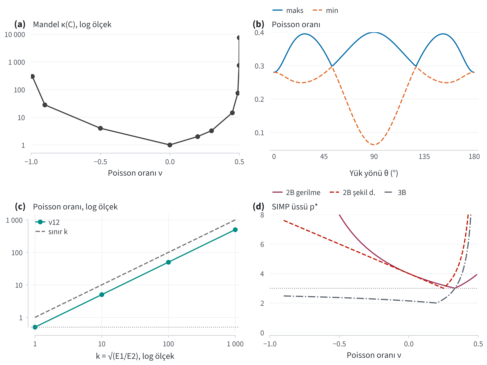

# Tensör çekirdeği, lineer elastik aile ve Poisson analizi — doğrulama kaydı

Görev: araştırma komutu `01_TENSOR_ELASTICITY.md` (00_MASTER kurallarıyla). Dal `claude/tensor-core-f4b40b`, taban
`main` = `1d1f027`. Etiketler `malzeme_modelleri.md` ile aynı: **[Ö]** ölçüldü, **[O]** koddan okundu, **[H]**
hafızadan, doğrulanmadı.

## 0. Ön kayıt (2026-11-26 00:29 +0300, `date` çıktısı; yeni kodun ilk satırından ve ilk test koşusundan önce)

Tutmayan ön kayıtlı bir kontrol gevşetilmez: test `xfail(strict=True)` olarak kalır, ölçülen değer ve neden
docstring'e ve bu kayda yazılır. Ön kayıttan sonra eklenen her kontrol "post hoc" diye etiketlenir.

### 0.1 Tasarım kararları (toleransları etkilediği için burada)

- Tek çekirdek: `core/tensor.py` (2./4. mertebe cebir, Voigt/Mandel, rotasyon, invariantlar, kinematik, gerilme
  ölçüleri), `core/linear_elastic.py` (izotropik → genel anizotropik aile, SPD / strong ellipticity, düzlem
  indirgemeleri), `core/anisotropy.py` (yönlü modüller, Poisson ekstremumları, tarama, duyarlılık). Mevcut
  kopyalar (`core/material.py::_tensor`, `rotate_stiffness`, `fem/elements.py::D_*`, `optimization/strength.py`
  içindeki Voigt→tensör ve invariantlar, `fem/nonlinear.py::_green/_voigt/_det_minus_one`,
  `design/interp.py::_bulk_shear`, `post/verify.py::von_mises`) bu çekirdeğe bağlanır.
- Eski yolun aritmetiği korunur: `D_iso`, `D_plane_stress`, `D_plane_strain`, von Mises ve Tresca aynı ifade
  sırasıyla yazılır. Bu yüzden R1'de bu girdiler **bit düzeyinde** aynı olmalı.
- Çekirdek işlevleri hem NumPy hem Torch dizisi alır (aynı kod, ad alanı girdiden seçilir); ikinci bir backend
  yazılmaz. Torch modülü yalnız Torch girdisi geldiğinde içe aktarılır.
- Voigt sırası `[xx, yy, zz, yz, xz, xy]`; gerilme fiziksel kayma bileşeniyle, şekil değiştirme mühendislik kaymasıyla
  (γ = 2ε). Rijitlik Voigt matrisi C_ab = C_ijkl (çarpansız); esneklik S_ab = w_a w_b S_ijkl (w = 1, 1, 1, 2, 2, 2).
  Mandel: m = (1, 1, 1, √2, √2, √2), M_C = diag(m) C diag(m), M_S = diag(1/m) S diag(1/m) = M_C⁻¹. Özdeğer ve koşul
  sayısı yalnız Mandel gösteriminde fiziksel anlam taşır.
- Simetri politikası: giriş matrisi `max|A − Aᵀ| ≤ 1e-12 · max|A|` değilse **hata**; sessiz simetrize yok. Bu eşiğin
  altında kalan yuvarlama asimetrisi (ör. ters alma sonrası) belgelenmiş biçimde ortalanır.
- SPD politikası: simetri kontrolü + Mandel matrisinde Cholesky; ek olarak ölçekli en küçük özdeğer
  λ_min/λ_max raporlanır ve `≤ 64 · eps` ise "sayısal olarak tekil" diye reddedilir.
- Global ekstremum garantisi yoksa sonuç `sampled` / `refined` etiketi taşır.

### 0.2 Tolerans gerekçesi

Float64, birim mertebesinde iyi koşullu girdiler (rastgele örneklerde Mandel koşul sayısı κ ≤ 1e4 ile üretilir):
cebirsel özdeşlikler için göreli 1e-13 (≈ 450 eps; birkaç einsum toplamı), ters alma içerenlerde κ ile ölçekli
`1e-12 · κ` alt sınır 1e-12. Salt indeks kopyası / 2 ile çarpma-bölme gibi kesin işlemler: **tam eşitlik**.
Türevler: merkezi fark, adım h = 1e-6 · ölçek, hedef göreli 1e-6 (kesme hatası ~h², yuvarlama ~eps/h ≈ 1e-10);
sınıra yakın koşullarda `1e-6 · κ`. Taylor testi: birinci mertebe düzeltilmiş kalanın eğimi ≥ 1.9 (beklenen 2).

### 0.3 Kontroller

| # | Karşılaştırma | Referans / bağımsız taraf | Tolerans |
|:--|:---|:---|---:|
| T1 | Voigt gerilme ↔ tensör, Voigt şekil değiştirme ↔ tensör gidiş-dönüş, 2-B ve 3-B, 200 rastgele simetrik | kendisi | tam eşitlik |
| T1b | Mandel ↔ tensör gidiş-dönüş | kendisi | ≤ 1e-15 · max\|x\| |
| T1c | Simetrik olmayan tensör (P = F S) `stress_to_voigt`'a verilince hata; 1e-14 göreli asimetri kabul | politika | hata / kabul |
| T2 | Enerji eşdeğerliği σ:ε = σ_vᵀ ε_v = σ_Mᵀ ε_M, 200 durum | tensör çift daraltma | ≤ 1e-13 göreli |
| T3 | 120 rastgele SPD + 6 deterministik C (izotropik, kübik, TI, ortotropik, monoklinik, triklinik): Voigt C → tensör → Voigt | kendisi | tam eşitlik |
| T3b | Aynı örneklerde S_voigt = C_voigt⁻¹ iken tensör S:C = 𝕀ˢ; M_S = M_C⁻¹ | 𝕀ˢ, birim matris | ≤ 1e-12 · κ |
| T4 | Voigt'ten kurulan tensörün küçük ve büyük simetrisi | tanım | tam eşitlik |
| T4b | 1e-6 göreli asimetrik C reddedilir; 1e-14 göreli kabul edilir (negatif kontrol) | politika | hata / kabul |
| T5 | 100 rastgele R (QR): ortonormallik, det = +1; yansıma (det −1) ve 1e-8 bozulmuş R `check_rotation`'da hata | tanım | ≤ 1e-14 / hata |
| T5b | rotate4 ile R sonra Rᵀ gidiş-dönüş; döndürülmüş enerji ε':C':ε' = ε:C:ε; Mandel özdeğerleri değişmez | kendisi | ≤ 1e-12 göreli |
| T5c | İzotropik C her R altında değişmez | kendisi | ≤ 1e-13 · \|C\| |
| T5d | Dönme vektörü ↔ R (exp/log) gidiş-dönüş, açı ∈ (0, π − 1e-3) | kendisi | ≤ 1e-12 |
| T5e | 2-B: ortotropik C(θ) = C(θ + π); C(θ) ≠ C(θ + π/2) (kare simetrisi yokken, negatif kontrol) | periyodiklik | ≤ 1e-13 / > 1e-3 |
| T6 | 𝕀ˢ:A = sym A; P_vol, P_dev idempotent, P_vol:P_dev = 0; tr(dev A) = 0; izotropik C = 3K P_vol + 2G P_dev | tanım | ≤ 1e-13 göreli |
| T7 | I1, I2, I3 = özdeğerlerin simetrik fonksiyonları; J2 = ½ s:s, J3 = det s; Voigt von Mises² = 3 J2 | özdeğerler | ≤ 1e-12 göreli (ölçek \|A\|^k) |
| T7b | Lode açısı (cos 3θ = (3√3/2) J3 / J2^{3/2}, θ ∈ [0, π/3]): tek eksenli çekme 0, basma π/3, saf kayma π/6; hidrostatik (J2 = 0) NaN | kapalı form | 1e-6 rad / 1e-12 / NaN |
| T8 | Ayrık özdeğerlerde dλ_i/dA = n_i ⊗ n_i (boşluk ≥ 0.1 \|A\|), 50 örnek | merkezi fark | ≤ 1e-6 göreli |
| T8b | Tekrarlı özdeğerde türev NaN + `repeated` bayrağı | politika | davranış |
| T9 | Düzeltilmiş von Mises √(q + e²) − √q ∈ [0, e], 1000 durum | kesin eşitsizlik | e (1 + 1e-12) |
| K1 | 100 rastgele F (J > 0, \|H\| ~ 0.3): C = FᵀF, B = FFᵀ; polar R özgün ortogonal, U SPD, F = RU = VR | tanım | ≤ 1e-13 · \|F\| |
| K1b | Green–Lagrange(H) = ½(C − I); Euler–Almansi = F⁻ᵀ E F⁻¹; Hencky: exp(2 ln U) = C, ln V = R ln U Rᵀ | tanım | ≤ 1e-12 göreli |
| K1c | \|H\| = 1e-6: \|E − sym H\| ≤ ½\|H\|² (kesin sınır, Frobenius) | eşitsizlik | sınır |
| K1d | \|H\| = 1e-10: H biçimli Green–Lagrange ve J − 1, `fractions.Fraction` ile kesin değere karşı (10 örnek); F biçimli ½(FᵀF − I) hatası yalnız raporlanır | kesin aritmetik | ≤ 1e-14 göreli |
| K2 | det F < 0 → `InvertedDeformationError`; det F = 0 → `SingularDeformationError`; κ(F) > 1e8 → `near_singular` sınıfı | politika | davranış |
| S1 | SVK ψ(E): P = F S, ∂ψ/∂F'ye karşı | merkezi fark | ≤ 1e-6 göreli |
| S1b | İş eşleniği P:Ḟ = S:Ė = τ:d = J σ:d (d = sym(Ḟ F⁻¹)), 100 rastgele durum | kendisi | ≤ 1e-12 göreli |
| S1c | PK2 → Cauchy → PK2 ve PK2 → PK1 → PK2 gidiş-dönüş; σ simetrik | kendisi | ≤ 1e-12 göreli |
| L1 | İzotropik (E, ν), (E, G), (K, G), (λ, μ), (E, K), (M, G) çiftlerinden bütün modüllere ve geri; ν ∈ {−0.99, −0.5, −0.3, 0, 0.3, 0.49} | kapalı formlar | ≤ 1e-13 göreli |
| L1b | ν = 0.5, ν = −1, ν = 0.6, ν = −1.2, E ≤ 0, G ≤ 0 reddedilir; ν = −0.3 (λ < 0) kabul edilir | politika | hata / kabul |
| L1c | `isotropic_stiffness(E, ν)` = 2μ 𝕀ˢ + λ I⊗I (Lamé tensör biçimi) | bağımsız ifade | ≤ 1e-14 göreli |
| L2 | Ortotropik: mühendislik sabitleri → S → sabitler gidiş-dönüş; ν21 = ν12 E2/E1 (reciprocity) | kendisi | ≤ 1e-13 göreli |
| L2b | E1/E2 = 10, ν12 = 2 SPD kabul; ν12² > E1/E2 (iki eksenli Schur koşulu ihlali) reddedilir; ν_ij < −1 olan SPD örnek kabul edilir | SPD analitik | kabul / hata |
| L3 | Transvers izotropik (5 sabit): eksen etrafında rastgele açılarla C değişmez; C66 = (C11 − C12)/2; dik eksen etrafında döndürme değiştirir (negatif kontrol) | tanım | ≤ 1e-13 · \|C\| / > 1e-3 |
| L4 | Genel anizotropik (21): C ya da S'den kurulum aynı kanonik C; belirsiz (bir negatif Mandel özdeğeri) ve simetrik olmayan C reddedilir, simetrize edilmez | politika | ≤ 1e-12 · κ / hata |
| L5 | Simetri sınıfı (verilen çerçevede): izotropik, kübik, TI, ortotropik, triklinik örnekleri doğru adlandırılır; döndürülmüş izotropik yine izotropik | tanım | doğru sınıf |
| L6 | Akustik tensör Q(n): izotropikte özdeğerler μ, μ, λ + 2μ, örneklenen bütün n'lerde | kapalı form | ≤ 1e-13 göreli |
| L6b | 120 rastgele SPD'de örneklenmiş min özdeğer > 0 (PD ⇒ SE) | teori | > 0 |
| L6c | μ = 1, λ = −1.5: PD reddedilir, örneklenmiş SE min = min(μ, λ + 2μ) = 0.5; λ + 2μ < 0 örneğinde örneklenmiş min < 0 | kapalı form | ≤ 1e-12 / < 0 |
| L7 | Düzlem gerilme: esneklik biçimi = C üzerinden Schur tümleyeni (σzz, σyz, σxz = 0), 120 rastgele C | blok ters özdeşliği | ≤ 1e-12 · κ |
| L7b | İzotropik → `D_plane_stress`; 3-B referans: rastgele anizotropik C, rastgele düzlem içi ε, düzlem dışı ε'ler σ_o = 0'dan 6 × 6 çözümle: σ_p = Q ε_p ve geri kazanım matrisi | 3-B çözüm | ≤ 1e-12 göreli |
| L7c | Yalnız σzz yoğuşturma: z etrafında döndürülmüş ortotropikte tamla aynı; genel döndürmede fark > 1e-3 göreli (eski yaklaşımın yetersizliği, negatif kontrol) | tam Schur | ≤ 1e-13 / > 1e-3 |
| L7d | Düzlem şekil değiştirme: Q = C_pp; σzz, σyz, σxz geri kazanımı 3-B C ε'ye eşit | 3-B | ≤ 1e-13 göreli |
| L7e | dQ_plane_stress / dC analitik, merkezi farka karşı | merkezi fark | ≤ 1e-6 göreli |
| P1 | İzotropikte E(n) = E, ν(n, m) = ν, G(n, m) = G, β(n) = 1/(3K), 2000 Fibonacci yönü | kapalı form | ≤ 1e-12 göreli |
| P2 | E(n), ν(n, m), G(n, m), β(n) tensör formülleri, n'yi 1. eksen yapan döndürülmüş Voigt S'nin S'11, −S'12/S'11, 1/S'66'sına karşı (50 malzeme × 20 yön) | bağımsız yol | ≤ 1e-11 göreli |
| P3 | Malzeme ve yönler aynı Q ile döndürülünce değerler değişmez | kendisi | ≤ 1e-12 göreli |
| P4 | Sabit n'de m ⊥ n üzerinden ν ekstremumu (2 × 2 özproblem) | 3600 noktalı çember taraması; sınırlı skaler rafine | taramaya ≤ 1e-5 göreli, rafineye ≤ 1e-10 |
| P5 | n küresi: Fibonacci N = 2000 ve 8000 + çoklu başlangıçlı rafine; iki N'nin rafine sonucu; rafine ≥ örneklenmiş (maks için) | kendisi | ≤ 1e-8 göreli |
| P6 | İzotropik tarama ν ∈ {−0.99, −0.9, −0.5, 0, 0.2, 0.3, 0.45, 0.49, 0.499, 0.4999}, E sabit ve G sabit: Mandel κ(C) = max(3K, 2G)/min(3K, 2G) | kapalı form | ≤ 1e-10 göreli |
| P6b | Aynı tarama: K/G, λ, μ, M, dalga hızları (ρ = 1), birim ε'de enerji, float32/float64 S = C⁻¹ gidiş-dönüş hatası | ölçüm | yalnız kayıt |
| P7 | Sınırsız ν ortotropik SPD ailesi: E1 = k², E2 = E3 = 1, ν12 = ν13 = ±0.5k, ν23 = 0, G = 1, k ∈ {1, 10, 100, 1000}: analitik PD koşulu (ν12² < E1/2) ve Cholesky kabul; ν12 = 0.5k sınırsız büyür | analitik | kabul |
| P8 | Kübik aile (Ting & Chen 2005'in abstract'ında adı geçen sınıf; tam metin okunamadı): PD sınırına yaklaşan parametrede örneklenmiş/rafine max\|ν\| | — | **yalnız ölçüm, eşik yok** |
| P9 | dC/dE, dC/dν (izotropik) analitik; dS = −S dC S; 2-B E(θ) açı türevi | merkezi fark | ≤ 1e-7 / 1e-7 / 1e-6 göreli |
| P9b | Taylor kalanı (6 yarılama): birinci mertebe düzeltilmiş kalanın eğimi | teori | ≥ 1.9 |
| P9c | ν = 0.4999 ve ν = −0.999'da aynı FD kontrolü | merkezi fark | ≤ 1e-6 · κ |
| P10 | Cholesky parametrizasyonu θ → C: 1000 rastgele θ (büyük değerler dahil) SPD; θ → C → θ | kendisi | Cholesky geçer / ≤ 1e-12 |
| P10b | Mühendislik sabiti parametrizasyonuna karşı: rastgele adımlarda SPD dışına çıkma oranı | ölçüm | yalnız kayıt |
| P11 | Genel HS üs fonksiyonu = eski `simp_admissible_penal` (düzlem gerilme, 3-B), ν ızgarası | eski kod | ≤ 1e-14 göreli |
| P11b | x ∈ (0, 1] 10⁴ noktada, 2-B düzlem gerilme, 2-B düzlem şekil değiştirme, 3-B: p* ile x^p K ≤ K_HS(1 + 1e-12) ve x^p G ≤ G_HS(1 + 1e-12); 0.95 p* ile ihlal | HS sınırları | eşitsizlik |
| P11c | Düzlem şekil değiştirmede p* ≠ düzlem gerilme p* (ν = 0.3: 3.5 ve 40/13) | kapalı form | ≤ 1e-14 göreli |
| R1 | `tensor_elastisite_parmakizi.py`: taban `1d1f027`'de kaydedilen 63 dizi (`tensor_elastisite_oncesi.json`, değerler + SHA-256) | eski kod | `D_iso`, `D_plane_*`, `ke_*`, ölçütler, von Mises/Tresca, `nonlinear` yardımcıları **bit düzeyinde**; geri kalanı ≤ 1e-15 göreli |
| R2 | `pytest -m "not slow"`: tabanda geçen hiçbir test kırılmaz; `-m baseline` fark 0; ruff, mypy temiz | taban | aynı |

P8'in neden eşiksiz olduğu: Ting & Chen (2005), QJMAM 58(1) 73–82, https://doi.org/10.1093/qjmamj/hbh021. Bu
oturumda yalnız yayıncı sayfasındaki abstract okundu [Ö]: anizotropik malzemede, şekil değiştirme enerjisi pozitif
tanımlıyken Poisson oranının keyfi büyük pozitif ya da negatif olabileceği ve bunun kübik malzemeler için fiziksel
olarak gerçekçi olduğu söyleniyor. Hangi sabit birleşiminin ve hangi (n, m) yönlerinin sınırsızlığı verdiği tam
metinde ve okunamadı. Bu yüzden kübik aile ön kayıtlı bir geçti/kaldı ölçütü değil; geçti/kaldı ölçütü analitik
olarak doğrulanabilen P7 ailesidir. P7 bir fiziksel malzeme kataloğu verisi değildir.

## 1. Ne eklendi, ne birleştirildi [O]

Yeni modüller (temel katman, yalnız `core` ve `references`'a bağımlı):

- `core/tensor.py`: 2./4. mertebe işlemler (`sym`, `skew`, `trace`, `deviator`, `ddot`, `outer`, `ddot42`, `ddot44`,
  `identity4_sym`, `volumetric_projector`, `deviatoric_projector`), Voigt (`stress_to_voigt` / `strain_to_voigt` ayrı;
  rijitlik ve esneklik için ayrı tensör dönüşümleri), Mandel, `check_symmetric`, `check_rotation`, `rotate2` /
  `rotate4`, dönme vektörü haritası, invariantlar, J2/J3/Lode, `principal_value_gradients` (tekrarlı özdeğerde NaN +
  bayrak), Tresca, kinematik (F, J, J − 1, C, B, H'den Green–Lagrange, Euler–Almansi, polar, Hencky,
  `deformation_state`; `InvertedDeformationError`, `SingularDeformationError`), gerilme ölçüleri (PK1, PK2,
  Kirchhoff, Cauchy, d). NumPy ve Torch aynı kodla; Torch yalnız Torch girdisinde içe aktarılır.
- `core/linear_elastic.py`: `check_positive_definite` (simetri + Mandel Cholesky + ölçekli özdeğer), izotropik
  modül dönüşümleri (`isotropic_moduli`, dokuz çift), izotropik / kübik / transvers izotropik / ortotropik C ve S,
  `engineering_constants` (altı ν_ij; reciprocity denetlenebilir), `symmetry_class`, akustik tensör ve örneklenmiş
  strong ellipticity, dalga hızları, kanonik sınıf `ElasticTensor` (malzeme ekseninde C + çerçeve R).
- `core/anisotropy.py`: E(n), ν(n, m), G(n, m), β(n), β_V; m üzerinde analitik ekstremumlar (2 × 2 özproblem);
  n üzerinde örneklenmiş + rafine ekstremum (`directional_extrema`, etiketli); izotropik tarama; dC/dE, dC/dν,
  dS = −S dC S, çerçeve dönme türevi, dE(n); Cholesky (SPD koruyan) parametrizasyonu.
- `core/material.py`: `plane_stress_recovery`, `plane_strain_recovery`, `plane_stress_derivative`.
- `design/interp.py`: `hs_admissible_exponents(nu, dim, plane)`, `hashin_shtrikman_bounds(x, bulk, shear, dim)`.
- `references/_materials.py`: `ting_chen_2005` (yalnız abstract okundu).

Birleştirilen kopyalar (aynı matematik artık tek yerde; takma ad yok):

| Eski | Yeni | Davranış |
|:--|:--|:--|
| `core/material.py::VOIGT_3D`, `_tensor`, `rotate_stiffness` içindeki einsum | `core.tensor.VOIGT_3D`, `stiffness_to_tensor`, `rotate4` | bit düzeyinde aynı (R1) |
| `fem/buckling.py::voigt_pairs` | `core.tensor.voigt_pairs` | aynı indeks tablosu |
| `fem/elements.py::D_iso`, `D_plane_stress`, `D_plane_strain`, `_check_D` | `core.linear_elastic.isotropic_*`, `check_positive_definite` | bit düzeyinde aynı (R1) |
| `optimization/strength.py`: Voigt→tensör, `rotate_stress_to_material`, `_invariants`, `tresca_equivalent` | `voigt_to_stress`, `rotate2`, `von_mises_squared`, `tresca` | bit düzeyinde aynı (R1) |
| `fem/nonlinear.py::_green`, `_voigt`, `_det_minus_one`, `_PAIRS`, κ/μ | `green_lagrange`, `strain_to_voigt`, `jacobian_minus_one`, `voigt_pairs`, `isotropic_moduli` | bit düzeyinde aynı (R1) |
| `design/interp.py::_bulk_shear`, `simp_admissible_penal` | `isotropic_moduli`, `plane_bulk_modulus`, `hs_admissible_exponents` | `simp_admissible_penal` 4.4e-17 göreli fark |
| `post/verify.py::von_mises` | `core.tensor.von_mises_squared` | bit düzeyinde aynı (R1) |
| `core/material.py::Orthotropic` PD denetimi, `Orthotropic.isotropic` | `check_positive_definite`, `isotropic_moduli` | ek olarak λ_min/λ_max ≤ 64 eps reddi |

Kırıcı API değişikliği (anlık görüntü bilerek yeniden yazıldı): `toporlogy.core.material.VOIGT_3D` →
`toporlogy.core.tensor.VOIGT_3D`; `toporlogy.fem.buckling.voigt_pairs` → `toporlogy.core.tensor.voigt_pairs`.
Davranış değişiklikleri: `rotate_stiffness` artık simetrik olmayan C'yi reddediyor ve ortogonalliği 1e-12 mutlak
toleransla denetliyor (önce `np.allclose`; köşegende fiilen 1e-5); `plane_stress` simetrik olmayan C'yi reddediyor.

Bilerek bırakılan: `post/verify.py::d_iso` kesme terimini c(1 − 2ν)/2 biçiminde yazıyor; çekirdekteki
E/(2(1 + ν)) ile aynı matris, yalnız yuvarlama farkı var. T10 regresyon kaydı P5 (`test_element_orientation.py`)
rijitliği SHA-256 ile bit düzeyinde sabitlediği için değiştirilmedi; çekirdekle uyumu 1e-15 içinde (post hoc test
`test_post_verify_d_iso_agrees_with_the_core`). `optimization/stress.py::von_mises_matrix` alan einsum'u için
ikinci dereceden form matrisi olarak kaldı. İkisi §5'te.

`fem/nonlinear.py`'deki neo-Hooke düzlem gerilme tanjantı yalnız σzz'yi yoğuşturuyor. Bu, izotropik malzeme ve
düzlem içi şekil değiştirmede düzlem dışı kayma bağlaşımı tam sıfır olduğu için doğrudur; anizotropik bir
hiperelastik model eklenirse L7c'deki gibi üç bileşen birden yoğuşturulmalıdır [O].

## 2. Sonuçlar [Ö]

Koşu: `pytest tests/toporlogy/test_tensor.py test_linear_elastic.py test_anisotropy.py` ve
`python docs/olcumler/tensor_elastisite.py` (ham sonuç `tensor_elastisite.json`; ortam ve SHA içinde). Platform:
Windows 11, Python 3.12.1, NumPy 2.2.6, SciPy 1.14.1, Torch 2.5.1+cu121.

### 2.1 İlk koşuda tutmayanlar (ön kayıt gevşetilmedi)

| # | İlk koşu | Neden | Ne yapıldı |
|:--|:--|:--|:--|
| T5d | 3.41e-11 > 1e-12 | `rotvec_from_rotation` θ'yı `arccos`'tan alıyordu; küçük açıda kötü koşullu (dθ ≈ eps/θ) | uygulama hatası: θ = atan2(\|v\|, c); yeniden koşu 7.8e-15, PASS |
| T8b | bayrak hiç kalkmadı | `eye · inf` köşegen dışında 0 · ∞ = NaN üretti | uygulama hatası düzeltildi; PASS |
| L3 | x ekseni "y" diye sınıflandı | x ve y için permütasyon matrisleri yer değiştirmişti | uygulama hatası düzeltildi; PASS |
| P5 | rafine maksimum yanlış (E_max 39.70 / 39.99, doğrusu 40) | `directional_extrema` maksimumda rafine sonucunu ters işaretle karşılaştırıp hiç kabul etmiyordu | uygulama hatası düzeltildi; PASS (ortotropikte E_max = 40 = E1) |
| **P3** | 1.21e-12 > 1e-12 (β(n)) | kontrol yolu döndürülmüş C'nin tersini alıyor; hata Mandel koşul sayısıyla (≤ 1e4) büyüyor, tolerans bunu öngörmemişti | **strict xfail**; post hoc: S tensör olarak döndürülünce (ters yok) aynı 1e-12 içinde PASS |
| **P10** | (a) 37/1000 θ'da `cholesky` kalıyor; (b) gidiş-dönüş 3.1e-8 > 1e-12 | (a) N(0, 10) grubunda koşul sayısı 7.6e16–1e35: kesin aritmetikte SPD, float64'te değil; (b) N(0, 2) grubunda κ ≤ 2.4e11, tolerans κ'ya ölçeklenmemişti; 98 θ 64 eps kuralıyla tekil sayıldı | **strict xfail**; post hoc: ılımlı θ'da (köşegen U(−1, 1), dışı N(0, 0.5)) SPD ve gidiş-dönüş ≤ 1e-12 κ, PASS |

Uygulama hatası düzeltmesi bir eşik değişikliği değildir; eşiklerin hiçbiri değişmedi. P3 ve P10'da ölçüt
tasarımı (κ ölçeklemesi) eksikti; bu yüzden kontrolün kendisi başarısız sayıldı.

### 2.2 Durum

| Grup | Durum | Ölçülen (seçme) |
|:--|:--|:--|
| T1–T9 | PASS | T3b en kötü / tolerans 2.2e-4; T5d 7.8e-15 (düzeltme sonrası); T9 hata ∈ [0, e] |
| K1–K2 | PASS | K1d: F biçimli ½(FᵀF − I) göreli hatası \|H\| = 1e-10'da 1.67e-6 (yalnız rapor; H biçimi ≤ 1e-14) |
| S1 | PASS | P = ∂ψ/∂F merkezi farkla ≤ 1e-6; iş eşleniği ≤ 1e-12 |
| L1–L7 | PASS | L7 (Schur = esneklik biçimi) en kötü / tolerans 2.5e-5; L7c yalnız σzz yoğuşturma: z etrafında 1.5e-16, genel döndürmede **0.26 göreli** fark |
| P1, P2, P4–P7, P9, P11 | PASS | P2 en kötü 2.6e-12; P6 en kötü 1.9e-12 |
| P3 | FAIL (strict xfail) | 1.21e-12; post hoc varyant PASS |
| P10 | FAIL (strict xfail) | 37/1000, 3.1e-8; post hoc varyant PASS |
| P6b, P8, P10b | ölçüm (eşiksiz) | §2.3 |
| R1 | PASS | 63 diziden 62'si bit düzeyinde; `simp_penal` 4.4e-17 (sınır 1e-15) |
| R2 | §2.4 | |

### 2.3 Ölçümler

**P6b, izotropik tarama** (E = 1 sabit; G = 1 sabitte koşul sayıları aynı, modüller ölçekli). Mandel κ(C) =
max(3K, 2G)/min(3K, 2G): ν = −0.99'da 298, 0'da 1, 0.3'te 3.25, 0.49'da 74.5, 0.499'da 749.5, 0.4999'da 7499.5.
‖S C − I‖_max: float64 0.4999'da 2.4e-13; float32 0.4999'da 8.7e-5, ν = −0.99'da 1.5e-6. dC/dν'nin en büyük girdisi
0.4999'da 1.7e7 (κ ile birlikte büyüyor; P9c'de FD hatası yine ≤ 1e-6 κ). c_L = √(M/ρ) ν → 1/2'de sınırsız
(0.4999'da 40.8), c_T sınırlı (0.577). Bu bir sıkıştırılamazlık modeli değildir: ν = 1/2 reddedilir.

**P8, kübik aile** (C11 = 1; yalnız ölçüm). C11 − C12 = t → 0⁺: rafine ν aralığı t = 1e-1, 1e-2, 1e-3, 1e-4'te
[−0.57, 1.41], [−2.16, 2.97], [−7.17, 7.97], [−23.0, 23.8]; E_max/E_min 8.6 → 8571; yaklaşık |ν| ∝ t^(−1/2).
C11 + 2C12 → 0⁺: ν → −1'e yaklaşıyor ama sınırlı (−0.9998 … −0.9997). C44 → 0⁺: ν ∈ (0, 1) içinde kalıyor.
Ting & Chen abstract'ındaki "kübikte sınırsız" ifadesiyle C11 − C12 → 0⁺ yönü uyumlu; makalenin koşulu
okunmadığından bu bir doğrulama değil, gözlemdir.

**P7.** ν12 = 0.5k, k ∈ {1, 10, 100, 1000}: hepsi SPD; ν12 = ±500'e kadar. Cauchy–Schwarz sınırı
|ν| ≤ √(E(n)/E(m)) = k (Şekil c). a² = 0.5625 > 1/2 olan negatif kontrol reddedildi.

**P10b, SPD dışına çıkma oranı** (sınıra yakın ortotropik, 2000 adım): mühendislik sabitlerinde adım
0.01/0.03/0.1/0.3/1 için 0 / 0 / 2.6 % / 29 % / 68 %; Cholesky parametrizasyonunda her adımda 0 % (64 eps kuralına
göre de).

**Yönlü ekstremumlar** (`directional_extrema`, N = 2000, "refined"): ortotropik E ∈ [8.94, 40], ν ∈ [0.063, 0.402];
kübik (1.7, 1.2, 0.75) ν ∈ [−0.109, 0.783]; transvers izotropik β ∈ [−0.20, 0.50] (**negatif lineer
sıkışabilirlik**, SPD); k = 10 ailesi ν ∈ [−0.33, 5.0]. Ham değerler JSON'da, yön örnekleri
`tensor_elastisite_yonler.csv`'de (6 malzeme × 600 yön; NPZ kopyası `runs/` altında, izlenmiyor).

**P11, SIMP/HS.** Genel üs fonksiyonu eski kapalı formlara 1e-14 içinde eşit. Düzlem şekil değiştirmede κ = λ + μ,
p* = max(2/(1 − ν'), 4/(1 + ν')), ν' = ν/(1 − ν): ν = 0.3'te 3.5 (düzlem gerilme 40/13 ≈ 3.08). ν → 1/2'de düzlem
şekil değiştirme ve 3-B p* sınırsız büyüyor, düzlem gerilme sınırlı kalıyor (Şekil d). Mevcut
`simp_admissible_penal` yalnız düzlem gerilme için doğru; düzlem şekil değiştirme analizinde
`hs_admissible_exponents(nu, 2, "strain")` kullanılmalı. `HashinShtrikman` elemanda katının ν'sünü tutuyor:
ν_HS(x) − ν, x = 0.1'de 2-B ν = 0.3 için +0.032, ν = −0.3 için +0.61; 3-B ν = 0.3 için −0.059 (JSON
`hs_poisson_minus_solid`). Gri yoğunluk gerçek bir gözenekli malzeme değildir; bu sınırlar yalnız "gri eleman
izotropik gözenekli katı olsaydı" varsayımında geçerlidir.

**Şekil.** Sınırlar konvansiyona bağlı. (a) İzotropik C'nin Mandel koşul sayısı, E = 1 (log ölçek); ν → 1/2 ve
ν → −1'de büyür. (b) Ortotropik malzemede (E1 = 40, E2 = E3 = 9) x–y düzlemindeki yük yönü θ için m ⊥ n
üzerinden en büyük ve en küçük ν (m düzlem dışına çıkabilir; analitik 2 × 2 özproblem). (c) SPD ortotropik aile
E1 = k², E2 = E3 = 1, ν12 = 0.5k: ν12 sınırsız büyür; kesikli çizgi Cauchy–Schwarz sınırı k, noktalı çizgi
izotropik üst sınır 1/2; log–log. (d) HS sınırlarının altında kalan en küçük SIMP üssü p*: 2-B düzlem gerilme,
2-B düzlem şekil değiştirme, 3-B; noktalı çizgi p = 3. Bütün değerler sentetik, normalize. Denetim: datawiz
0 HATA · 0 UYARI (`tensor_elastisite_sekil.denetim.txt`), renk körlüğü önizlemesi `tensor_elastisite_sekil.cvd.png`.

Yeniden üretim: `python docs/olcumler/tensor_elastisite.py` (≈ 1 dk; `--figure-only` JSON'dan figürü yeniden
çizer), `python docs/olcumler/tensor_elastisite_parmakizi.py` (R1).

### 2.4 R2: paket, ruff, mypy

- `pytest -m "not slow" tests` (kod commit'i `7fcbf8b` + anlık görüntü): **997 passed, 4 skipped, 55 deselected,
  13 xfailed**, 0 failed (747 s). Taban `1d1f027` bu makinede: 896 passed, 4 skipped, 55 deselected, 11 xfailed
  (773 s). Fark: +101 yeni test, +2 strict xfail (P3, P10); tabanda geçen hiçbir test kırılmadı.
- `pytest -m baseline tests`: 8 passed (örnek kayıtları bit düzeyinde aynı).
- `ruff check src tests` ve `python -m mypy`: temiz.
- `test_api_surface.py`: anlık görüntü bilerek yeniden yazıldı (iki taşınan ad; geri kalanı ekleme), ayrı commit.

## 3. Doğrulanmamış / kapsam dışı

- Ting & Chen (2005) tam metni okunmadı (yalnız yayıncı sayfasındaki abstract); P8 bu yüzden eşiksiz bir ölçüm.
- Bendsøe & Sigmund (1999) metni okunmadı; HS sınırları depodaki genel iki fazlı ifadeden türetilmiş (değişmedi).
- FEM locking ve performans karşılaştırması bu kaydın konusu değil (03'e bağlı); C'nin SPD olması FEM'in
  locking'siz olduğunu göstermez.
- 3-B yön optimizasyonu için yalnız dönme vektörü haritası var; |w| = π'de bire bir değil, π yakınında log haritası
  kötü koşullu (belgede yazılı, ölçülmedi).

## 4. Açık işler

- `post/verify.py::d_iso` çekirdekle birleştirilebilir; T10 P5 kaydının SHA'sı bilinçli güncellenmeli.
- `optimization/stress.py::von_mises_matrix` çekirdeğin deviatorik projektöründen türetilebilir.
- Düzlem şekil değiştirme kullanan bir yapılandırmada SIMP üssü için uyarı yok; `hs_admissible_exponents(..., "strain")`
  yapılandırma denetimine bağlanabilir.
